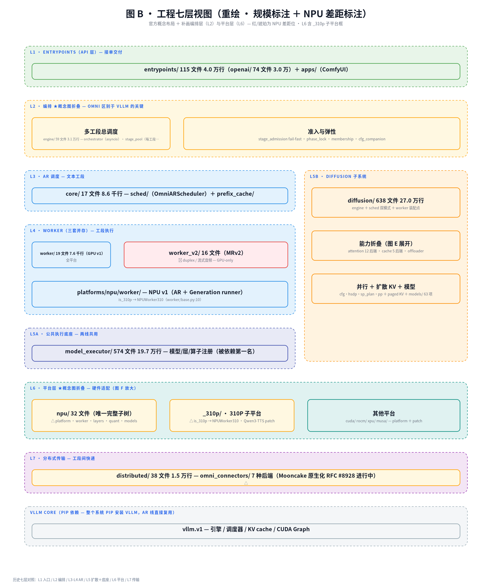
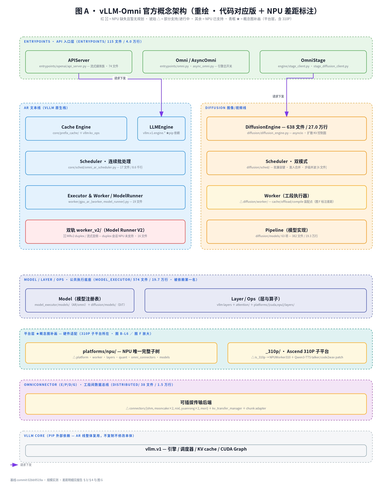
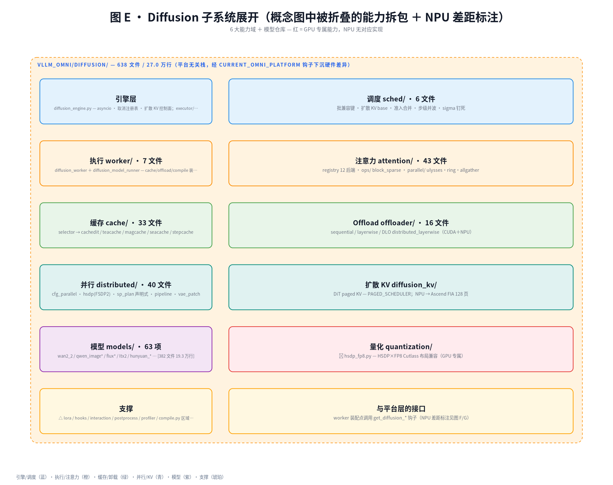
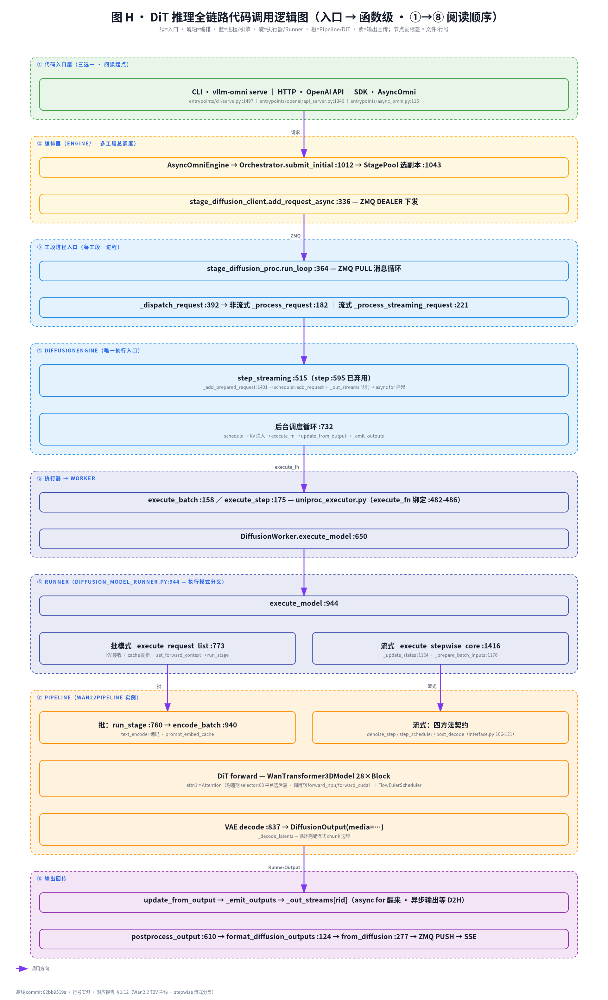
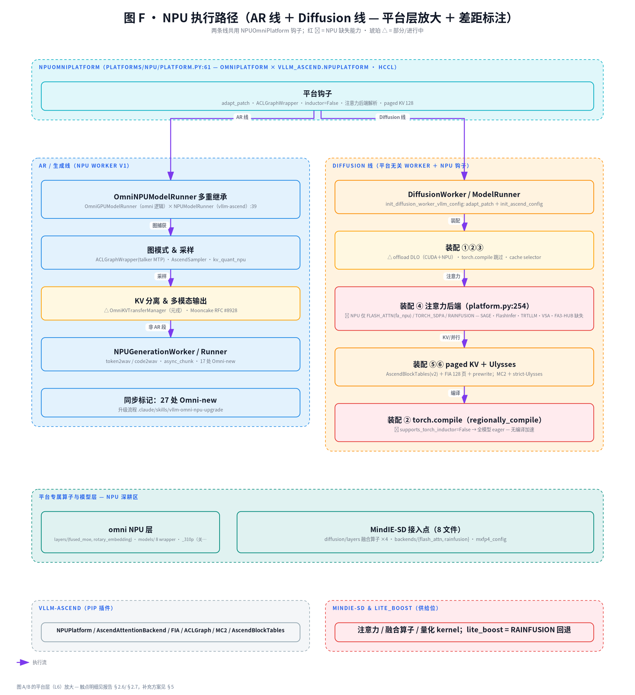
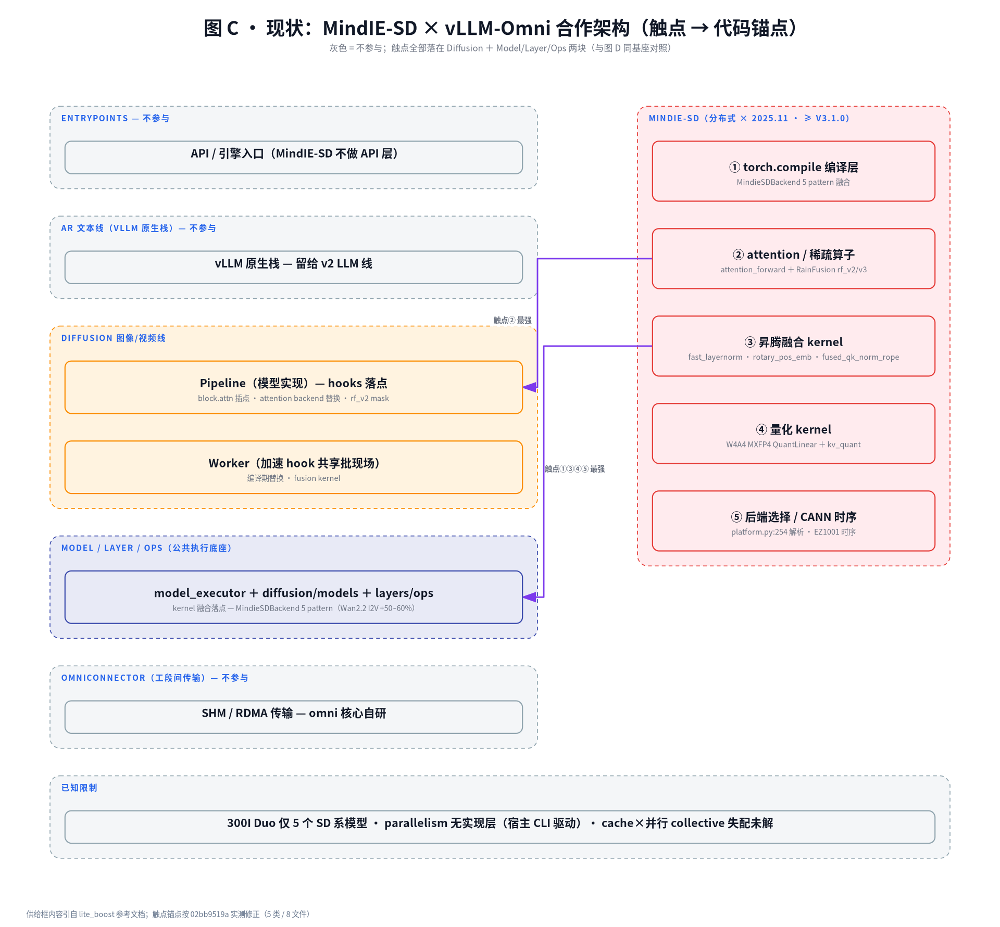
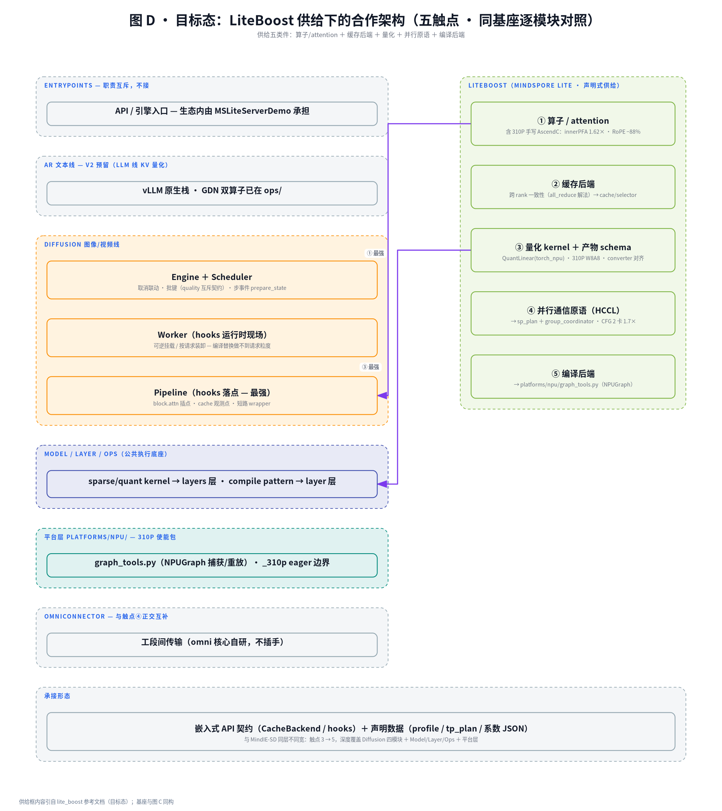
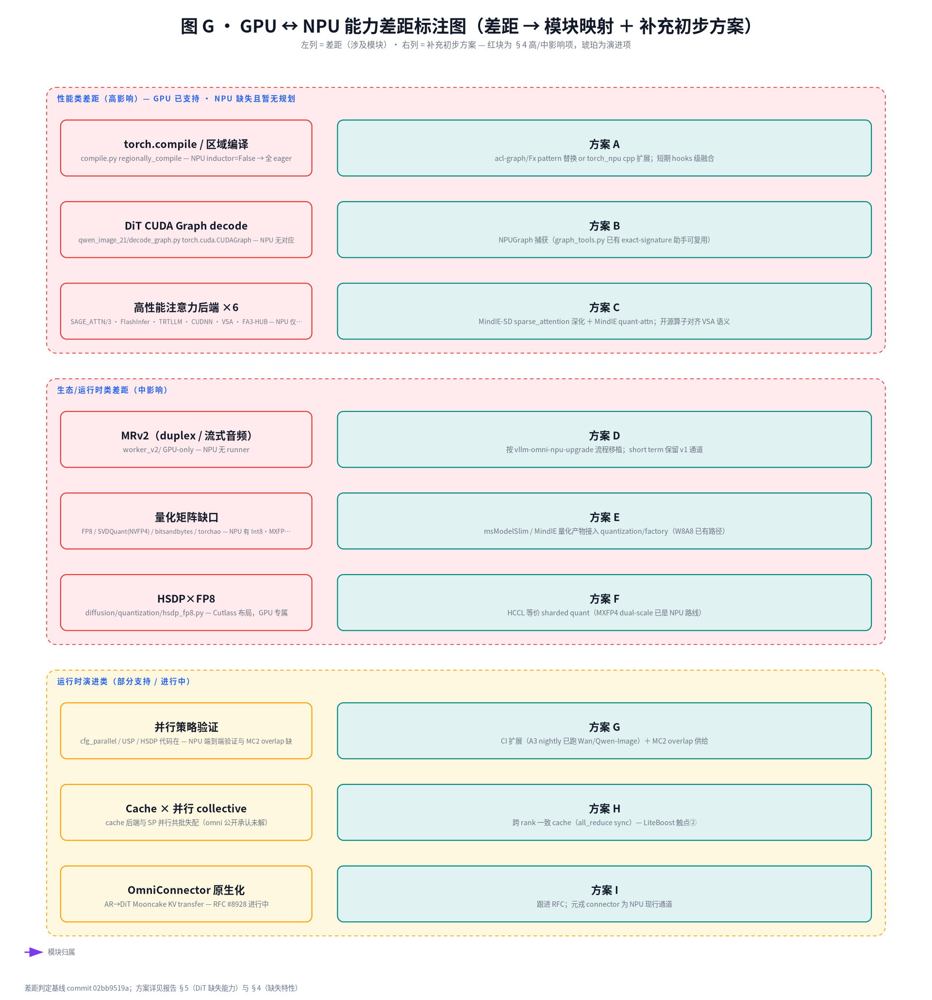
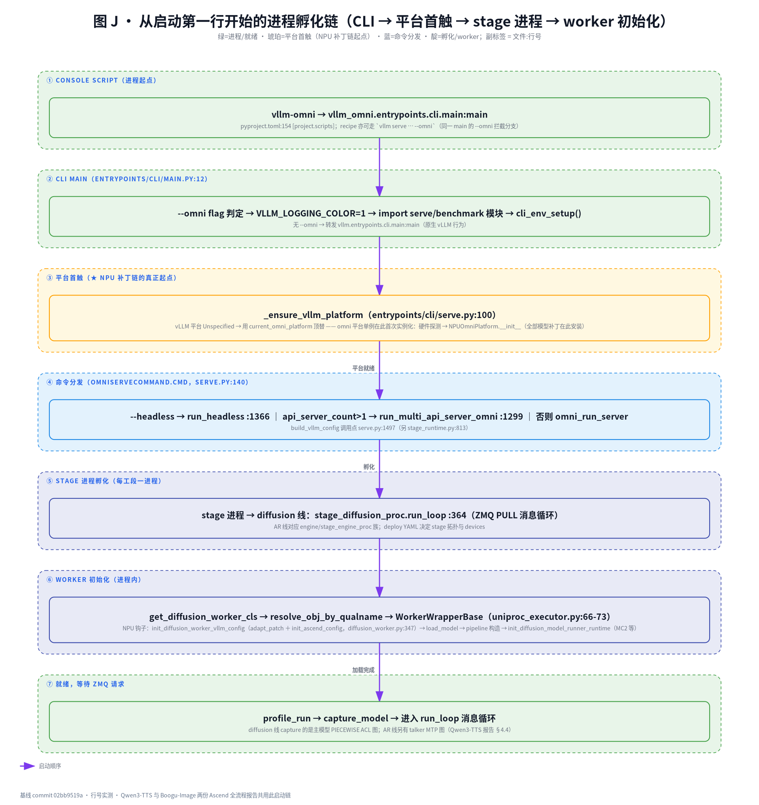
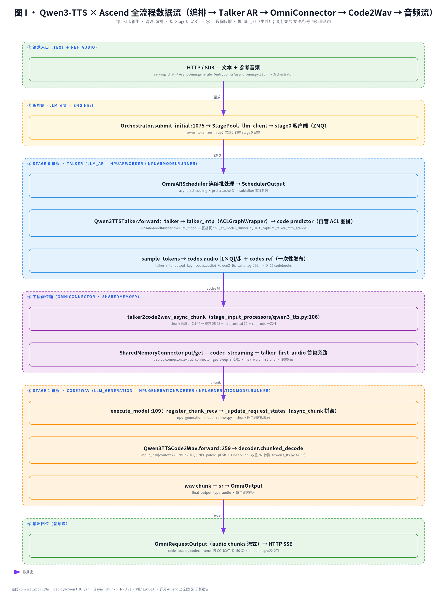

# vLLM-Omni 架构与技术报告

> 合并日期：2026-11-12
> 内容：第 I 部分 架构与代码；第 II 部分 Ascend 全流程（Qwen3-TTS / HunyuanImage3）。
> 300I DUO（310P）专项与社区贡献方案见 [300I-DUO-适配与优化分析.md](300I-DUO-适配与优化分析.md)。

---

## 合并说明

| 来源文档 | 合并后位置 |
| --- | --- |
| `reports/README.md` | 第 I 部分 §1、§8、§13-§15 等 |
| `reports/vllm-omni代码与架构分析.md` | 第 I 部分 §1-§3、§6.1/§6.4-§6.6、§7、§9-§12、§16-§17 |
| `reports/代码结构与调用流程详解.md` | 第 I 部分 §3.3、§4.2、§6.2-§6.3、§7.11 |
| `reports/Ascend全流程代码分析-以Qwen3-TTS为例.md` | 第 II 部分 第一/二部分 |
| `reports/Ascend离线全流程代码分析-以HunyuanImage3为例.md` | 第 II 部分 第一/三部分 |

---

## 跨部分导航（同一主题的不同粒度）

| 主题 | 第 I 部分（架构/索引） | 第 II 部分（Ascend 逐函数） |
| --- | --- | --- |
| 启动链 | §4 启动全流程、§7.8 NPU 启动 | §2 T0 启动、§4 引擎与 stage 孵化 |
| AR 线（Qwen3-TTS） | §5.1 生命周期、§6.2 逐函数 | §9-§15 完整 AR 线 |
| Diffusion 线（HunyuanImage3） | §5.2 生命周期、§6.3 逐函数 | §16-§24 完整 Diffusion 线 |
| 平台层 / NPU 钩子 | §7 平台层与 Ascend 架构 | §2-§8 共享基础设施 |
| 310P 适配 | §7.4 平台层片段 | §13 310P 变体（Qwen3-TTS 视角）；全景见 `300I-DUO-适配与优化分析.md` |

---

## 总目录

- **第 I 部分 · 架构与代码**：仓库定位、七层架构、目录/文件、启动流程、两条请求线、五条调用链、平台层与 Ascend 架构、NPU 特性矩阵、术语表。
- **第 II 部分 · Ascend 全流程**：共享基础设施（启动/平台/编排/stage/connector/横切件/数据结构）、AR 线（Qwen3-TTS）、Diffusion 线（HunyuanImage3，含客户端离线逐行与服务端逐函数）、全链路调用树与索引。

> 说明：为便于与原始文档对照，部分小节保留原文档编号；以小节标题为准。

---

<a id="part-i"></a>
# 第 I 部分 · 架构与代码

> **合并文档基线**：分支 `contrib/rainfusion-provider-fallback`，commit `02bb9519a`。全部 `文件:行号` 在该基线实测（三份源文档同基线）。
> **归档日期**：2026-10-17（《vllm-omni代码与架构分析》）。
> **文档定位**：只看这一篇，就掌握整个代码仓的**逻辑、架构、调用链与关键细节**；需要再下钻到逐函数时，用 §15 的精读报告索引当字典。
> **说明**：本文档为内部技术分析报告（合并自三篇同基线内部分析），非上游官方文档；所有结论均附代码引用，可用 `文件:行号` 快速复核。
> **核实方法**：调用链与数据流经两轮并行代码深读核实（16 个子系统读取器，全部结论到 文件:函数:行号）；「无法支持/暂未实现」判定基于各特性依赖代码实测。
> **图表**：架构图以 **fireworks-tech-graph** 技能生成（Diagram IR JSON → SVG → 几何门禁 → 1920px PNG）；图源为 `assets/fireworks_specs/fig_*.json`，重跑 `assets/fireworks_specs/render_all.sh` 再生成。**NPU 差距标注约定**：红色 ✗ = NPU 缺失且暂无规划，琥珀 △ = 部分支持/进行中，其余配色 = NPU 已支持（标注依据 §9/§10/§11）。
> **参考基图**：`lite_boost/docs/vLLM_Omni_Architecture_Analysis.md`（图 1~4）——本文 §2.1~2.4 / §7.10~7.11 为其重绘增强版（全部图块补注当前仓库代码路径，规模数字按本仓库实测校准，并修正参考文档两处过时标注，见 §7.11 末）。

---

### 本篇合并说明

| # | 源文档 | 行数 | 内容概要 | 合并处理（保留 / 合并 / 删除） |
| --- | --- | --- | --- | --- |
| 1 | [README.md](../README.md)（vLLM-Omni 代码全景解读） | 260 | 60 秒版综述、七层架构、启动 9 步、AR/Diffusion 两条请求线、平台层、六大关键机制、模型接入、目录地图、下钻索引与 14 步读码 | **全文保留**。§1 的图 B 与源 2 §1.5 合并为一处（保留两版图注）；§2 与源 3 §二 合并为「启动全流程」一章（9 步概要 + 函数级树）；§3 与源 3 §三/§四 合并为「请求生命周期 + 调用链」（概览表 + 逐函数细节均保留）；§8 的「下钻索引」原样保留 |
| 2 | [vllm-omni代码与架构分析.md](#part-i) | 1109 | 总体架构、图 A/B/E/F/C/D/G、五条主干调用链、三例端到端数据流、DiT 代码阅读图、Ascend 平台解剖、GPU vs NPU 特性矩阵与成因、差距与方案、社区动向、附录、术语表 | **全文保留**。§1.5 的图 B 与源 1 §1 合并（不再重复贴图）；§2.8~2.10 的 NPU 初始化/runner 步骤与源 3 §二/§3.2 的重复项按「最详细版本 + 对照表」合并；目录/文件职责与源 1 §1 归入同一章分层呈现 |
| 3 | [代码结构与调用流程详解.md](#part-i) | 308 | 模块→类→函数结构表、启动调用树、AR 线逐函数（Qwen3-TTS）、Diffusion 线逐函数（HunyuanImage3）、平台钩子分发链、函数索引 | **全文保留**。§二并入「启动全流程」；§三/§四并入「调用链」（逐函数表全部保留，与源 2 的 GPU/NPU 对照表互为补充）；§1.3 平台表并入 §7.1；§五/§六原样保留 |

**去重与合并记录（无整节删除）**：

- **图 B**：源 1 §1 与源 2 §1.5 为同一图（`assets/fig_b_seven_layer_view.png`），合并到 §1.2 一处，两版图注均保留。
- **启动链**：源 1 §2（9 步流水）与源 3 §二（函数级树）为同一过程的不同粒度，合并为 §4；源 2 §2.8 的 NPU 专属 T0~T3b 移至 §7.12，并注明与 §4 互补。
- **AR `execute_model` 顺序**：源 1 §3.1、源 2 §1.10 链③、源 3 §3.2 三处重复。§6.1 保留源 2 的 GPU↔NPU 9 步对照表（含 GPU 行号），§6.2 保留源 3 的 NPU 15 步内部细节表，两表互补而非重复；源 1 的 8 工段概览表保留在 §5.1。
- **Diffusion stepwise 链**：源 1 §3.2、源 2 §1.10 链④、源 3 §4.1 三处重复。§6.1 保留源 2 的 engine→scheduler→worker→runner→pipeline 表，§6.3 保留源 3 的逐函数树与四方法内部步骤（源 3 更细）；源 1 的模式三分表保留在 §5.2。
- **平台解析**：源 1 §4.1、源 2 §1.3、源 3 §1.3 三处重复，合并为 §7.1（解析规则 + 成员表 + 设计不变量）。
- **目录职责**：源 1 §1（七层表）与源 2 §1.8（逐文件夹规模表）分层保留：§1.2 速览、§3.1 明细。
- **类谱系**：源 2 §2.2 与源 3 §1.5/§1.6 重复，合并到 §7.6 与 §3.3 各保留一处（继承关系 / 执行线各取所需）。
- 源 2 §8 术语表虽与正文多处事实重叠，但属独立查阅形态，**整节保留**，不做删减。

**链接处理**：图片链接保持 `assets/...`；仓库路径链接统一加 `../` 前缀（本文位于 `reports/` 下）；指向其他中文报告（`*.md`）的相对链接**保持原样**（见文末说明）。

---

### 本篇目录

- [1. 总览与全景](#1-总览与全景)
  - [1.1 60 秒版：这个仓库是什么](#11-60-秒版这个仓库是什么)
  - [1.2 全景架构：七层结构](#12-全景架构七层结构)
  - [1.3 顶层目录职责](#13-顶层目录职责)
  - [1.4 diffusion 子系统（平台无关栈）](#14-diffusion-子系统平台无关栈)
  - [1.5 平台抽象层](#15-平台抽象层)
- [2. 架构总图（概念图 ↔ 代码实态）](#2-架构总图概念图--代码实态)
- [3. 代码结构：目录、文件与模块](#3-代码结构目录文件与模块)
  - [3.1 逐文件夹详解](#31-逐文件夹详解)
  - [3.2 重要文件单独分析（调用关系到方法级）](#32-重要文件单独分析调用关系到方法级)
  - [3.3 模块 → 类 → 关键函数总览](#33-模块--类--关键函数总览)
- [4. 启动全流程（第一行 → worker 就绪）](#4-启动全流程第一行--worker-就绪)
- [5. 一次请求的生命周期（两条线）](#5-一次请求的生命周期两条线)
- [6. 调用链详解（函数级）](#6-调用链详解函数级)
  - [6.1 五条主干调用链](#61-五条主干调用链)
  - [6.2 AR 线逐函数（Qwen3-TTS）](#62-ar-线逐函数qwen3-tts)
  - [6.3 Diffusion 线逐函数（HunyuanImage3）](#63-diffusion-线逐函数hunyuanimage3)
  - [6.4 三例端到端数据流](#64-三例端到端数据流)
  - [6.5 DiT 推理全链路代码阅读逻辑图](#65-dit-推理全链路代码阅读逻辑图)
  - [6.6 按调用链查函数索引](#66-按调用链查函数索引)
- [7. 平台层与 Ascend 代码架构](#7-平台层与-ascend-代码架构)
  - [7.1 平台解析与抽象](#71-平台解析与抽象)
  - [7.2 钩子清单（OmniPlatform 基类 → NPU 覆盖）](#72-钩子清单omniplatform-基类--npu-覆盖)
  - [7.3 五平台差异速览](#73-五平台差异速览)
  - [7.4 `platforms/npu/` 解剖](#74-platformsnpu-解剖)
  - [7.5 与 vllm-ascend 的集成方式](#75-与-vllm-ascend-的集成方式)
  - [7.6 NPU 上的 DiT / AR 执行路径与分离部署](#76-npu-上的-dit--ar-执行路径与分离部署)
  - [7.7 图 F/C/D：NPU 执行路径与供给侧两态](#77-图-fcdnpu-执行路径与供给侧两态)
  - [7.8 Ascend 流程专述 A：进程启动与平台初始化](#78-ascend-流程专述-a进程启动与平台初始化)
  - [7.9 Ascend 流程专述 B：AR 线一次 execute_model](#79-ascend-流程专述-bar-线一次-execute_model)
  - [7.10 Ascend 流程专述 C：Diffusion 线一次请求](#710-ascend-流程专述-cdiffusion-线一次请求)
  - [7.11 平台钩子分发链](#711-平台钩子分发链)
- [8. 六大关键机制（细节层）](#8-六大关键机制细节层)
- [9. GPU vs NPU 特性支持矩阵](#9-gpu-vs-npu-特性支持矩阵)
- [10. GPU 已支持但 NPU 缺失且暂无规划的特性](#10-gpu-已支持但-npu-缺失且暂无规划的特性)
- [11. DiT：社区 Ascend 版本欠缺能力分析](#11-dit社区-ascend-版本欠缺能力分析)
- [12. 社区 NPU 近期动向与规划中事项](#12-社区-npu-近期动向与规划中事项)
- [13. 模型接入：新模型如何上 NPU](#13-模型接入新模型如何上-npu)
- [14. 目录地图与按问题找代码](#14-目录地图与按问题找代码)
- [15. 下钻：精读报告索引 + 14 步读码流程](#15-下钻精读报告索引--14-步读码流程)
- [16. 附录：关键文件索引](#16-附录关键文件索引)
- [17. 术语表与概念详解](#17-术语表与概念详解)

---

# 1. 总览与全景

## 1.1 60 秒版：这个仓库是什么

vLLM-Omni 是 **vLLM 的全模态（any-to-any）推理扩展**：把一个多模态请求（文本→音频/图像/视频，或反向）拆成**多个工段**（编码器 → LLM → 扩散/声码器…），每个工段是**独立进程 + 独立 vLLM 引擎**，工段之间用可插拔连接器传数据。它在三层上扩展 vLLM：

1. **编排层**（omni 独有）：多工段总调度、显存准入、副本弹性——vLLM 没有；
2. **模型层**：53 个 AR/omni 模型 + 63 个 diffusion 模型的实现与契约；
3. **平台层**：`current_omni_platform` 单例——**所有硬件差异（CUDA/NPU/XPU/ROCm/MUSA）的唯一注入面**。

一个请求的旅程（30 字版）：**HTTP → 编排器 → 工段进程 → 引擎/调度器 → worker/runner → 模型 → 连接器（下一工段）→ … → 输出流 → SSE**。

> 源文档：README.md §0。

## 1.2 全景架构：七层结构



> 与参考文档图 1 同构（在概念图布局上补画「编排层」与「平台层」），规模数字按当前仓库实测校准。
> 图源：`assets/fireworks_specs/fig_b.json`（fireworks-tech-graph Diagram IR）。差距标注位：L4 worker_v2（红）、L6 平台层 npu 子树（琥珀）、L7 传输（琥珀）。310P 标注位（琥珀）：L4 `platforms/npu/worker/` 节点的 `is_310p → NPUWorker310` 选择点（`worker/base.py:10`）、L6 独立框 `_310p/ · 310P 子平台`（`is_310p → NPUWorker310 · Qwen3-TTS patch`）。
> （与《vllm-omni代码与架构分析》§1.5 重复的图块已合并至此，两版图注保留。）

| 层 | 目录 | 规模 | 职责 | 关键文件 |
| --- | --- | --- | --- | --- |
| L1 入口 | `entrypoints/` | 115 文件/4.0 万行 | OpenAI 兼容 HTTP/WS、CLI、SDK | `openai/api_server.py`（3,112 行）、`cli/main.py:12`、`cli/serve.py` |
| L2 编排 ★omni 独有 | `engine/` | 59 文件/3.1 万行 | orchestrator 消息循环、stage 进程池、准入、弹性 | `orchestrator.py`（3,614 行）、`stage_pool.py`、`stage_admission.py` |
| L3 AR 调度 | `core/` | 17 文件/8.6 千行 | 连续批处理、前缀缓存 | `sched/omni_ar_scheduler.py`、`prefix_cache/` |
| L4 worker | `worker/`（v1 全平台）＋ `worker_v2/`（GPU-only） | 19+16 文件 | 工段执行器：AR runner / 生成 runner | `gpu_ar_model_runner.py`（2,407 行）、`gpu_model_runner.py` |
| L5 扩散＋底座 | `diffusion/`（638 文件/27.0 万行）＋ `model_executor/`（574 文件/19.7 万行） | 最大两块 | diffusion 引擎/调度/worker/pipeline；AR 模型注册表 | `diffusion_engine.py`、`diffusion_model_runner.py`、`models/registry.py` |
| L6 平台 ★概念图折叠 | `platforms/` | 53 文件/8.9 千行 | **硬件差异唯一注入面**；npu/ 是唯一完整子树 | `interface.py`、`npu/platform.py` |
| L7 传输 | `distributed/` | 38 文件/1.5 万行 | 工段间连接器（7 后端）+ KV 传输 | `omni_connectors/kv_transfer_manager.py`、`factory.py` |

支撑件：`config/`（7.7 千行配置体系）、`deploy/`（135 个模型 YAML）、`outputs/`（统一输出结构）、`quantization/`（量化工厂）。

**理解本仓的第一性原理**：diffusion 子系统是**平台无关栈**，所有 NPU/GPU 差异经 `current_omni_platform` 钩子下沉到 L6；AR 线则直接继承 vLLM/vllm-ascend 的 worker 体系。读代码时遇到平台分支，永远去 L6 对照。

## 1.3 顶层目录职责

vLLM-Omni 是在 vLLM 之上构建的多模态（omni）统一推理框架，核心特点是**多阶段级联**（AR 阶段 + 生成/diffusion 阶段）与**多硬件平台**（CUDA/ROCm/NPU/XPU/MUSA）。

| 目录 | 职责 |
| --- | --- |
| `vllm_omni/entrypoints/` | 用户入口：`Omni` 离线 API、OpenAI 兼容 server、diffusion 入口 |
| `vllm_omni/engine/` + `vllm_omni/core/` | 引擎编排、请求生命周期、stage 调度（AR stage 与 generation stage 串联） |
| `vllm_omni/worker/` | GPU 侧 Model Runner（`gpu_model_runner.py`、`gpu_ar_model_runner.py`、`gpu_generation_model_runner.py`）与公共 mixin/base |
| `vllm_omni/worker_v2/` | 下一代 Model Runner V2（duplex 会话、流式音频、`omni_data_plane`）；**当前仅 GPU** |
| `vllm_omni/diffusion/` | 平台无关的扩散模型栈（详见 1.4） |
| `vllm_omni/platforms/` | 平台抽象与各硬件实现（`interface.py` + `cuda/npu/rocm/xpu/musa`） |
| `vllm_omni/distributed/` | 多 stage 间的连接器（`omni_connectors` KV transfer、IPC、disaggregation） |
| `vllm_omni/model_executor/models/` | AR/omni 模型实现注册表（Qwen3-Omni、Ming、MiMo-Audio、TTS 系列等） |
| `vllm_omni/quantization/` | 跨 stage 量化配置工厂（`factory.py` 按 method 分发，含平台标注） |
| `vllm_omni/deploy/` | 每 stage 的部署配置 YAML（含 `moss_tts_local_2npu.yaml`、`moss_tts_local_3npu.yaml` 等 NPU 拓扑） |
| `vllm_omni/lora/` | AR 侧 LoRA；diffusion 侧 LoRA 独立于 `vllm_omni/diffusion/lora/` |
| `vllm_omni/experimental/` | `ar_diffusion`、`fullduplex`、`world_models` 等实验性运行时 |
| `recipes/`、`docs/` | 模型部署配方（91 篇）与用户/设计文档 |

> 源文档：《vllm-omni代码与架构分析》§1.1。

## 1.4 diffusion 子系统（平台无关栈）

`vllm_omni/diffusion/` 是 diffusion/DiT 的核心，**大部分代码平台无关**，通过 `current_omni_platform` 钩子下沉硬件差异：

| 子目录 | 内容 |
| --- | --- |
| `worker/` | `DiffusionWorker`（1907 行）+ `DiffusionModelRunner`（1624 行）：连续批处理、step 调度、cache/offload/compile 装配 |
| `attention/backends/` | 12 个注意力后端注册表（`registry.py:38` `DiffusionAttentionBackendEnum`）：FLASH_ATTN、TORCH_SDPA、SAGE_ATTN(_3)、CUDNN、FLASHINFER、TRTLLM、FASTVIDEO_VSA、VDNH3、FLASH_ATTN_HUB(_3)、RAINFUSION |
| `cache/` | 5 种 step-cache 后端（`selector.py`）：CacheDiT、TeaCache、MagCache、SeaCache、StepCache；另有 `prompt_embed_cache`、`exact_projection_cache` |
| `offloader/` | 三种 offload 策略：sequential / layerwise / **distributed layerwise（DLO，支持 CUDA+NPU）** |
| `distributed/` | DiT 并行：`cfg_parallel.py`、`hsdp.py`（FSDP2）、`sp_plan.py`/`sp_sharding.py`（Ulysses/Ring/AllGather-KV）、`pipeline_parallel.py`（PipeFusion 式 PP）、`vae_patch_parallel.py`、`group_coordinator.py` |
| `diffusion_kv/` | DiT paged KV cache（`PAGED_SCHEDULER` 模式），NPU 上对接 Ascend FIA |
| `models/` | 50+ 条 diffusion pipeline（Wan2.2、Qwen-Image(2.1)、Flux1/2、LTX-2、HunyuanImage3/Video、MiniMax-H3、MAGI-2、SeedVR2、SDXL/SD3、Cosmos3、GR00T/pi0 等 VLA、音频 DiT） |
| `quantization/` | `hsdp_fp8.py`（HSDP+FP8 的 Cutlass 布局兼容层，GPU 专属） |
| `executor/` | uniproc / multiproc / ray 执行器 |
| `compile.py` | `regionally_compile`：按重复 block 区域性 torch.compile |

> 源文档：《vllm-omni代码与架构分析》§1.2。

## 1.5 平台抽象层

- `vllm_omni/platforms/interface.py:31` 定义 `OmniPlatform(Platform)`，在 vLLM `Platform` 之上增加 omni 专用接口：AR/generation worker 类选择、diffusion 注意力后端选择与校验（`validate_diffusion_attn_backend`，interface.py:131，按后端声明的 `supported_platforms` 拒绝）、diffusion KV paged 模式钩子、torch inductor 支持声明、CPU offload 支持声明、profiler/graph wrapper 类等。
- `OmniPlatformEnum`：`CUDA / ROCM / NPU / XPU / MUSA / OOT`（interface.py:19）。
- 各平台实现目录：`platforms/{cuda,rocm,npu,xpu,musa}/platform.py`，NPU 实现见第 7 节。
- 设计不变量见 `docs/design/module/execution_platforms.md`：硬件相关行为必须走平台选择或能力探测（PLATFORM-INV-001~003）。

> 源文档：《vllm-omni代码与架构分析》§1.3。平台单例解析规则与成员表见 §7.1（与《代码结构与调用流程详解》§1.3 合并）。

---

# 2. 架构总图（概念图 ↔ 代码实态）

## 2.1 图 A：官方概念架构（重绘 · 代码对应版）

> 与参考文档（`lite_boost/docs/vLLM_Omni_Architecture_Analysis.md`）图 2 同布局；每一块补注当前仓库（commit `02bb9519a`）的真实代码位置与规模。



> 图源：`assets/fireworks_specs/fig_a.json`（fireworks-tech-graph Diagram IR）。红 ✗ = NPU 缺失且暂无规划（worker_v2 duplex），琥珀 △ = 部分支持/进行中（diffusion worker 装配点、OmniConnector Mooncake 原生化、平台层 NPU 子树）。青色平台层带为**概念图补画**（官方概念图不含平台层，见 §2.4 省略②）：右端琥珀块即 **310P 子平台** `platforms/npu/_310p/`——`is_310p → NPUWorker310`（`worker/base.py:10`）＋ Qwen3-TTS talker/code2wav 310P patch（`_310p/patch/qwen3_tts.py`）。

## 2.2 图 B：工程七层实态

> 图 B 已在 §1.2 呈现（`assets/fig_b_seven_layer_view.png`），其规模标注与 NPU 差距标注说明见该节图注。此处不重复贴图。

## 2.3 图 E：Diffusion 子系统展开（概念图中被折叠的能力拆包）



> 图源：`assets/fireworks_specs/fig_e.json`。差距标注位：quantization/hsdp_fp8（红，GPU 专属）、compile.py 区域编译（琥珀）。

## 2.4 概念图 ↔ 代码实态对照与判定

| 概念图元素 | 代码对应 | 判定 |
| --- | --- | --- |
| EntryPoints 三卡 | APIServer=`entrypoints/openai/api_server.py`；Omni/AsyncOmni=`entrypoints/omni.py`/`async_omni.py`；OmniStage=`engine/stage_client.py`+`diffusion/stage_diffusion_client.py` | ✅ 符合 |
| AR 块六卡 | LLMEngine/Scheduler/CacheEngine/Executor=vllm 原生 + `core/sched/`、`core/prefix_cache/` 扩展；Worker/ModelRunner=`worker/gpu_ar_*` | ✅ 完全符合（=vLLM 原生栈） |
| Diffusion 块四卡 | DiffusionEngine=`diffusion_engine.py`；Scheduler=`diffusion/sched/` 双模式；Worker=`diffusion/worker/`；Pipeline=`diffusion/models/` 63 项 | ✅ 符合 |
| Model/Layer/Ops | `model_executor/`（19.7 万行）+ `diffusion/models/` + `platforms/*/layers/` | ✅ 符合 |
| OmniConnector(E/P/D/G) | `distributed/omni_connectors/`（7 种可插拔后端，connectors/ 目录实测）；E/P/D/G 为论文记号 | ✅ 机制符合 |
| **概念图省略①：编排子系统** | `engine/`（orchestrator/stage_pool/stage_admission/membership/phase_lock/cfg_companion，图 B-L2） | ★ 补画 |
| **概念图省略②：平台层** | `platforms/`（图 B-L6；图 A 亦以 ★补画带标注，含 `_310p/` 310P 子平台）；NPU 唯一完整子树（图 F） | ★ 补画 |
| 概念图折叠③：AR worker v1/v2 双轨 | `worker/`（v1，全平台）‖ `worker_v2/`（MRv2，GPU-only） | ★ 补画 |
| 概念图折叠④：扩散子能力 | cache/offloader/attention 后端/量化/扩散 KV（图 E 拆包） | ★ 补画 |

> 源文档：《vllm-omni代码与架构分析》§1.4~§1.7。

---

# 3. 代码结构：目录、文件与模块

## 3.1 逐文件夹详解

> 规模为 commit `02bb9519a` 实测（文件数 / Python 行数）。「被调」= 一次请求中谁调用该目录。源文档：《vllm-omni代码与架构分析》§1.8。

**① 入口与编排层**

| 目录 | 规模 | 职责 | 关键文件 | 被调关系 |
| --- | --- | --- | --- | --- |
| `entrypoints/` | 115 / 40,093 | 全部用户入口。`openai/`（74 文件）= OpenAI 兼容 HTTP/WS；`cli/`（10 文件）= 命令行；`duplex/`（8 文件）= 全双工会话入口 | `openai/api_server.py`（3,112 行，路由注册）；`async_omni.py`（AsyncOmni.generate:115）；`omni.py`（同步封装） | api_server → AsyncOmni → engine（§6.1 链①） |
| `engine/` | 59 / 31,498 | 多工段编排核心。orchestrator 消息循环、stage 进程池、显存准入、副本弹性、CFG 伴随簿记、duplex 编排（`duplex/` 29 文件） | `orchestrator.py`（3,614 行）；`stage_pool.py`；`stage_engine_core_{client,proc,proc_manager}.py`；`stage_engine_startup.py`；`stage_admission.py`；`stage_phase_lock.py`；`async_omni_engine.py`；`omni_engine_base.py`（输出队列）；`messages.py`（EngineQueueMessage 族） | api_server/AsyncOmni → AsyncOmniEngine → Orchestrator → StagePool → 各 stage 进程 |
| `core/` | 17 / 8,611 | AR 线调度与缓存：`sched/`（OmniARScheduler 及族）+ `prefix_cache/`（8 文件，KV 前缀缓存管理器/块池） | `sched/omni_ar_scheduler.py`；`sched/omni_generation_scheduler.py`（多模态输出调度）；`prefix_cache/manager.py` | 被 vllm 引擎核作为 Scheduler 执行；每步产出 SchedulerOutput |
| `config/` | 20 / 7,655 | Omni 配置体系：`omni_config.py`（2,412 行，OmniStageModelConfig 族——每 stage 可覆盖 model/cache/scheduler/parallel/connector 等 12 类 override） | `omni_config.py`；stage_config 解析 | deploy yaml → stage_init_utils → 各 stage 构造 |
| `deploy/` | yaml | 每 stage 拓扑与参数（`bagel.yaml`、`moss_tts_local_{2,3}npu.yaml` 等 NPU 拓扑）；`connectors:`/`stages[i].input_connectors` 定义工段间传输 | — | stage_init_utils.resolve_deploy_yaml 解析 |

**② 工段执行层**

| 目录 | 规模 | 职责 | 关键文件 | 被调关系 |
| --- | --- | --- | --- | --- |
| `worker/` | 19 / 7,582 | GPU v1 Model Runner：`gpu_ar_*`（AR 工段）、`gpu_model_runner`（基类）、`gpu_generation_*`（非 AR 生成工段）、`mixins.py`/`base.py`、`encoder_cudagraph.py` | `gpu_ar_model_runner.py`（2,407 行）；`gpu_generation_model_runner.py` | vllm EngineCore → worker.execute_model（§6.1 链③） |
| `worker_v2/` | 16 / 6,428 | Model Runner V2（GPU-only）：`omni_data_plane.py`（数据面）、`first_audio_sender.py`（首包旁路）、`streaming_audio.py`、`model_states/`（eager_mtp 等） | `omni_data_plane.py`；`first_audio_sender.py` | MRv2 引擎核 → 数据面（NPU 无对应，§9.7） |
| `diffusion/` | 638 / 270,346 | 扩散子系统（图 E 拆包）：engine/sched/worker/attention/cache/offloader/distributed/diffusion_kv/models 等 15 个子目录 | 见 §1.4 与图 E | DiffusionEngine → worker → runner → pipeline |
| `model_executor/` | 574 / 197,240 | AR/omni 模型实现注册表（53 个模型目录）+ 公共件：`stage_input_processors/`（38 文件——跨 stage payload 构建函数，被 connector runtime 动态加载）、`common/`、`layers/` | `models/registry.py`；`stage_input_processors/*`（每模型一份） | vllm 模型加载器按 arch 分发 |
| `experimental/` | 54 / 9,482 | 实验运行时：`ar_diffusion/`（14 文件，AR 与扩散交替会话）、`fullduplex/`（29 文件）、`world_models/`（10 文件） | — | 显式开关启用 |

**③ 平台与传输层**

| 目录 | 规模 | 职责 | 关键文件 | 被调关系 |
| --- | --- | --- | --- | --- |
| `platforms/` | 53 / 8,863 | 平台抽象（`interface.py` OmniPlatform）+ 5 硬件实现；npu/ 32 文件唯一完整子树（§7.4 专述） | `interface.py`；`npu/platform.py` | 所有 `current_omni_platform.*` 钩子调用点 |
| `distributed/` | 38 / 14,934 | 工段间传输（OmniConnector）：`omni_connectors/`（7 后端工厂 + kv_transfer_manager + payload transport + model_runner 运行时）+ `transfer_adapter/` | `omni_connectors/kv_transfer_manager.py`；`omni_connectors/model_runner/omni_connector_runtime.py`；`factory.py` | runner mixin 前置 recv / 后台 send（§6.1 链⑤） |
| `outputs/` | 8 / 2,173 | 输出数据结构：`OmniModelRunnerOutput`（worker→调度器）、`OmniEngineCoreOutput`（engine/__init__:137）、`OmniRequestOutput`（对外统一）、`mm_outputs.py`（MultimodalPayload）、`output_processor.py`（真正的 MultimodalOutputProcessor） | `output_processor.py`（1,000+ 行） | scheduler → orchestrator → HTTP 层 |
| `inputs/` | 4 / 721 | 输入参数结构：`OmniDiffusionSamplingParams`（streaming_output_ack:365）等 | `data.py` | api_server → engine |
| `attention/` | 4 / 973 | 顶层共享注意力件：`fish_kvcache_attn/backend/triton`（FishSpeech KV cache 注意力，平台守卫已加 #8589） | — | fish 模型 forward |
| `quantization/` | 16 / 5,574 | 跨 stage 量化工厂：`factory.py`（按 method 路由，标注平台）、fp8/int8/mxfp4/mxfp8/svdquant/inc/bitsandbytes | `factory.py`；`mxfp4_config.py`（MindIE QuantLinear） | 模型加载期 layer 替换 |
| `lora/` | 3 / 30 | AR 侧 LoRA 薄封装（diffusion 侧独立在 `diffusion/lora/`） | — | — |
| 其余支撑 | metrics 9 / protocol 15 / tokenizers 4 / transformers_utils 23 / model_extras 19 / host_weight_runtime 14 / clients 7 / benchmarks 31 / utils 11 / reasoning 2 / profiler 2 / plugins 1 | 指标、协议 schema、tokenizer 适配、HF 配置映射、模型附属资产、host 权重运行时（DLO 加载）、客户端 SDK、基准、工具 | — | — |

**④ diffusion/ 子目录明细**（27.0 万行，展开见图 E）

| 子目录 | 规模 | 关键文件 | 备注 |
| --- | --- | --- | --- |
| `worker/` | 7 / 5,026 | `diffusion_worker.py`（1,907）；`diffusion_model_runner.py`（1,624）；`input_batch.py`；`stage_payload.py` | 平台钩子汇聚点 |
| `sched/` | 6 / 1,485 | `interface.py`（批兼容键）；`base_scheduler.py`；`request_scheduler.py`；`step_scheduler.py`；`sigma_schedule.py` | 双模式调度 |
| `attention/` | 43 / 11,920 | `backends/registry.py`（12 后端）；`backends/flash_attn.py`（NPU fa_npu 路径）；`backends/rainfusion_attn.py`；`ops/block_sparse.py`；`parallel/factory.py` | §7.10 专述 |
| `cache/` | 33 / 7,558 | `selector.py`；`cachedit/ teacache/ magcache/ seacache/ stepcache/`；`prompt_embed_cache.py` | 5 后端插线板 |
| `offloader/` | 16 / 5,818 | `distributed_layerwise_backend.py`（CUDA+NPU）；`module_residency.py`（NPU allocator 分支 :55） | 三策略 |
| `distributed/` | 40 / 12,697 | `cfg_parallel.py`；`hsdp.py`；`sp_plan.py`/`sp_sharding.py`；`pipeline_parallel.py`；`group_coordinator.py` | 声明式 SP |
| `diffusion_kv/` | 11 | `manager.py`；`paged_attention_adapter.py`；`kv_connector.py`；`config.py` | DiT paged KV |
| `models/` | 382 / 193,461 | 63 项：每模型 `pipeline_*.py` + `*_transformer.py` + `interface.py` 契约 | 图 E |
| 其余 | engine/sched 同级 | `diffusion_engine.py`；`executor/`；`lora/ hooks/ interaction/ postprocess/ profiler/`；`compile.py`；`ipc.py`；`media.py`；`output_formatter.py`；`data.py`（2,496，OmniDiffusionConfig:831 / DiffusionOutput:1854） | — |

## 3.2 重要文件单独分析（调用关系到方法级）

> 源文档：《vllm-omni代码与架构分析》§1.9。

**① `entrypoints/async_omni.py` — 程序化引擎入口（EngineClient 角色）**
- `generate():115` 统一入口 → `AsyncOmniEngine.add_request_async():561 → add_request():476`（`async_omni_engine.py`），组装 `StageSubmissionMessage`（`_build_add_request_message:202`）入 janus request_queue → 跨线程交给 Orchestrator。
- 输出侧：`generate():324-331` async generator ← `_process_orchestrator_results`（`async_omni_base.py:246-312`，per-request queue.get:265）。
- 流式播放：`:269-271` 对带 `streaming_buffer_seconds` 的请求强制 `streaming_output_ack=True`；每块 yield 后 `_engine_core_rpc('release_streaming_output')`（:336-338）释放背压 credit（§6.4 例 3）。

**② `engine/orchestrator.py`（3,614 行）— 多工段总调度**
- 消息循环：`run():490 → _request_handler():568 → _dispatch_message()`（基类模板 :605 / Orchestrator 覆写 :3326），按 `msg.type` 分发（`_handle_add_request:3366` → `StagePool.submit_initial:1012`）。
- 输出路由：`_route_output():1977-2104`——final stage → `output_async_queue.put(OutputMessage):2031`；非 final → `_forward_to_next_stage:2073-2099`（下游输入由 `next_client.process_engine_inputs:2834-2841` 组装）。
- LLM 输出处理：`_orchestration_loop:1078-1135`（轮询 `poll_llm_raw_output:1105` → `_process_llm_stage_outputs:1109` → `stage_pool.process_llm_raw_outputs:1217-1245` → `outputs/output_processor.py:MultimodalOutputProcessor.process_outputs:670-727`）；事件驱动变体 `_orchestration_loop_event_driven:1137`。
- 传输控制面：`_diffusion_submit_kwargs:3202-3225` 挂 `kv_sender_info`（`_build_kv_sender_info:3238-3269`）与 `payload_sender_info` 到请求 → connector 端点发现。
- 首包音频：`_route_upstream_first_audio:972-1014` / `_flush_upstream_first_audio:1016-1061`（worker_v2 旁路帧的编排层接续）。

**③ `engine/stage_pool.py` — stage 进程池**
- `submit_initial():1012`：diffusion 分支 `OmniDiffusionSamplingParams.from_params:1028` + `_diffusion_client(replica).add_request_async:1043-1044`；LLM 分支 `output_processor.add_request:1063` + `_llm_client(replica).add_request_async:1075`（replica 由 `_pick_or_select:1033` 选择）。
- 输出回收：`process_llm_raw_outputs:1217-1245`；`poll_diffusion_output:1277-1284`。

**④ `core/sched/omni_ar_scheduler.py` — AR 调度器（扩展 vllm v1 Scheduler）**
- KV 传输触发：`kv_transfer_criteria:155` → `_should_transfer_kv_for_request:1770-1776`（门控 `need_send_cache:1771`）→ `requests_needing_kv_transfer:1773-1780` → `get_finished_requests_needing_kv_transfer:1801` → 随 `SchedulerOutput:480-485` 下发（criteria `prefill_finished:408`）。
- 每步输出：`update_from_output:488`（读取 `multimodal_outputs` :499）→ 组装 `OmniEngineCoreOutput`（`multimodal_output` 字段 :906）；generation 变体经 `_append_request_output:1062-1079` → mixin `_make_omni_engine_output`（`omni_scheduler_mixin.py:733-769`）。

**⑤ `worker/gpu_ar_model_runner.py`（2,407 行）— AR 工段执行器（GPU 基准实现）**
- `execute_model` 内顺序：KV 发送（前置 `:1041-1051`，同步）→ chunk/full payload 接收 `:1053-1061`（早于 `_update_states:1086`）→ forward → `sample_tokens` 结尾 `attach_omni_connector_output:2105`。
- 输出构造：`:2071-2087` `OmniModelRunnerOutput`（`multimodal_outputs` 每请求 payload；异步 D2H copy stream 包装 :206-300）。
- connector 挂载点：`:359/387/395-399`（mixin `omni_connector_runtime.py:103`）。

**⑥ `diffusion/diffusion_engine.py` — 扩散工段引擎**
- 模式：`DiffusionExecutionMode:253`；`_resolve_execution_mode:387`；`_init_executor:407`（uniproc/multiproc/ray）。
- 请求入口：`step_streaming():515`（流式 async generator）/ `step():595`；调度泵 `_busy_loop():684-807`（下一方法 `:809`）。
- 流式背压（#8721）：`_StreamingPlayback:234-250`（buffer_seconds/generated/played/outstanding_chunk）；门控 `_playback_blocked:865-904`；credit 释放 `release_streaming_output:906-919`（output_ack=False 时 `_iterate_output_stream:1454-1476` 自动释放 :1466-1467；为 True 时由前端逐块 RPC 释放）；播放反馈 `update_streaming_playback:939-956`；消费停滞超时 `_expire_streaming_idle:921-937`。

**⑦ `diffusion/worker/diffusion_worker.py`（1,907 行）— 工段执行器**
- `init_device():320`：`:339` `create_diffusion_vllm_config`（内部 `:257` 调平台 `configure_diffusion_vllm_config`）；`:347` 调 `init_diffusion_worker_vllm_config`（NPU 装 adapt_patch + init_ascend_config）。
- `load_model():418` → `:432` `model_runner.load_model`；`:301` `get_diffusion_model_runner_cls()` 选 runner（NPU 未覆盖 → 默认 DiffusionModelRunner）。
- 执行：`execute_model():650` / `execute_model_batch():711` / `execute_stepwise():733`；LoRA 激活 `_activate_step_lora:763`；sleep/wake_up `:831/:890`。

**⑧ `diffusion/worker/diffusion_model_runner.py`（1,624 行）— 装配点（NPU 差距集中地）**
- 装配顺序（`load_model` 附近）：offload `enable_offload_backend:390` → torch.compile `:396-417`（`supports_torch_inductor():398` 为 False 时整段跳过 = NPU 无编译）→ cache `get_cache_backend:419`。
- decode graph 联动：`:255-264`（`enable_cuda_graph_decode` 模型 + inductor cudagraphs 关闭）。
- KV/payload：`_prepare_request_for_forward:646`（KV 接收 `:665-675`）；stage payload 收发 `:656/1136`。

**⑨ `diffusion/distributed/sp_plan.py` — 声明式序列并行**
- `SequenceParallelConfig:53`（ulysses/ring/allgather 度与 rank 视图 `:107-200`）；输入/输出/部分输入描述子 `:215/273/305`；`validate_sp_plan:415`。策略工厂在 `attention/parallel/factory.py:25`（`build_parallel_attention_strategy`）。

**⑩ `diffusion/attention/backends/registry.py` + `selector.py` — 后端插线板**
- 枚举 `DiffusionAttentionBackendEnum:38`（12 后端）+ 运行时覆盖表 `_DIFFUSION_ATTN_OVERRIDES:118`。
- 解析链：`attention/layer.py:Attention.__init__:146-152` → `selector.get_attn_backend_for_role:101-157` → `selector._cached_get_backend_cls:68` → `platform.get_diffusion_attn_backend_cls`（NPU 实现 `platforms/npu/platform.py:255-305`）→ `layer.py:200-223` 绑定 impl 实例。运行时 forward 分发在 `abstract.py:AttentionImpl.forward:311-330`（`is_npu` 分支 `:323-324`）。

**⑪ `platforms/npu/platform.py` — NPU 平台实现（§7.4 有方法表）**
- 钩子消费点已核实：`configure_diffusion_vllm_config:137-155`（仅 PAGED_SCHEDULER；设 block_size=FIA 128）← `diffusion/vllm_config.py:224-239`；`init_diffusion_worker_vllm_config:125-134` ← `diffusion_worker.py:347`；`init_diffusion_model_runner_runtime:198-217`（MC2 + MiniMax patch）← `diffusion_model_runner.py:336`；`get_diffusion_attn_backend_cls:255-305` ← `selector.py:68`。

**⑫ `platforms/npu/worker/npu_{model,ar_model,generation_model}_runner.py`**
- mixin 挂载：`npu_ar_model_runner.py:114/127`；`npu_generation_model_runner.py:48/60`（与 GPU 同构）。
- execute_model 顺序：KV 发送 `:354-360`（同步）→ payload 接收 `:362-370` → forward → 输出 `:1195-1213`（OmniModelRunnerOutput；attach `:419/447/858/862`）。
- 图模式：`npu_model_runner.py` load_model 中 talker MTP ACLGraphWrapper 捕获；27 处 Omni-new 同步标记。

**⑬ `distributed/omni_connectors/kv_transfer_manager.py` — KV 传输管理器**
- `OmniKVTransferManager:349`；配置 `from_vllm_config:498`（`model_config.omni_kv_config`）；懒创建 connector `:524-585`（工厂调用 `:580`，sender/receiver role `:555-566`）。
- 发送：`handle_finished_requests_kv_transfer:977` → `_extract_kv_cache:1042`（GPU blocks → 连续张量 `:1093-1102`）→ `_transfer_kv_cache:1120`（rank 分片键 `:1134`）→ `_transfer_with_retry:1187`（`connector.put:1209`，指数退避）。
- 接收：`receive_kv_cache_for_request:1407` → `connector.get:1483` → `apply_kv_cache_to_request:1579`（写 `req.past_key_values:1591`）；分布式接收 `receive_multi_kv_cache_distributed:1876`（LOCAL/LEADER/FOLLOWER `:51-57`）。
- 平台抽象：无 is_npu 硬分支，全部走 `current_omni_platform`（Stream `:415/1307`，device_memory `:1240`）。

**⑭ `config/omni_config.py`（2,412 行）+ `diffusion/data.py`（2,496 行）**
- `OmniStageModelConfig:471` 等 12 类 per-stage override（`_TrackExplicitConfigFields` 显式字段追踪）。
- `OmniDiffusionConfig:831`（od_config：diffusion_kv_mode/cache_backend/enable_cuda_graph_decode/offload 策略/parallel_config 全集）；`DiffusionOutput:1854`（chunk_index/streaming_metrics/media，与 `OmniRequestOutput` 的映射在 `diffusion/output_formatter.py:124`）。

## 3.3 模块 → 类 → 关键函数总览

> 源文档：《代码结构与调用流程详解》§一。本小节是函数级索引，与 §3.1（目录规模）/§3.2（重要文件方法级）互补。

### 1.1 入口层 `entrypoints/`

| 函数/类 | 位置 | 职责 |
| --- | --- | --- |
| `main()` | cli/main.py:12 | 进程第一函数：`--omni` 判定（无 → 转发 `vllm.entrypoints.cli.main:main`）；有 → 设 `VLLM_LOGGING_COLOR=1` → import serve/benchmark 模块 → `cli_env_setup()` → `_ensure_vllm_platform()` → `TrackingArgumentParser` 注册子命令 → 分发 |
| `_ensure_vllm_platform()` | cli/serve.py:100-136 | vLLM `current_platform.is_unspecified()` 时用 `current_omni_platform` 顶替（★平台单例首触）；双 Unspecified → CpuPlatform 兜底 |
| `OmniServeCommand.cmd()` | cli/serve.py:140-163 | log_logo → model_tag 优先 → `--no-guardrails` 归一 → 三分支：`run_headless(:1366)` / `run_multi_api_server_omni(:1299)` / `uvloop.run(omni_run_server)` |
| `run_headless()` | cli/serve.py:1366 | 无头多工段启动（`build_vllm_config` 调用点 :1497）；signal_handler :1508 |
| `_build_multi_api_stage_runtime()` / `_start_api_server_process_manager()` | :1161 / :1264 | 多 API server 副本编排 |
| `AsyncOmni.generate()` | async_omni.py:115 | SDK 入口 → 引擎 |

### 1.2 配置层 `config/`

| 函数/类 | 位置 | 职责 |
| --- | --- | --- |
| `OMNI_PIPELINES` | pipeline_registry.py（如 :172 `"hunyuan_image3_dit"` → `HUNYUAN_IMAGE3_DIT_PIPELINE`） | `pipeline:` 字符串 → `PipelineConfig` 字典 |
| `StageConfigFactory.try_infer_model_type()` | config_factory.py:183-281 | 无显式 pipeline 时：hf_config.model_type → config.json architectures → model_index.json `_class_name` → OMNI_PIPELINES 最长匹配 |
| `StageConfigFactory.get_pipeline_config()` | config_factory.py:284-340 | 优先级：deploy `pipeline:` 覆盖 > OMNI_PIPELINES[model_type] > hf_architectures 交集（hf_config_predicate 门控） |
| `resolve_deploy_yaml()` | stage_config.py:939-966 | `base_config:` 继承解析 + `_merge_platforms` 深合并 |
| `_apply_platform_overrides()` | stage_config.py:1039-1121 | 按 `current_omni_platform.device_name.lower()` 取 yaml `platforms.<device>` 块：platform 级 `model_runner`/`cuda_mps` 换挡（:1050-1064）→ per-stage `devices/env`（:1073-1085）→ attention/moe/linear backend 再归一（:1088-1107）→ 未识别键入 `engine_extras`（:1104）→ **MRv2 在 npu/xpu 直接 NotImplementedError**（:1114-1119） |
| `resolve_worker_cls()` | engine/stage_init_utils.py:370-385 | `worker_cls` 为 None/"auto" 时按 `worker_type`（ar/generation）调 `current_omni_platform.get_omni_*_worker_cls()`；显式配置短路 |
| `OmniEngineArgs.__post_init__` | engine/arg_utils.py:258-263 | 同上的第二入口（EngineArgs 构造期） |

### 1.3 平台层 `platforms/`

> 该表已并入 §7.1「平台解析与抽象」（与《vllm-omni代码与架构分析》§1.3、README §4.1 合并），不在此重复。

### 1.4 编排层 `engine/`

| 函数 | 位置 | 职责 |
| --- | --- | --- |
| `Orchestrator.submit_initial()` | orchestrator.py:1012 | LLM 分支：`output_processor.add_request:1063` + `_llm_client(replica).add_request_async:1075`；diffusion 分支：`OmniDiffusionSamplingParams.from_params:1028` + `_diffusion_client.add_request_async:1043` |
| `StagePool` | stage_pool.py | 副本选择 `_pick_or_select:1033`；工段客户端持有与输入组装（`next_client.process_engine_inputs:2834`） |
| 输出路由 | orchestrator.py:1977-2104 | final stage → `output_async_queue:2031`；非 final → `_forward_to_next_stage:2073` |

### 1.5 AR 执行线（core/sched + worker/ + platforms/npu/worker/）

```
类谱系：
OmniARScheduler（core/sched/omni_ar_scheduler.py）        ← 作为 vLLM Scheduler 安装
NPUARModelRunner(OmniNPUModelRunner, OmniConnectorModelRunnerMixin, DuplexSamplingRunnerMixin)   # npu_ar_model_runner.py:114
OmniNPUModelRunner = OmniAuxOutputMixin × OmniGPUModelRunner × NPUModelRunner（vllm-ascend）
NPUARWorker → OmniNPUWorkerBase(NPUWorker | NPUWorker310)  # worker/base.py:16，:10-13 按代际路由
```

### 1.6 diffusion 执行线 `diffusion/`

```
类谱系：
DiffusionEngine（diffusion_engine.py）                     ← asyncio 引擎核 + 调度循环
DiffusionExecutor（executor/abstract.py:30-78 uni/mp/ray）
UniprocExecutor.execute_batch:158 / execute_step:175       ← collective_rpc 到 worker
DiffusionWorker.execute_model:650 / execute_model_batch:720 / execute_stepwise:733
DiffusionModelRunner.execute_model:944
  ├─ execute_model_batch:1048 → _execute_request_list:773        （批模式）
  └─ execute_stepwise → _execute_stepwise_core:1416              （stepwise 模式）
Pipeline 契约两套：四方法（interface.py:106-121）｜ run_stage/forward（批）
```

### 1.7 模型层（两套契约的函数族）

| 契约 | 函数集 | 本报告实例 |
| --- | --- | --- |
| stepwise 四方法 | `prepare_encode / denoise_step / step_scheduler / post_decode`（interface.py:106-121） | HunyuanImage3（§6.3） |
| request 批 | `run_stage` 或 `forward(DiffusionRequestBatch)` + `encode_batch/decode_batch` | Wan2.2 |
| AR/omni | `forward + compute_logits + make_omni_output`（+ 可选 `talker_mtp`/`preprocess_decode_batch` 状态机） | Qwen3-TTS（§6.2） |

### 1.8 横切件

| 模块 | 关键类/函数 | 位置 |
| --- | --- | --- |
| OmniConnector | `OmniConnectorFactory`（7 后端注册 :140-148）、`SharedMemoryConnector`、`kv_transfer_manager` | distributed/omni_connectors/ |
| 量化 | `build_quant_config`（factory.py）+ `_OVERRIDES:180` + `ComponentQuantizationConfig`（前缀路由） | quantization/ |
| 注意力后端 | `DiffusionAttentionBackendEnum`（12 后端）+ `get_attn_backend_for_role`（selector.py:68）+ `AttentionImpl.forward` 平台分发（abstract.py:311-331） | diffusion/attention/ |
| NPU 融合 MoE | `FusedMoE`（omni 自有）+ 三钩子（platforms/npu/layers/fused_moe.py:100/:123/:167） | diffusion/layers/fused_moe.py |
| 图助手 | `NPUExactGraphRunner`（exact-signature 捕获/重放） | platforms/npu/graph_tools.py |

---

# 4. 启动全流程（第一行 → worker 就绪）

## 4.1 启动全流程（9 步）

> 源文档：README.md §2。

```
① pyproject.toml:154   vllm-omni = vllm_omni.entrypoints.cli.main:main      ← 进程第一行
② cli/main.py:12       main()：--omni flag 判定（recipe 的 `vllm serve X --omni` 也落这）
③ serve.py:100         _ensure_vllm_platform()：★ vLLM 平台 Unspecified 时用
                         current_omni_platform 顶替 —— NPU 平台单例首次实例化，
                         硬件探测 + 全部模型补丁在此安装
④ serve.py:140 cmd     --headless→run_headless:1366 / multi-api→:1299 / 单API→omni_run_server
⑤ serve.py:1497        build_vllm_config：读 deploy YAML → PipelineConfig → 每 stage 装配
   配置解析链            yaml `pipeline: <name>` → config/pipeline_registry.py（OMNI_PIPELINES 字典）
                         → PipelineConfig（声明 stage/execution_type/model_arch）
                         → _apply_platform_overrides（config/stage_config.py:1039-1121）
                           按 current_omni_platform.device_name 合并 yaml 的 platforms.<device> 块
⑥ stage 孵化           每工段一个独立进程：diffusion 线 → stage_diffusion_proc.py:364 run_loop（ZMQ）
                         AR 线 → engine/stage_engine_proc 族
⑦ worker 初始化        LLM 线：resolve_worker_cls → current_omni_platform.get_omni_*_worker_cls()
                         （CUDA/ROCm/MUSA→共享 GPUARWorker；NPU→NPUARWorker/NPUGenerationWorker；
                          XPU→XPU 专属；310P→NPUWorker310，worker/base.py:10-13）
                       diffusion 线：全平台同一 DiffusionWorker（get_diffusion_worker_cls，interface.py:175）
                         + 平台钩子 init_diffusion_worker_vllm_config（NPU: adapt_patch+init_ascend_config）
⑧ 模型加载             load_model → pipeline 构造（diffusers_loader）→ NPU 运行时钩子
                         init_diffusion_model_runner_runtime（MC2 mask 等）
⑨ 捕获与就绪           capture_model（PIECEWISE ACL 图 / talker MTP 专属图）→ run_loop 等请求
```

关键点：**⑤ 的配置链决定一切**——`pipeline:` 字符串经 `OMNI_PIPELINES` 字典映射到 `PipelineConfig`（如 `hunyuan_image3_dit` → pipeline_registry.py:172 → pipeline.py:74），stage 的 `execution_type` 决定后续走哪条执行线。

## 4.2 启动调用链（函数级）

> 源文档：《代码结构与调用流程详解》§二。与 §4.1 的 9 步流水同一过程，此处展开到函数与调用点。

```
main（cli/main.py:12）
├─ "--omni" not in sys.argv → vllm_main() 返回
├─ os.environ["VLLM_LOGGING_COLOR"]="1"（必须在 vLLM import 前，formatter import 期定型）
├─ import serve/benchmark 模块 → cli_env_setup()
├─ _ensure_vllm_platform（serve.py:100）
│   ├─ vllm current_platform.is_unspecified()?
│   │    └─ touch current_omni_platform        ← ★ NPU：硬件探测 → NPUOmniPlatform.__init__
│   │       （adapt_patch/contiguous-KV/各模型 patch/310P —— 补丁链起点）
│   └─ 否则保持 vLLM 平台
├─ TrackingArgumentParser + 子命令注册 → 解析
└─ OmniServeCommand.cmd（:140）
   ├─ --headless → run_headless（:1366）
   │    ├─ 读 deploy YAML → PipelineConfig → StageConfigFactory.get_pipeline_config（config_factory.py:155）
   │    ├─ build_vllm_config（serve.py:1497 调用；stage_runtime.py:813 同）
   │    │    ├─ resolve_worker_cls（stage_init_utils.py:370）→ engine_args["worker_cls"]
   │    │    └─ OmniEngineArgs.create_engine_config + Executor.get_class（:1584-1588，vLLM 核）
   │    └─ 每 stage 孵化进程
   ├─ api_server_count>1 → run_multi_api_server_omni（:1299）
   └─ 否则 uvloop.run(omni_run_server(args))

[stage 进程内，diffusion 线]
stage_diffusion_proc.run_loop（:364）
  ├─ ZMQ PULL → _dispatch_request（:392）→ _process_request（:182）/ _process_streaming_request（:221）
  └─ DiffusionEngine 构造链：
      DiffusionExecutor.get_class（abstract.py:30-78）→ UniprocExecutor
      ├─ worker_cls = current_omni_platform.get_diffusion_worker_cls()（uniproc:66）
      │    └─ WorkerWrapperBase(base_worker_class=resolve_obj_by_qualname(...))（:72）
      ├─ init_worker：init_diffusion_worker_vllm_config（diffusion_worker.py:347 ← npu/platform.py:125）
      ├─ model_runner 三级优先（:301）：od_config 覆盖 > engine 默认 > 平台默认
      ├─ load_model → pipeline 构造（diffusers_loader；NPU 钩子 :336 ← npu/platform.py:198）
      └─ capture_model / profile_run → 就绪
```

> NPU 侧进程构造/设备就绪的专属步骤（T0~T3b）见 §7.8，与本节互补。

---

---

# 5. 一次请求的生命周期（两条线）

> 源文档：README.md §3。图 H（DiT 推理调用链）统一在 §6.5 呈现，不重复贴图。

## 5.1 AR 线（以 Qwen3-TTS 为例：文本 → 音频）

双工段：Stage 0 Talker（`LLM_AR`，自回归出 RVQ 码流）→ OmniConnector → Stage 1 Code2Wav（`LLM_GENERATION`，码流→波形）。

| 阶段 | 函数链 | 细节锚点 |
| --- | --- | --- |
| ① 编排下发 | orchestrator.py:1012/:1075 → stage_pool → stage 客户端 ZMQ | tokenizer 在 stage 0（`owns_tokenizer=True`） |
| ② 调度 | `OmniARScheduler.schedule` 连续批处理 → `SchedulerOutput` | subtalker 采样参数随批下发 |
| ③ runner 主函数 | `NPUARModelRunner.execute_model`（npu_ar_model_runner.py:313）**15 步**：KV 发送（先于状态更新）→ 连接器接收 → `_update_states` → 空步早退 → `_prepare_inputs` → `_determine_batch_execution_and_padding`（**cudagraph_mode 在此决定**）→ `_build_attention_metadata` → `set_ascend_forward_context` 内 `_model_forward` → `extract_multimodal_outputs`（码流与隐藏态分离）→ **延迟采样**（execute_model_state 打包返回 None） | 逐步表见 §6.2（原 Qwen3-TTS 报告 §4.2） |
| ④ 采样 | `sample_tokens`（:833）：grammar 位掩码 CPU 往返（NPU 无 compile 路径）→ `_sample` → 多模态 pooler 组装 | 词表钳制 + min_tokens stop 清洗（#4962） |
| ⑤ 模型 | `Qwen3TTSTalker.forward` → talker 层 → **talker_mtp（ACLGraphWrapper 捕获/重放）** → code predictor（自管 ACL 图桶）→ `compute_logits`（codec id 掩码 + 静音帧禁止）→ `make_omni_output` → `codes.audio [1×Q]/步` | 一次 decode 步调用树见 §6.2（原 Qwen3-TTS 报告 §4.5） |
| ⑥ 工段间传输 | `talker2code2wav_async_chunk`（stage_input_processors/qwen3_tts.py:106）：首包 IC=1 帧 → 稳态 25 帧 + left_context 72 → **SharedMemoryConnector**（`talker_first_audio` 首包旁路） | chunk 调度四分支（fixed/IC/ramp/adaptive） |
| ⑦ 生成工段 | `NPUGenerationModelRunner.execute_model`（:109）→ chunk 接收 → `_decoder_state_cache` 拼窗 → `Qwen3TTSCode2Wav.forward:259` → `decoder.chunked_decode`（NPU patch：jit off + Linear/Conv 权重手动 NZ 转换）→ wav chunk | 逐函数见 §6.2（原 Qwen3-TTS 报告 §6） |
| ⑧ 输出 | 音频 chunk 流 → `OmniRequestOutput` → SSE | `codes.audio=CONCAT_DIM0` 累积策略 |

## 5.2 Diffusion 线（以 HunyuanImage3 为例：文本 → 图像；stepwise 模式）

单工段，但**执行模式三分**（先判模式再读码）：

| 模式 | pipeline 声明 | runner 函数 | 典型模型 |
| --- | --- | --- | --- |
| 批模式 | `supports_request_batch=True` | `_execute_request_list:773` → `run_stage/forward` | Wan2.2 |
| stepwise | `supports_step_execution=True` | `_execute_stepwise_core:1416` → 四方法 | **HunyuanImage3**、qwen_image_21 |
| MRv2 数据面 | `supports_native_mrv2_data_plane` | `worker_v2/`（GPU-only，NPU 无） | Qwen3-TTS CUDA |

stepwise 一步的函数链（全函数档案见 §6.3，原 HunyuanImage3 报告 §3-§5）：

```
execute_step（uniproc:175，all-rank rpc 仅 rank0 回包）
→ DiffusionWorker.execute_stepwise（:733，步级 LoRA + 异常清理）
→ _execute_stepwise_core（:1416）
   ├─ _update_states（:1124）：StepRequestState 新建/复用
   ├─ _prepare_batch_inputs（:1176）：prepare_encode + ★_dit_any_rank_failed 跨 rank 守卫
   ├─ set_forward_context（NPU → set_ascend_forward_context）
   ├─ pipeline.denoise_step（:2351）
   │   └─ _denoise_step_group（:2272）：CFG 行展开 → KV 恢复（first_step 注入 AR KV /
   │       后续步复用 prompt KV 缓存）→ autocast bf16 前向 → cfg_operator 组合
   ├─ 逐请求 step_scheduler（:2375）→ should_decode? → post_decode（:2396，fp16 VAE）
   └─ RunnerOutput（单请求异常不拖垮整批）
```

**HunyuanImage3 的两个运维约束**：分组批（max_num_seqs>1）只允许 TORCH_SDPA 注意力（pipeline:2151，故 NPU yaml 用 max_num_seqs=1）；step 执行不兼容 paged KV（:2362）。

---

# 6. 调用链详解（函数级）

## 6.1 五条主干调用链

> 源文档：《vllm-omni代码与架构分析》§1.10。以下调用链经两轮并行代码深读核实（16 个子系统读取器），所有行号为 commit `02bb9519a` 实测。NPU 分支单独标注，Ascend 专属流程展开见 §7.8~§7.10。

**链①：HTTP 入口 → Orchestrator（entrypoints/ → engine/）**

| # | 调用方 | 被调方 | 数据 |
| --- | --- | --- | --- |
| 1 | `api_server.py:1272` @router.post `/v1/chat/completions` → `create_chat_completion:1284` | `serving_chat.py:169` OmniOpenAIServingChat（app.state，`api_server.py:836` 多阶段 / `:916` 纯扩散创建） | ChatCompletionRequest |
| 2 | `serving_chat.py:create_chat_completion:559`（引擎调用 `:922-952`） | `async_omni.py:AsyncOmni.generate:115` | prompt + sampling_params_list（每 stage 一个） |
| 3 | `AsyncOmni.generate:296` | `async_omni_engine.py:add_request_async:561 → add_request:476` | StageSubmissionMessage（`_build_add_request_message:202`）入 request_queue |
| 4 | `orchestrator.py:OrchestratorBase.run:490 → _request_handler:568 → _dispatch_message:3326 → _handle_add_request:3366` | `stage_pool.py:StagePool.submit_initial:1012` | (request_id, OrchestratorRequestState, prompt) |
| 5a | `submit_initial` LLM 分支 `:1063/1075` | `output_processor.add_request` + `stage_engine_core_client.py:250-259`（vLLM AsyncMPClient） | EngineCoreRequest |
| 5b | `submit_initial` diffusion 分支 `:1027-1045` | `_diffusion_client:1043` → `stage_diffusion_client.py:add_request_async:336` | OmniDiffusionSamplingParams.from_params |
| 6 | `orchestrator.py:_route_output:1977`（final 判定 `:2002-2009`） | `output_async_queue.put(OutputMessage):2031`；非 final → `_forward_to_next_stage:2073-2099` → `next_client.process_engine_inputs:2836-2841` → `submit_update:2799`/`submit_initial:2801` | OutputMessage / 下游 prompt |
| 7 | `async_omni_base.py:_final_output_loop:327` ← `omni_engine_base.py:get_outputs_async:968-998` | `req_state.queue.put:391`（多分支路由 :372/:391/:407/:417/:426）→ `AsyncOmni.generate:324` yield | OmniRequestOutput |
| 8 | `serving_chat.py:chat_completion_stream_generator:1576`（文本 SSE `:2258-2259`；音频 `:2261-2339`） | `api_server.py:1346` StreamingResponse（SSE） | `data: {json}` 帧 |

- 其余路由：`/v1/audio/speech` → `serving_speech.py:create_speech:2561` → `_prepare_speech_generation:2003` → `AsyncOmni.generate:2140`；`/v1/images/generations` → `api_server.py:generate_images:2065` → `openai/diffusion.py:_generate_with_async_omni:22-54` → `engine_client.generate:43`；`/v1/videos` → `create_video:2667` → 后台任务 `video/generation/helpers.py:_run_video_generation_job:415`；`/v1/realtime/video`（WS）→ `serving_video_output_stream.py:113 handle_session`；`/v1/video/chat/stream`（WS）→ `video_stream_base.py:323 handle_session → _process_query_engine:906 → engine_client.generate:998-1004`。
- **协议分叉**：chat 走 SSE；视频/语音流走 **WebSocket**（`send_json(metadata)+send_bytes(chunk)`，`serving_video_output_stream.py:200-207`）。
- **单工段独立服务链（OmniStage）**：`engine/stage_client.py`（AR 工段客户端）+ `diffusion/stage_diffusion_client.py:336`（diffusion 工段客户端）——不经 Orchestrator、单 stage 独立部署时的入口（recipes 中单工段形态）。流式输入（可恢复会话）经 `AsyncOmni._add_streaming_input_request:282` → 同一 `add_request_async` 通道。
- NPU 分支：`serving_audio_generate.py:73-78`（seed 随机源用 `current_omni_platform.device_type` 建 torch.Generator）。orchestrator/stage_pool 全文 **零** NPU 分支（grep 实测 0 命中）——平台差异收敛在 stage 进程内。

**链②：stage 进程模型（每工段一个独立进程）**

| 工段类型 | 进程内引擎 | 子进程入口 | spawn 链 |
| --- | --- | --- | --- |
| LLM/AR stage | vLLM V1 EngineCore | `stage_engine_core_proc.py:133` StageEngineCoreProc（继承 vLLM EngineCoreProc）→ `run_stage_core:179-345`（构造 engine core `:282-286`，`run_busy_loop:324`） | `stage_engine_core_proc_manager.py:131` target=run_stage_core ← `stage_engine_startup.py:1065-1078`（coordinator）/`:1280-1291`（headless） |
| Diffusion stage | **DiffusionEngine**（非 vLLM 引擎核） | `stage_diffusion_proc.py:68-80` StageDiffusionProc → `DiffusionEngine.make_engine:159` | `create_diffusion_client`（`stage_diffusion_client.py:47-69`）← `stage_init_utils.py:initialize_diffusion_stage:2072-2087` ← `stage_engine_startup.py:1604`（colocated）/`:1386`（headless）；内联模式 `inline_stage_diffusion_client.py:70`（Orchestrator 内联线程） |

- 启动期显存准入：`stage_runtime.py:380-382/903 → _run_stage_admission:1008 → check_admission:1077`（fail-fast）。
- SH/EX 相位锁：`stage_engine_core_proc.py:279-280 → _install_phase_locks:50-76`（EngineCore.__init__ 前包装 executor_class：load/KV alloc/capture 持 LOCK_SH、profiling 持 LOCK_EX）；父进程侧拒绝 Ray/多节点（`stage_runtime.py:_reject_unguardable_executors:958-1006`）。
- 子进程设备可见性：`stage_engine_startup.py:scoped_spawn_device_env:909-935`（`current_omni_platform.set/unset_device_control_env_var`，`interface.py:338-347`；NPU=ASCEND_RT_VISIBLE_DEVICES，CUDA=CUDA_VISIBLE_DEVICES）。

**链③：AR 工段一次 execute_model（runner 内部顺序）**

| # | 步骤 | GPU（`worker/gpu_ar_model_runner.py`） | NPU（`platforms/npu/worker/npu_ar_model_runner.py`） |
| --- | --- | --- | --- |
| 0 | prefix-cache step begin | `_prefix_cache_step_begin` | 同（eager 控制器，无 CUDA stream，`npu_model_runner.py:53-54`） |
| 1 | **KV 发送（先于 _update_states！**，因为 _update_states 会移除 finished 请求） | `:1041-1051`（同步） | `:328-361`：读 `scheduler_output.finished_requests_needing_kv_transfer:336` → `model.get_kv_transfer_metadata:344-347` → `kv_transfer_manager.handle_finished_requests_kv_transfer:354-360` → `kv_extracted_req_ids` |
| 2 | omni connector 收流 | `:1053-1061`（register_chunk_recv/recv_full_payload/flush，早于 _update_states:1086） | `:362-370` |
| 3 | `_update_states` | `:1086` | `:396`（覆写 `:139-142` 追加 `_update_duplex_sampling_states:141`） |
| 4 | 输入准备 | `_prepare_inputs/_build_attention_metadata/_preprocess` | `:466/584/605`；`model.prepare_runner_inputs:611-622`；`update_cos_sin:625` |
| 5 | forward | vllm 原生 context | `with set_ascend_forward_context(...):642-654`（vllm_ascend）→ `_model_forward`（`npu_model_runner.py:449-498`：`get_forward_context` 断言 `:470-471`；`update_full_graph_params` 时序按 `enable_enpu` 分叉 `:483-489`） |
| 6 | 后处理 | — | `flush_pending_metadata:670-672`、`extract_multimodal_outputs:683`、`_prefix_cache_save_step:700-705` |
| 7 | 收尾：返回 None（两段式契约） | `ExecuteModelState` 暂存后 return None | `:768-791`（状态 NamedTuple `:93-112`，含 multimodal_outputs/prefix_cache_step_id） |
| 8 | `sample_tokens` 采样 | → OmniModelRunnerOutput | `:832-1254`：`_sample:793-830`（duplex 采样/model sampler/回退）；**grammar bitmask CPU 降级 `:888-894`**（"ascend does not support it now"）；payload 组装 `:1090-1172`；`OmniModelRunnerOutput:1195-1213`；`torch.npu.Event:921` + `global_stream wait:1234-1237` |
| 9 | post-sample talker MTP | 第二阶段路径 | 同构（图捕获见 §7.8） |

- 继承链：`npu_model_runner.py:39 OmniNPUModelRunner(NPUAuxOutputMixin, OmniGPUModelRunner, NPUModelRunner)`；310P 时基类换成 `NPUModelRunner310`（`:33-36`）。`npu_ar_worker.py` 仅 21 行（mixin 委托）。
- 调度器侧：`OmniARScheduler(OmniSchedulerMixin, VLLMScheduler)`（`omni_ar_scheduler.py:109`；Async 版 `:1814`）；注入链 = `stage_config.py:318-319` 按执行类型选类 → `stage_init_utils.py:1209 → OmniEngineArgs`（`engine/arg_utils.py:143`，继承 vllm EngineArgs）→ vllm 引擎。三个变体：`OmniGenerationScheduler`（chunk 流式生成 stage，凑批+等待合并 `:68-70`）、`OmniCFGARScheduler`（原子 CFG 准入，双分支等长预留，禁 prefix cache/spec decode，docstring :3-9）、VoxCPM2 专用（`models/voxcpm2/scheduler.py:9`）。
- NPU 特有的逐步骤细节（grammar、request_id 注入、图参数更新、duplex 采样等）见 §7.9。

**链④：Diffusion 工段一次请求（engine → scheduler → worker → runner → pipeline）**

| # | 调用方 | 被调方 | 数据 |
| --- | --- | --- | --- |
| 1 | `stage_diffusion_proc.py`（ZMQ `add_request:541`） | `_dispatch_request:392-467`（try 主体 :401-426 + abort/exception/finally）→ `DiffusionEngine.step_streaming:515`（唯一入口；`step():603` 已弃用） | OmniDiffusionRequest |
| 2 | `_busy_loop:684-807`（常驻线程，`:496-513` 首请求时启动） | `scheduler.schedule():732` | DiffusionSchedulerOutput |
| 3 | `_busy_loop:758-759` | `execute_fn(sched_output)`（`_init_execute_fn:482-486`：STEP_BATCH→`executor.execute_step`，否则 `execute_batch`；`streaming_output=True` 强制 step 执行 `:389-391`） | — |
| 4 | `diffusion_engine.py:789/790-795` | `scheduler.update_from_output:789` + `_emit_outputs` | 步事件/输出 |
| 5 | executor → `diffusion_worker.py` | `execute_model:650` / `execute_model_batch:711` / `execute_stepwise:733` | DiffusionSchedulerOutput |
| 6 | `diffusion_model_runner.py` | request 模式：`_execute_request_list:817-860`（paged metadata 激活）→ `run_stage` 优先/`forward` 兜底 `:878-882` → 归一化 `:128-155`；stepwise：`_execute_stepwise_core:1416-1535`（`_update_states:1431 → _prepare_batch_inputs:1441 → set_forward_context:1448-1454 → pipeline.denoise_step:1456 → pipeline.step_scheduler:1483-1485 → pipeline.post_decode:1499 → RunnerOutput:1525-1534`） | pipeline 四方法契约（prepare_encode/denoise_step/step_scheduler/post_decode，`:376-381`） |
| 7 | `output_formatter.py:format_diffusion_outputs:124` | `OmniRequestOutput.from_diffusion:277-331` | DiffusionOutput→对外统一输出 |
| 8 | orchestrator `poll_diffusion_output:1277-1284` → `_route_output` | 输出队列 / 下一 stage | — |

- 调度器（`diffusion/sched/`，全目录 **零** NPU 分支）：`BaseScheduler.schedule:166-323` = 门禁 `_can_schedule_waiting:721-726`（批兼容键相等才准入）→ KV 预留 `reserve_request:206-209` + `commit_kv_load:229-234` → native prefetch 投机预留 `:325-384`（第二 reserve 调用点 `:359`，失败不 fail 在跑请求）→ 输出 `DiffusionSchedulerOutput`（`interface.py:243`，字段 `:249-298`）。`_diffusion_kv_manager` 仅 PAGED_SCHEDULER 模式创建（`:106-129`）。
- REQUEST_BATCH 准入合并：`get_admission_wait_decision:75-95`（`request_batch_max_wait_ms<=0` 或已有 running → 不等；稳定窗 dp 并发 0.3s/串行 0.05s）+ `should_end_admission_wait:97-109` 三条件（攒满 max_batch / 稳定窗到期 / 截止期）。
- STEP_BATCH 相位控制：`StepScheduler._can_schedule_waiting:66-77`（默认同批全首步或全非首步，`allow_mixed_step_phases` 显式放行）；进度 `_StepProgress:25-29`；步回写 `update_from_output:122-123`。

**链⑤：OmniConnector 工段间传输（控制面 + KV 通道 + payload 通道）**

| 通道 | 发送方 | 接收方 | 介质 |
| --- | --- | --- | --- |
| KV 通道 | AR scheduler 按 `kv_transfer_criteria`（`omni_ar_scheduler.py:408/1771/1801`）随 `SchedulerOutput:480-485` 下发 → runner `execute_model` 最前同步提取+put（`kv_transfer_manager.py:977→1042→1120→1209`） | DiT `_prepare_request_for_forward`（`diffusion_model_runner.py:646,665-675`）→ `apply_kv_cache_to_request:1579` 写 `req.past_key_values:1591` | per-layer 连续化张量（`:1093-1102`），rank 分片键 `:1134`；异构 TP 合并/切分 `omni_connector_runtime.py:898/935` |
| payload 通道（hidden states/嵌入） | AR：累积-刷出-后台线程 put（`gpu_ar_model_runner.py:2057-2062 → 1057-1061`；`payload_transport.py:_save_loop:999 → _send_single_request:1369 → put:1401-1406`）；DiT 间 handle 机制（`stage_payload.py:36/100-159`） | `_maybe_recv_stage_payload`（`stage_payload.py:63-98`）→ 写 `prompt['additional_information']:87-92` | chunk/full 两种粒度（`register_chunk_recv`/`recv_full_payload_inputs`） |
| 控制面 | orchestrator 挂 `kv_sender_info`/`payload_sender_info`（`orchestrator.py:3238-3269/3202-3225`） | `kv_transfer_manager.update_sender_info:962-967`；recv 端 source_host/port `:1467-1481` | ZMQ 端点（端口公式 `initialization.py:28-44`：base+100+replica×1024+rank×16+stage） |

- 配置来源：deploy yaml `connectors:` + `stages[i].input/output_connectors:` + `runtime.edges`（解析链 `stage_config.py:939 → stage_init_utils.py:1947-1962 → initialization.py:load_omni_transfer_config:269-444`）；缺失边自动补 SharedMemoryConnector（`:391-424`）。工厂注册表 `factory.py:140-148`（7 后端）；connector 基类接口 `connectors/base.py`（put/get/cleanup/health/close + `supports_raw_data`）。
- NPU 差异：**Yuanrong connector 是唯一强制 NPU 的通道**（真身在 `platforms/npu/omni_connectors/`；`distributed/` 下同名文件是 10 行 re-export）——`protocol='ascend'`、池强制 NPU（`_resolve_pool_device:77-85` 非 npu 抛 ValueError）、传输=元数据握手 + 单边 DMA READ（`batch_transfer_sync_read:574-575`，`supports_raw_data=True` 零拷贝 fast path `:600`）。对比：Mooncake TE（rdma、CPU pinned 池）、Mooncake Store（中心对象存储、序列化 bytes）、shm（本机 POSIX 共内存 + fcntl 锁文件）。kv_transfer_manager 本体**无** is_npu 硬分支，全走 `current_omni_platform`（Stream `:415/1307`）。

## 6.2 AR 线逐函数（Qwen3-TTS）

> 源文档：《代码结构与调用流程详解》§三（主线模型 Qwen3-TTS，双工段）。与 §6.1 链③的 GPU↔NPU 对照表互补：本节给出 NPU runner 的 15 步内部细节与完整函数族。

### 3.1 引擎侧两相契约

vLLM EngineCore 驱动 runner 的**两相调用**：`execute_model()`（前向，返回 None + 打包状态）→ `sample_tokens()`（采样，返回 OmniModelRunnerOutput）。两相之间可插 grammar/草拟。

### 3.2 `NPUARModelRunner.execute_model`（npu_ar_model_runner.py:313，15 步）

| # | 步骤 | 内部调用 |
| --- | --- | --- |
| 1 | profiling 计时 | :318-325（need_timing 时 `_sync_device`） |
| 2 | 状态断言 | :326 `execute_model_state is not None → RuntimeError` |
| 3 | warmup 清理 | :331 `model._clear_warmup_state()`（一次性） |
| 4 | **KV 发送** | :337-361 `finished_requests_needing_kv_transfer` → `model.get_kv_transfer_metadata` → `kv_transfer_manager.handle_finished_requests_kv_transfer`（blocks→连续张量→connector.put）→ `kv_extracted_req_ids` |
| 5 | 连接器接收 | :362-371 `register_chunk_recv`（新请求）/ `recv_full_payload_inputs` / `flush_full_payload_outputs` |
| 6 | 前缀缓存步开始 | :373 `_prefix_cache_step_begin` |
| 7 | aux 步开始 | :394 `_begin_omni_aux_output_step` |
| 8 | 批状态更新 | :398-407 `synchronize_input_prep()` 内 `_update_states` + `model.on_requests_finished` |
| 9 | 空步早退 | :437-456 DP+外部启动器先 `_dummy_run(1)`；回 EMPTY（附 kv_extracted_req_ids） |
| 10 | 输入准备 | :470 `_prepare_inputs` → logits_indices/spec 元数据；cascade 前缀预计算（DBO 禁用） |
| 11 | 批执行判定 | :485 `_determine_batch_execution_and_padding` → `(cudagraph_mode, batch_desc, should_ubatch, …)` |
| 12 | 注意力元数据 | :566-581 FULL/SP 时 `_pad_query_start_loc_for_fia` → `_build_attention_metadata` |
| 13 | 输入张量 | :583-607 `_preprocess` → omni 钩子 `model.prepare_runner_inputs` → `update_cos_sin(positions)` |
| 14 | **前向** | :640-661 `set_ascend_forward_context(…, aclgraph_runtime_mode=cudagraph_mode, batch_descriptor, model_instance)` 内 `_model_forward` |
| 15 | 后处理 | :662-700 `flush_pending_metadata` → `set_batch_req_ids` → **`extract_multimodal_outputs`**（codes 分离）→ `_prefix_cache_save_step` → PP 尾 Rank 打包 `execute_model_state` 返回 None |

### 3.3 `sample_tokens`（:833，8 步）

解包 `execute_model_state`（:853-871）→ grammar 位掩码 **CPU 往返**（:880-885，ascend 无 compile 路径）→ logits 清洗（词表钳制 + `sanitize_min_tokens_stop_ids` #4962）→ `_sample`（:919，`torch.npu.Event` 记录）→ 草拟分支（:924-1010）→ `_bookkeeping_sync`（:1012）→ **omni 多模态组装**（:1021-1100：`_resolve_pooler_payload_req_ids` → prefix cache 命中 `_prefix_cache_materialize` 否则 `build_mm_cpu` → `_process_additional_information_updates` 写 `model_intermediate_buffer` → 按 `query_start_loc` 切 hidden）→ `OmniModelRunnerOutput`。

### 3.4 模型函数族（qwen3_tts_talker.py）

```
runner._model_forward
└─ Qwen3TTSTalker.forward（:478，薄委托 self.model）
   └─ 内部 talker 解码器状态机
      ├─ preprocess_decode_batch        # text_step + past_hidden（每请求，缺失零填）
      ├─ talker 层前向（PIECEWISE 图内）
      ├─ talker_mtp（ACLGraphWrapper；捕获 npu_ar_model_runner.py:163-212：
      │    逐 capture_size → NONE 预热×N → FULL 捕获 → synchronize）
      ├─ code predictor（自管 ACL 图桶，qwen3_code_predictor.py:782+；NPU 关 prefix_reprefill :793）
      └─ postprocess                    # last hidden GPU 驻留 → meta
[两相切换]
compute_logits（:484）                 # _codec_disallowed_mask + silence ban（#4966，CPU [B] 短路）
make_omni_output（:557）               # eager 帧路径 _make_eager_omni_output:713 / 常规 cat 路径
```

### 3.5 连接器收发链（工段间）

```
[stage 0 发送] 每步每请求
talker2code2wav_async_chunk（stage_input_processors/qwen3_tts.py:106）
  ├─ 提帧 :119-125（codes.audio 末帧 + codes.ref 一次性入 request_payload）
  ├─ IC 决策 :155-186（请求覆盖 > adaptive > 固定 IC > 动态 IC）
  ├─ 发射分支 :230-330（full_utterance / adaptive(EWMA) / ramp 表 / 固定 IC+稳态 25）
  └─ OmniPayloadStruct(codes, meta{left_context, finished, ref_context…}) → connector.put
[stage 1 接收] 每步
NPUGenerationModelRunner.execute_model（:109）
  ├─ register_chunk_recv / recv chunk（:149-161）
  ├─ _update_request_states（:64）      # 持久批维护
  ├─ _run_generation_model（:611）→ Qwen3TTSCode2Wav.forward（:259）
  │    ├─ meta 解析（:330-357）→ [q*F]→[Q,F] 重排（:368-394）
  │    ├─ _decoder_state_cache（:395-431，prefix_frames 恒定校验）
  │    └─ decoder.chunked_decode → wav chunk + codec_frames + sr
  └─ sample_tokens（:465）per_req_payloads 打包（waveform→CPU）
```

### 3.6 输出链

`OmniModelRunnerOutput` → `OmniARScheduler.update_from_output`（vLLM 核内）→ `EngineCoreOutput` → orchestrator → `MultimodalOutputProcessor.process_outputs`（outputs/output_processor.py:670-727）→ `OmniRequestOutput` → SSE。

## 6.3 Diffusion 线逐函数（HunyuanImage3）

> 源文档：《代码结构与调用流程详解》§四（主线模型 HunyuanImage3，stepwise 四方法）。与 §6.1 链④的 engine→runner 表互补：本节给出四方法内部步骤、KV 生命周期与 NPU 融合算子链。

### 4.1 stepwise 全链

```
EngineCore（diffusion_engine.py:732 调度循环）
├─ scheduler.schedule()                        # base_scheduler.py:166：RUNNING 优先 → WAITING 容量
│    （KV 预留 reserve_request / 连接器匹配 get_num_new_matched_tokens，不齐 defer）
├─ _prepare_kv_for_forward（KV 通道注入）
├─ execute_fn = execute_step（:482-486 绑定）
│  └─ UniprocExecutor.execute_step（:175）     # collective_rpc("execute_stepwise", all-rank, rank0 回包)
│     └─ DiffusionWorker.execute_stepwise（:733）# 步级 LoRA → profiler → runner；异常清整批 LoRA
│        └─ DiffusionModelRunner._execute_stepwise_core（:1416）
│           ├─ grad 上下文（HSDP no_grad / 否则 inference_mode）
│           ├─ _update_states（:1124）          # StepRequestState 新建/复用 + CFG KV 聚合接收
│           ├─ _prepare_batch_inputs（:1176）   # prepare_encode + ★_dit_any_rank_failed 守卫
│           │    └─ pipeline.prepare_encode（§4.2）
│           ├─ set_forward_context（NPU → set_ascend_forward_context）
│           ├─ pipeline.denoise_step（:2351）   # §4.3
│           ├─ 逐请求 step_scheduler / post_decode（§4.4）
│           └─ RunnerOutput（per_req 异常隔离 :1535-1543）
└─ scheduler.update_from_output → _emit_outputs → _out_streams → async for 醒来
   └─ postprocess_output（:610）→ format_diffusion_outputs（output_formatter.py:124）→ SSE
```

### 4.2 四方法内部步骤

| 方法 | 步骤摘要 |
| --- | --- |
| `prepare_encode`（pipeline:2009） | `_validate_step_request` → `extract_hunyuan_prompt_inputs`（CoT 文本归一）→ guidance 解析 → **`_extract_ar_kv_from_sampling`（:1994，`past_key_values` → 逐层 {key,value} 字典）** → `prepare_model_inputs(mode="gen_image", kv_computed_tokens)` → `use_cache=False` → 布局 token 数 → `retrieve_timesteps` |
| `denoise_step`（:2351） | interrupt/空批检查 → **paged-KV 守卫**（step 执行不兼容 :2362）→ **分组批 SDPA-only 守卫**（`_ensure_grouped_attention_backend_supported:2151`）→ `_split_step_groups`（按 `_step_group_key:2134` 六元组：首步/CFG 度/形状/token 数/ar_kv_reuse_len/有无 AR-KV）→ 每组 `_denoise_step_group` → 按 states 序 cat |
| `_denoise_step_group`（:2272） | CFG factor 校验（1/2）→ 行展开 `_step_row_order` → latents/timestep 拼批 → `_merge_step_model_inputs`（:741，`_pad_tensor_rows` 补齐）→ cfg_distilled guidance=1000×scale（bf16）/ meanflow timesteps_r → **KV 恢复：first_step `_restore_injected_ar_kv`（:571，逐层 `_injected_ar_kv`）/ else `_restore_prompt_kv_cache`（:796）** → `prepare_inputs_for_generation` → `set_forward_context_denoise_step_idx` → autocast bf16 `forward_call` → `pred["diffusion_prediction"]` → first_step `_capture_prompt_kv_cache`（:823）→ CFG `cfg_operator` 逐请求组合 → `_split_merged_kwargs_to_states` |
| `step_scheduler`（:2375） | `state.scheduler.step(noise_pred, current_timestep, latents, generator, return_dict=False)` → latents 更新 → `step_index += 1` |
| `post_decode`（:2396） | latent 反缩放（scaling/shift）→ `unsqueeze(2)` → **fp16 autocast `vae.decode`** → squeeze → CoT 文本入 metadata → `DiffusionOutput({"payload":{"image":…}, "metadata":…})` |

### 4.3 KV 生命周期（6 函数）

```
prepare_encode: _extract_ar_kv_from_sampling（:1994）→ ar_kv_data 进 model_kwargs
first_step 前:  _restore_injected_ar_kv（:571）      # 逐层 image_attn._injected_ar_kv = [branch 行]
first_step 后:  _capture_prompt_kv_cache（:823）     # 逐层读 mgr.image_kv_cache_map → 按 branch 行截断 clone
后续步前:       _restore_prompt_kv_cache（:796）      # extra[_STEP_PROMPT_KV] → mgr.image_kv_cache_map/lens
组批时:         _step_group_key（:2134）              # 六元组保证 KV 语义相同的请求才同组
收尾:           _pad_tensor_rows/_merge_attention_masks（:596-625）
```

成本意义：50 步去噪中 prompt 段 KV 只算一次；`ar_kv_reuse_len` 允许 AR 工段文本 KV 跨工段复用。

### 4.4 MoE + NPU 融合算子链

```
HunYuanSparseMoeBlock.forward（transformer:1732）
  hidden.view(-1, D) → gate(ReplicatedLinear) → router_logits [T, n_experts]
  → self.experts = FusedMoE（:1718 构造：shared_experts 融合 / renormalize=topk>1 /
     pcp_size=None if enable_expert_parallel else 1）
[首次 forward 前] prepare_diffusion_op_runtime("fused_moe")（npu/platform.py:224-230）
  → prepare_fused_moe_runtime（fused_moe.py:100-121）
     ├─ _ensure_ascend_moe_customop_registered
     ├─ _init_mc2_group_for_diffusion（EP 通信组，get_expert_parallel_group_ranks）
     └─ forward_context 装配（moe_comm_type/method、max_tokens_dp/pcp、flash_comm_v1_enabled）
[每层每次 forward] fused_moe_forward_context_pre_hook（:167-200）
  └─ _set_max_tokens（DP max + PCP all_gather_object，懒计算缓存）+ comm method 刷新
[每步尾] reset_fused_moe_forward_context（:123-131）# 清 DP/PCP padding 缓存（token 数步间会变）
```

### 4.5 批模式对照（Wan2.2 等 `supports_request_batch=True`）

`execute_batch`（:158，>1 请求走 `collective_rpc("execute_model_batch")`）→ `_execute_request_list`（:773，11 步）：校验 → grad 上下文 → `_prepare_request_for_forward`（KV 接收）→ `_refresh_cache_for_requests` → `DiffusionRequestBatch` 组批 → paged KV 分支（元数据非空时激活 `diffusion_kv_backend`）→ `set_forward_context` + cancellation scope → **`run_stage` 存在则调之，否则 `pipeline.forward(batch)`**（:877-883）→ `_normalize_pipeline_outputs:123` → `_prepare_output_for_transport`（D2H）→ `_maybe_send_stage_payload` → `BatchRunnerOutput`。

## 6.4 三例端到端数据流

> 源文档：《vllm-omni代码与架构分析》§1.11。

**例 1：`/v1/chat/completions` 语音对话（Qwen3-Omni：AR thinker → talker → code2wav，SSE 流式）**

```text
① POST /v1/chat/completions                          api_server.py:1272
② OmniOpenAIServingChat.create_chat_completion        serving_chat.py:559
③ AsyncOmni.generate → add_request_async              async_omni.py:115 → async_omni_engine.py:476
④ StageSubmissionMessage → Orchestrator               orchestrator.py:568/3326/3366
⑤ StagePool.submit_initial（stage0 = AR thinker）      stage_pool.py:1012 → EngineCore 子进程
⑥ OmniARScheduler.schedule（vllm 引擎核内）            core/sched/omni_ar_scheduler.py:109
⑦ NPUARWorker.execute_model（KV 发送→收流→forward）    npu_ar_model_runner.py:313（GPU 同构）
   → sample_tokens → OmniModelRunnerOutput             :832/1195（multimodal_outputs 携带 audio chunk）
⑧ update_from_output → OmniEngineCoreOutput            omni_ar_scheduler.py:906 → mixin:733
⑨ orchestrator 轮询 → OutputProcessor                  orchestrator.py:1105/1109 → outputs/output_processor.py:670-727
   （音频中间块抑制 finish_reason，DELTA 续流          multimodal_accumulation.py:88-92）
⑩ _route_output：非 final → _forward_to_next_stage     orchestrator.py:2073 → stage1(talker)/stage2(code2wav)
   （hidden states 走 OmniConnector payload 通道；NPU 分离部署走 Yuanrong DMA）
⑪ final stage 输出 → OutputMessage → per-request queue orchestrator.py:2031 → async_omni_base.py:397
⑫ generate() yield → SSE 音频帧（multimodal_output['audio'] + 'sr'）  serving_chat.py:2261-2339
⑬ [DONE] 结束                                          :2339
```

**例 2：`/v1/images/generations` 文生图（Qwen-Image 单扩散 stage）**

```text
① POST /v1/images/generations                        api_server.py:2065
② _generate_with_async_omni → engine_client.generate  openai/diffusion.py:22-54（:43）
③ AsyncOmni.generate → StageSubmissionMessage         async_omni.py:115/296
④ Orchestrator → StagePool.submit_initial（diffusion 分支） stage_pool.py:1027-1045
⑤ StageDiffusionClient.add_request_async:336（ZMQ）    → StageDiffusionProc._dispatch_request:392
⑥ DiffusionEngine.step_streaming:515 → 请求入队
⑦ _busy_loop:684 → RequestScheduler.schedule          diffusion/sched/request_scheduler.py:75/97
   （准入合并：等 request_batch_max_wait_ms 凑批/稳定窗/截止期）
⑧ execute_fn = execute_batch → DiffusionWorker.execute_model  diffusion_worker.py:650
⑨ DiffusionModelRunner：offload→(NPU 跳过 compile)→cache 装配   diffusion_model_runner.py:390-419
   → _execute_request_list:817 → pipeline.run_stage/forward :878-882
⑩ 去噪循环内每层注意力：Attention.__init__ 已解析后端   attention/layer.py:146-152/200-223
   NPU：forward_fa_npu（mindiesd）/forward_paged（FIA）  flash_attn.py:804-817/885-986
⑪ DiffusionOutput → format_diffusion_outputs          output_formatter.py:124 → OmniRequestOutput
⑫ orchestrator._route_output → output queue → generate yield   orchestrator.py:1977
⑬ HTTP JSON（b64 images）                              diffusion.py:43-54
```

**例 3：Bagel AR→DiT 级联（KV handoff，跨工段数据流）+ 视频流背压**

```text
AR→DiT KV 接力（bagel.yaml 声明 stage0/1 的 omni_kv_config）：
① stage0 pipeline 声明 need_send_cache + kv_transfer_criteria=prefill_finished
   model_executor/models/bagel/pipeline.py:46-49（stage1 need_recv_cache :59-60）
② AR 调度器在 prefill 完成时标记请求                      omni_ar_scheduler.py:408/1771/1801
③ SchedulerOutput.finished_requests_needing_kv_transfer   :480-485
④ AR runner 前置提取 KV 并 put（同步）                    gpu_ar_model_runner.py:1041-1051 / NPU :354-360
   kv_transfer_manager: _extract_kv_cache→_transfer_kv_cache→connector.put（重试）
⑤ 编排层把发送端点注入 stage1 请求                        orchestrator.py:3238-3269
⑥ DiT worker _prepare_request_for_forward 接收            diffusion_model_runner.py:646/665-675
   → req.past_key_values（SimpleNamespace）               kv_transfer_manager.py:1591
⑦ Bagel DiT 管线读 sampling.past_key_values 作 gen_context  pipeline_bagel.py:618-622（CFG 分支 641-692）

流式视频 playback backpressure（#8721，WS /v1/realtime/video）：
⑧ DiffusionEngine 产出 chunk → _StreamingPlayback 记账   diffusion_engine.py:234-250
⑨ generated-played > buffer_seconds 或有未 ack 块 → 暂停调度  _playback_blocked:865-904（_busy_loop:684 门控）
⑩ 前端逐块确认 release_streaming_output（credit 释放）     async_omni.py:336-338 → :906-919
⑪ 播放进度反馈 update_streaming_playback（WS session.playback）  serving_video_output_stream.py:459-482 → :939-956
⑫ 消费停滞超时终止                                         _expire_streaming_idle:921-937
```

## 6.5 DiT 推理全链路代码阅读逻辑图

> 源文档：《vllm-omni代码与架构分析》§1.12。本节把 §6.1 链④与 §6.4 例程展开为"按阅读顺序"的代码地图：以 Wan2.2 T2V（request 批模式）为主线，同时标注 stepwise 流式分叉。每块标注 `文件:行号`，按 ①→⑧ 顺序阅读即可完整走通一次 DiT 推理。全部行号在 commit `02bb9519a` 实测。

### 1.12.1 代码入口清单（阅读起点，按调用顺序自上而下）

| 层级 | 入口 | 代码位置 | 说明 |
| --- | --- | --- | --- |
| 1 | CLI 服务入口 | `entrypoints/cli/serve.py`（engine 装配 `build_vllm_config` 调用点 `:1497`） | `vllm-omni serve` → 读取 deploy YAML → 装配 stage 进程池 |
| 2 | HTTP/SSE 入口 | `entrypoints/openai/api_server.py:1346` | OpenAI 兼容路由 → StreamingResponse |
| 3 | SDK 入口 | `entrypoints/async_omni.py:115`（`AsyncOmni.generate`）、`entrypoints/omni.py`（同步封装） | 程序化调用 |
| 4 | 编排入口 | `engine/orchestrator.py:1012`（`submit_initial`）→ `engine/stage_pool.py:1027-1045`（diffusion 分支）→ `diffusion/stage_diffusion_client.py:336`（`add_request_async`） | 选中 diffusion 副本，经 ZMQ 下发 |
| 5 | **工段进程入口** | `diffusion/stage_diffusion_proc.py:364`（`run_loop`，ZMQ PULL） | 每工段一进程；diffusion stage 的消息循环起点 |
| 6 | **引擎执行入口** | `diffusion/diffusion_engine.py:515`（`step_streaming`） | 唯一执行入口（`step():595` 已弃用，内部转发） |
| 7 | worker 入口 | `diffusion/worker/diffusion_worker.py:650`（`execute_model`） | 引擎核经 executor 调入 worker |
| 8 | runner 入口 | `diffusion/worker/diffusion_model_runner.py:944`（`execute_model`） | 分叉点：`:773` request 批 / `:1416` stepwise |

### 1.12.2 代码阅读逻辑图（①→⑧ 阅读顺序）



> 图源：`assets/fireworks_specs/fig_h.json`（fireworks-tech-graph Diagram IR，节点副标签即 `文件:行号`，重跑 `render_all.sh h` 再生成）。绿色=入口 · 琥珀=编排 · 蓝=工段进程/引擎 · 靛=执行器/Runner · 橙=Pipeline/DiT · 紫=输出回传；箭头为主调用链（自上而下直线），批/流式分叉在 ⑥ Runner 与 ⑦ Pipeline 两层以左右双列表达。stepwise 四方法契约（`prepare_encode`/`denoise_step`/`step_scheduler`/`post_decode`，models/interface.py:106-121）见 ⑦ 右列与 §1.12.5 对照表。
> （README §3 开头的同一图 H 已合并至此，不重复贴图。）

### 1.12.3 函数级调用链（分五段）

**段 1：工段进程 → 引擎**

| 步骤 | 函数 | 位置 | 职责 |
| --- | --- | --- | --- |
| 1 | `run_loop` | stage_diffusion_proc.py:364 | ZMQ PULL 收 add_request/abort/RPC，每请求建 asyncio task |
| 2 | `_dispatch_request` | stage_diffusion_proc.py:392 | 按 `streaming_output` 分流；异常分类回传（abort/client error/executor 死亡信号） |
| 3 | `_process_request` / `_process_streaming_request` | :182 / :221 | 调引擎、把结果经 `response_socket`（ZMQ PUSH）回传 |

**段 2：DiffusionEngine**

| 步骤 | 函数 | 位置 | 职责 |
| --- | --- | --- | --- |
| 1 | `step_streaming` | diffusion_engine.py:515 | 唯一执行入口；附全链路耗时 metrics |
| 2 | `_prepare_request_for_admission` | :1360 | 模型侧预处理（`pre_process_func`）与参数归一 |
| 3 | `_add_prepared_request` | :1401 | `scheduler.add_request` + 建 `_out_streams` 队列 + `cancellation_signal` + `notify_all` |
| 4 | 后台循环 schedule | :732 | 产出 `DiffusionSchedulerOutput`（双模式调度在 `diffusion/sched/`） |
| 5 | `_prepare_kv_for_forward` | 循环内 | KV 通道：AR 工段传来的 KV 应用到请求（`req.past_key_values`） |
| 6 | `execute_fn` 绑定 | :482-486 | 批模式 `execute_batch` / stepwise `execute_step` |

**段 3：Executor → Worker → Runner**

| 步骤 | 函数 | 位置 | 职责 |
| --- | --- | --- | --- |
| 1 | `execute_batch` / `execute_step` | uniproc_executor.py:158 / :175 | 单进程执行器（mp/ray 变体同构，`executor/abstract.py:30-78` 选型） |
| 2 | `execute_model` | diffusion_worker.py:650 | worker 壳：组装 KV cache 配置、调 runner |
| 3 | `execute_model` | diffusion_model_runner.py:944 | runner 入口，按执行模式分叉 |
| 4 | `_execute_request_list` | :773 | request 批模式主体（图 H ⑥ 左列） |
| 5 | `_execute_stepwise_core` | :1416 | stepwise 模式主体（图 H ⑥ 右列） |

**段 4：Pipeline（Wan2.2 实例）**

| 步骤 | 函数 | 位置 | 职责 |
| --- | --- | --- | --- |
| 1 | `run_stage` | pipeline_wan2_2.py:760 | 批入口：encode → generate → 输出 |
| 2 | `encode_batch` | :940 | text_encoder 编码；`prompt_embed_cache` 命中跳过 |
| 3 | `forward` → `diffuse` | :1178 → :647 | 去噪主循环；`boundary_timestep` 选 transformer/transformer_2 |
| 4 | `WanTransformer3DModel.forward` | wan2_2_transformer.py | 28× Block；`WanSelfAttention.attn = Attention`（:413，omni 注意力层） |
| 5 | Attention 选型/分发 | attention/layer.py:146 → selector.py:68 → abstract.py:311-331 | 构造期平台选后端；调用期 `forward_npu/forward_cuda` 按平台分发 |
| 6 | `predict_noise` / FlowEulerScheduler | :1532 / scheduling_wan_euler.py | 噪声预测与调度器步进 |
| 7 | `_decode_latents` | :837 | VAE decode → `DiffusionOutput(media=…)` |

**段 5：输出回传**

| 步骤 | 函数 | 位置 | 职责 |
| --- | --- | --- | --- |
| 1 | `update_from_output` → `_emit_outputs` | diffusion_engine.py 循环尾 | 按 `RunnerOutput.finished` 推进状态机，写 `_out_streams` |
| 2 | `wait_output_ready` | executor | 异步输出：等 D2H 完成（NPU 经 `record_device_event` 跨流同步） |
| 3 | `postprocess_output` | diffusion_engine.py:610 | DiffusionOutput → OmniRequestOutput（abort/error 分类抛出） |
| 4 | `format_diffusion_outputs` | output_formatter.py:124 | 主载荷判型（image/audio/text）+ metrics 组装 |
| 5 | `OmniRequestOutput.from_diffusion` | :277 | 对外统一结构 |

### 1.12.4 关键数据结构流转

| 阶段 | 结构 | 定义/归属 | 说明 |
| --- | --- | --- | --- |
| 请求进入 | `OmniDiffusionRequest` | diffusion/data.py | 参数 + prompt + connector 元数据 |
| 调度产出 | `DiffusionSchedulerOutput` | diffusion/sched/ | 本轮批（scheduled/finished ids） |
| runner 批 | `DiffusionRequestBatch` / `InputBatch` + `StepRequestState` | data.py / runner | 批模式整批 / stepwise 逐步状态（latents、step_index） |
| 模型输出 | `noise_pred` → latents | tensor | 一步噪声预测 → 调度器更新 |
| runner 返回 | `RunnerOutput`（`BatchRunnerOutput` 聚合） | runner | request_id + step_index + finished + result |
| 引擎流转 | `DiffusionOutput` | data.py:1854 | media/text/custom_output + streaming_metrics |
| 对外交付 | `OmniRequestOutput` | outputs/ | API 统一结构（media/text/metrics） |

### 1.12.5 两条执行模式对照

| | request 批模式 | stepwise 流式模式 |
| --- | --- | --- |
| 触发 | pipeline 声明 `supports_request_batch=True`（如 Wan2.2 :399） | pipeline 声明 `supports_step_execution` + `use_step_execution` |
| runner 函数 | `_execute_request_list` (:773) | `_execute_stepwise_core` (:1416) |
| pipeline 契约 | `run_stage`/`forward`/`encode_batch`/`decode_batch` | 四方法：`prepare_encode`/`denoise_step`/`step_scheduler`/`post_decode`（models/interface.py:106-121） |
| 粒度 | 一次调用跑完整个去噪循环 | 每调度轮一步（支持流式 chunk、逐块 VAE） |
| 典型模型 | wan2_2、hunyuan_image3 等整图/整视频生成 | qwen_image_21、omnivoice、pi0、bagel 等流式/交互式 |
| 分叉/汇合 | 分叉仅在 runner 内，上下游（调度/输出/回传）完全共用 | 同左 |

### 1.12.6 NPU 钩子插入点（对照 §7.10）

| 环节 | 钩子 | 消费点 |
| --- | --- | --- |
| worker 初始化 | `init_diffusion_worker_vllm_config`（adapt_patch + init_ascend_config） | diffusion_worker.py:347 |
| runner 初始化 | `init_diffusion_model_runner_runtime`（MC2 mask + MiniMax patch） | diffusion_model_runner.py:336 |
| Attention 层构造 | `get_diffusion_attn_backend_cls` | selector.py:68 |
| forward 上下文 | `set_forward_context` → `set_ascend_forward_context` | runner 两模式各一处 |
| fused MoE | `prepare_diffusion_op_runtime` + `register_additional_diffusion_fused_moe_hooks` | diffusion/layers/fused_moe.py |
| 异步输出 | `record_device_event`（HCCL 跨流同步） | `_prepare_output_for_transport` 路径 |

## 6.6 按调用链查函数索引

> 源文档：《代码结构与调用流程详解》§六。

| 想看哪条链 | 本文 | 精读报告 |
| --- | --- | --- |
| 启动（第一行 → worker 就绪） | §4 | HunyuanImage3 报告 §1（图 J） |
| 配置解析（yaml → stage） | §3.3（1.2） | HunyuanImage3 报告 §1.2 |
| AR 线一步 decode | §6.2（3.2-3.4） | Qwen3-TTS 报告 §4 |
| AR 工段间 chunk 传输 | §6.2（3.5） | Qwen3-TTS 报告 §4.6 |
| diffusion stepwise 一步 | §6.3（4.1-4.4） | HunyuanImage3 报告 §3-§4 |
| diffusion 批模式 | §6.3（4.5） | §6.5 图 H ⑥（原主报告 §1.12） |
| NPU 融合 MoE | §6.3（4.4） | HunyuanImage3 报告 §5 |
| 平台钩子全集 | §7.2 | 主报告 §4.2 |
| 图模式三层 | §8.2 | Qwen3-TTS 报告 §4.4 |
| 量化派发 | §8.4 | — |

---

# 7. 平台层与 Ascend 代码架构

## 7.1 平台解析与抽象

> 合并自 README §4.1 与《代码结构与调用流程详解》§1.3（平台层三条来源已去重；§1.5 的 interface 契约不重复）。

### 7.1.1 平台解析（无 CLI/env 开关，纯自动探测）

5 个内置探测（pynvml/amdsmi/`torch.npu`/`torch.xpu`/torchada）+ OOT entry-point 组 `vllm_omni.platform_plugins`；懒加载单例（首次访问 `current_omni_platform` 才实例化——**即 serve.py:100 那一刻**）；≥2 OOT 或 ≥2 内置同时激活报错，1 OOT 静默优先，0 个 → UnspecifiedOmniPlatform（cpu）。

### 7.1.2 平台层成员

| 成员 | 位置 | 说明 |
| --- | --- | --- |
| 单例解析 | platforms/\_\_init\_\_.py:132-191 | 5 内置探测 + OOT entry-point `vllm_omni.platform_plugins`；模块 `__getattr__` 懒实例化；≥2 同类激活 raise、1 OOT 静默优先、0 → UnspecifiedOmniPlatform |
| `OmniPlatform` | interface.py:31 | 继承 vLLM `Platform` + 约 30 个 Omni 钩子（worker 类/注意力后端/paged KV/fused MoE/图包装/事件/内存/能力开关） |
| `NPUOmniPlatform` | npu/platform.py:61 | `OmniPlatform × vllm_ascend.NPUPlatform` 双继承；`__init__:72-91` 补丁链（adapt_patch/contiguous-KV/qwen3_tts×3/310P）；`set_device:93-114`（voxcpm2 patch + enable_custom_op + allow_internal_format=True） |
| 其余四平台 | cuda/rocm/musa/xpu/platform.py | CUDA：diffusion 注意力阶梯（:317-376）；ROCm：GroupNorm 补丁；MUSA：mate FA 门控；XPU：专属 worker + fp8 patch |

## 7.2 钩子清单（OmniPlatform 基类 → NPU 覆盖）

> 源文档：README §4.2。

| 钩子组 | 基类默认 | NPU 覆盖 |
| --- | --- | --- |
| worker 类 | 抽象 | `NPUARWorker`/`NPUGenerationWorker`（:117-122） |
| diffusion worker/runner | 同一 `DiffusionWorker`/`DiffusionModelRunner` | 不换类，靠钩子注入 |
| 注意力后端 | 抽象 | mindiesd 门控：有→FLASH_ATTN(fa_npu)，无→TORCH_SDPA（:297-305）；显式后端按 `supported_platforms` 校验（interface.py:131-151） |
| 图包装/上下文 | `CUDAGraphWrapper`/`set_forward_context` | `ACLGraphWrapper`（:403-406）/ `set_ascend_forward_context`（:409-424） |
| paged KV | vLLM `BlockTables` | `AscendBlockTables` + FIA 128 页 + prewrite + ChunkedPrefill 元数据（:137-195） |
| fused MoE | 懒初始化 one-shot | **三钩子**：`prepare_diffusion_op_runtime`（MC2 EP 组）/ pre-hook（DP/PCP max-token 缓存）/ reset（:224-245）——全仓只有 NPU 覆盖 |
| packed 权重映射 | None | `HunyuanImage3Pipeline` 的 `experts: [gate_up_proj, down_proj]`（:20-24 ← registry.py:467 消费） |
| 事件/内存/设备 | no-op 或 torch.cuda | `record_device_event`（HCCL 跨流同步 :338）、`torch.npu.mem_get_info` 等 |

## 7.3 五平台差异速览

> 源文档：README §4.3。

| | CUDA | ROCm | MUSA | XPU | NPU |
|---|---|---|---|---|---|
| AR worker | 共享 GPUARWorker | 同左 | 同左 | XPU 专属 | NPU 专属（310P→NPUWorker310） |
| diffusion 注意力默认 | TRTLLM→CUDNN→FLASHINFER→FA→SDPA 阶梯 | aiter FA/SDPA | mate FA/SDPA | SDPA 系 | mindiesd 门控 FA/SDPA |
| 专属模型实现 | 无 | 无 | 无 | 无 | **有**（`platforms/npu/models/` 8 组 monkeypatch） |
| 特化方式 | — | GroupNorm 补丁 | supports_float64=False | patch.py | 构造期补丁 + 图模式 + NZ 布局 + **310P 子平台** |

**NPU 分支的分布**：全仓 139 处 `is_npu()` 运行时分支（78 文件），集中在 TTS/codec 模型、量化方法、diffusion 层、编译开关。

## 7.4 `platforms/npu/` 解剖

> 源文档：《vllm-omni代码与架构分析》§2.1。

```
vllm_omni/platforms/npu/
├── platform.py              # NPUOmniPlatform：能力声明、diffusion 钩子、MindIE-SD 集成
├── profiler.py              # NPUTorchProfilerWrapper（torch_npu profiler 适配，#8770）
├── graph_tools.py           # 图模式辅助
├── worker/                  # AR/Generation 两类 NPU Model Runner + Worker
│   ├── npu_model_runner.py            # OmniNPUModelRunner（基类，多重继承）
│   ├── npu_ar_model_runner.py         # NPUARModelRunner（AR 阶段，27 处 Omni-new 块）
│   ├── npu_ar_worker.py               # NPUARWorker
│   ├── npu_generation_model_runner.py # NPUGenerationModelRunner（非 AR/生成阶段）
│   ├── npu_generation_worker.py       # NPUGenerationWorker
│   ├── base.py / aux_output.py
├── models/                  # NPU 专属模型适配（均为 TTS/音频 codec/talker）
│   ├── qwen3_tts.py / qwen3_tts_tokenizer_v2.py / step_audio2_token2wav.py
│   ├── moss_tts_streaming_decode_wrapper.py / minicpmo_4_5_code2wav.py
│   ├── voxcpm2_talker.py / minimax_h3.py / cosyvoice2_dit_attn.py
├── layers/                  # NPU 算子：fused_moe.py、rotary_embedding.py
├── quant/kv_quant_npu.py    # MindIE-SD 量化注意力的 Walsh-Hadamard 旋转矩阵
├── omni_connectors/yuanrong_transfer_engine_connector.py  # 元戎分离部署 KV 传输
├── _310p/patch/qwen3_tts.py # Ascend 310P 专用 patch
```

**NPUOmniPlatform 关键行为**（`platforms/npu/platform.py`）：

| 方法 | 行为 | 行号 |
| --- | --- | --- |
| `__init__` | 安装 vllm-ascend `adapt_patch`、contiguous KV patch、Qwen3-TTS/MiniCPM-o/VoxCPM2 模型 patch、310P patch | platform.py:72-91 |
| `get_omni_ar_worker_cls` / `get_omni_generation_worker_cls` | 指向 NPU worker | platform.py:116-122 |
| `init_diffusion_worker_vllm_config` | DiffusionWorker 不经过 vllm-ascend NPUWorker 构造器，需手动 `adapt_patch()` + `init_ascend_config()`（AscendBlockTables 需要 patch 后的非 UVA buffer） | platform.py:124-134 |
| `configure_diffusion_vllm_config` | DiT paged KV 模式下把 block_size 改为 Ascend FIA 要求（128 token 页） | platform.py:136-155 |
| `requires_diffusion_paged_kv_prewrite` | True：分段 FIA 前一次性写入完整 KV span | platform.py:157-161 |
| `get_diffusion_paged_kv_attn_backend` | Ulysses>1 时绕过 vLLM PCP 派发，使用 `AscendStrictUlyssesPagedBackend`（类 :37-46；外层 @cache 工厂 :27-46） | platform.py:163-174 |
| `build_diffusion_kv_attn_metadata` | 构造 `AscendCommonAttentionMetadata`，`attn_state=ChunkedPrefill` | platform.py:182-195 |
| `init_diffusion_model_runner_runtime` | MiniMax-H3 encoder 三个 patch + `set_mc2_mask`/`set_mc2_tokens_capacity`（Ascend MC2 通信算子预处理） | platform.py:197-217 |
| `get_diffusion_attn_backend_cls` | NPU 后端解析：显式选择 FLASH_ATTN_HUB/FA3_HUB → 拒绝并回退本地 FLASH_ATTN；FLASH_ATTN/RAINFUSION_ATTN 需要 `mindiesd`（并解决 CANN custom-op 注册快照时序问题 EZ1001）；未指定时 mindiesd 存在 → FLASH_ATTN，否则 → TORCH_SDPA | platform.py:254-305 |
| `supports_torch_inductor` | **False** —— NPU 上 diffusion 路径整体跳过 torch.compile | platform.py:315-317 |
| `get_graph_wrapper_cls` | `ACLGraphWrapper`（AR/talker 图模式） | platform.py:402-406 |
| `prepare_diffusion_op_runtime` / fused MoE hooks | HunyuanImage3 等的 fused MoE NPU 运行时准备 | platform.py:223-245 |

## 7.5 与 vllm-ascend 的集成方式

> 源文档：《vllm-omni代码与架构分析》§2.2。

vLLM-Omni **不 fork vllm-ascend**，而是以插件依赖方式复用，并在少量点位打补丁：

- 平台类直接继承：`class NPUOmniPlatform(OmniPlatform, NPUPlatform)`（platform.py:61），hccl 作为 dist backend。
- Model Runner 多重继承（platforms/npu/worker/npu_model_runner.py:39）：
  ```
  OmniNPUModelRunner(NPUAuxOutputMixin, OmniGPUModelRunner, NPUModelRunner)
      ├── OmniGPUModelRunner   ← vllm_omni/worker/gpu_model_runner.py（omni 逻辑权威来源）
      └── NPUModelRunner       ← vllm-ascend worker/model_runner_v1.py（310P 走 NPUModelRunner310）
  ```
  NPU 侧保留 `Omni-new` 注释块标记 omni 专属逻辑（当前 npu_ar_model_runner 27 处、npu_generation_model_runner 17 处、npu_model_runner 8 处），升级 vllm-ascend 时按 `.claude/skills/vllm-omni-npu-upgrade` 流程重放。
- 直接 import 的 vllm-ascend 能力：`AscendAttentionBackend`/`AscendAttentionState`、`ACLGraphWrapper`、`set_ascend_forward_context`、`set_mc2_mask`、`AscendBlockTables`（v2）、`enable_custom_op`、`adapt_patch` 等。
- patch 点位：`apply_contiguous_kv_patch`（保持 vllm-ascend 0.30 的非填充 KV 布局，platform.py:49-58）、各 TTS 模型 patch（aclnn conv2d 限制等）。

## 7.6 NPU 上的 DiT / AR 执行路径与分离部署

> 源文档：《vllm-omni代码与架构分析》§2.3~§2.5。

### 2.3 DiT（Diffusion）在 NPU 上的执行路径

```
vllm-omni serve --omni
  → DiffusionWorker (diffusion/worker/diffusion_worker.py, 平台无关)
      → current_omni_platform.init_diffusion_worker_vllm_config()   # adapt_patch + ascend_config
      → DiffusionModelRunner
          → enable_offload_backend()      # DLO/layerwise/sequential（支持 NPU）
          → torch.compile 分支：supports_torch_inductor()=False → 跳过（diffusion_model_runner.py:397-417）
          → get_cache_backend()           # CacheDiT/TeaCache/... （平台无关选择器）
          → 注意力后端：mindiesd FLASH_ATTN 或 TORCH_SDPA 或 RAINFUSION_ATTN
      → DiffusionKV paged 模式（可选）
          → Ascend FIA 128-token 页 + ChunkedPrefill 状态 + KV prewrite
          → Ulysses>1 时 strict-Ulysses paged 后端 + MC2 预处理
```

### 2.4 AR / 多阶段模型在 NPU 上的执行路径

- `NPUARWorker` → `NPUARModelRunner`：vllm-ascend V1 runner + omni 块（`OmniKVTransferManager` KV 分离传输、`extract_multimodal_outputs`、`OmniModelRunnerOutput`）。
- 图模式：`ACLGraphWrapper` 包裹 talker MTP（Qwen3-Omni），`supports_talker_mtp_graph_capture` 默认允许（interface.py:165）；相关修复 #7008。
- 非 AR 生成阶段（token2wav/code2wav 等）：`NPUGenerationModelRunner`，支持 `async_chunk` 异步调度（npu_generation_model_runner.py:53,157,545）。
- NPU 专属加速已落地的模型：VoxCPM2 LocDiT NPUGraph（#7275）、MOSS-TTS codec NPUGraph（#7280）与增量 KV decode（#6967）、MiniCPM-o Code2Wav encoder graphs（#8515）、MOSS-Audio-Tokenizer codec 融合（#8002）、Qwen2.5-Omni Token2Wav DiT block-sparse（#7975）。

### 2.5 分离部署（disaggregation）

- NPU 侧提供元戎传输引擎 connector（platforms/npu/omni_connectors/yuanrong_transfer_engine_connector.py）。
- 已有 NPU 分离部署配置：`vllm_omni/deploy/moss_tts_local_2npu.yaml`、`moss_tts_local_3npu.yaml`（#7052）。
- 原 vllm-ascend KV transfer（如 Mooncake）在 omni AR→DiT 链路上的原生化支持仍在 RFC（#8928）。

## 7.7 图 F/C/D：NPU 执行路径与供给侧两态

> 源文档：《vllm-omni代码与架构分析》§2.6~§2.7。

### 2.6 架构总图 F：NPU 执行路径与平台钩子（本报告补充图）

> 图 A/B 是全平台视角；图 F 把平台层（图 B-L6）放大，标注两条线在 NPU 上的真实执行路径与 vllm-ascend/MindIE-SD 接入点。



> 图源：`assets/fireworks_specs/fig_f.json`。差距标注位：装配④ 注意力后端（红：SAGE×2/FlashInfer/TRTLLM/CUDNN/VSA/FA3-HUB 缺失）、装配② torch.compile（红）、KV 分离 Mooncake（琥珀）。

### 2.7 架构总图 C/D：供给侧合作两态（重绘 · 触点修正版）

> 与参考文档图 3/图 4 同基座（=图 A 布局）。图 C 为 MindIE-SD 现状，图 D 为 LiteBoost 目标态；右侧供给框内容引自参考文档（MindIE-SD/LiteBoost 内部数据本仓库不可验证），**左侧触点锚点已按当前代码逐一核实并修正**。







> **对参考文档的两处修正**（基于当前 commit `02bb9519a` 实测）：
> 1. `platforms/npu/graph_tools.py` 现为 **exact-signature NPUGraph 捕获/重放助手**（模块 docstring 原文 "Reusable exact-signature NPUGraph capture and replay helpers"），参考文档标注的 "torchair 路线" 已过时；
> 2. MindIE-SD 实际接入面比参考文档"3 触点"更宽：除注意力/编译/kernel 外，还覆盖 **diffusion/layers 四个融合算子文件**（rope/norm/adalayernorm/fused_qk_norm_rope，grep mindiesd 实测）与 **quantization/mxfp4_config.py**（W4A4 MXFP4 QuantLinear 即 MindIE-SD 量化层）——图 C 已按 5 类触点重绘。

## 7.8 Ascend 流程专述 A：进程启动与平台初始化

> 源文档：《vllm-omni代码与架构分析》§2.8（NPU 数据流起点）。与 §4.1/§4.2 的全平台启动流程互补：本节只列 NPU 专属差异。

编排层（orchestrator/stage_pool）**平台无关**（grep 零命中，§6.1 链②）；NPU 的一切差异从 stage 子进程内开始：

```text
T0 平台解析    vllm_omni/platforms/__init__.py → current_omni_platform
               = NPUOmniPlatform(OmniPlatform, vllm_ascend.NPUPlatform)   platform.py:61
T1 进程构造    NPUOmniPlatform.__init__:72-91
               ├─ adapt_patch(is_global_patch=True)          （vllm-ascend 全局 patch）
               ├─ apply_contiguous_kv_patch:55-58            （保持非填充 K/V 页布局，#8827）
               ├─ minicpmo_code2wav / qwen3_tts ×2 patches   （conv2d 不走 Aclnn 的规避）
               └─ apply_310p_patches                         （310P：关 JIT + NPUWorker310 接线）
T2 设备就绪    set_device:94-114（worker 进程内）
               ├─ apply_voxcpm2_talker_patch:100-104         （延迟到 worker，避免 import 环）
               ├─ enable_custom_op()                          （注册 torch.ops._C_ascend.*）
               └─ torch.npu.config.allow_internal_format=True（NZ 格式供融合 kernel）
T3a AR 工段    NPUARWorker.init_device → init_workspace_manager
               → load_model:73-97（is_310p patch → NPUModelRunner.load_model → enable_sp:82
                 → Omni-new 块 :83-97 → _init_talker_mtp:95）
                 └─ talker MTP 包装：graph_wrapper_cls=current_omni_platform.get_graph_wrapper_cls()
                    = ACLGraphWrapper（platform.py:403-406）   gpu_model_runner.py:271-273
                    + 4 个持久 buffer（talker_mtp_input_ids 等）:279-282
               → capture_model → _capture_talker_mtp_graphs:163-215
                 （逐 capture size：CUDAGraphMode.NONE 预热 → FULL 捕获 → torch.npu.synchronize:207）
T3b Diffusion 工段  DiffusionWorker.init_device:320
               ├─ :339 create_diffusion_vllm_config（内部 :257 调 configure_diffusion_vllm_config
               │    NPU 实现 :137-155：PAGED_SCHEDULER 时 block_size=FIA 128）
               ├─ :347 init_diffusion_worker_vllm_config:125-134
               │    = vllm_ascend adapt_patch() + init_ascend_config
               │    （Omni DiffusionWorker 不经过 NPUWorker 构造器；AscendBlockTables 需补丁非 UVA buffer）
               └─ runner load_model:336 → init_diffusion_model_runner_runtime:198-217
                    ├─ MiniMax-H3 encoder patch ×3（:213-215，须在 pipeline 加载前）
                    ├─ set_mc2_tokens_capacity:216（max_num_seqs）
                    └─ set_mc2_mask:217（MC2 通信计算重叠掩码）
```

要点：**worker 类选择链** `get_omni_ar_worker_cls/get_omni_generation_worker_cls`（platform.py:117-122）由 `stage_init_utils.py:380-385` 消费；而 `get_diffusion_model_runner_cls/get_diffusion_worker_cls` NPU **未覆盖**（用默认 DiffusionModelRunner/DiffusionWorker）——NPU 的 diffusion 差异全部经由钩子注入而非类替换。

## 7.9 Ascend 流程专述 B：AR 线一次 execute_model（NPU 侧）

> 源文档：《vllm-omni代码与架构分析》§2.9。链③（§6.1）的 NPU 特有细节：

| 步骤 | NPU 行为 | 证据 |
| --- | --- | --- |
| KV 发送 | 先于 _update_states（移除 finished 请求之前），metadata 来自 `model.get_kv_transfer_metadata` | npu_ar_model_runner.py:328-361 |
| grammar bitmask | **CPU 降级**：`logits.to('cpu') → apply_grammar_bitmask → to(device)`（apply_grammar_bitmask 依赖 torch.compile，ascend 暂不支持） | :888-894 |
| request_id 注入 | NPU 不跑 omni `_preprocess`，在 `_gather_runtime_additional_information:500-527` 补写 `info['request_id']`（GPU parity 补丁） | :516-526 |
| prefix cache | NPU 控制器跑 **eager**（无 CUDA stream，dispatch 同步完成 copy+scatter） | npu_model_runner.py:53-54 |
| 图参数更新 | `_update_full_graph_params_if_needed`（vllm-ascend model_runner_v1.py:3146-3166）：仅 FULL 模式且非 capturing；enable_enpu 时先 `torch.npu.current_stream().synchronize()` | :483-489 |
| 采样事件 | `torch.npu.Event()` + `torch.npu.stream(global_stream())` wait_event（跨流输出就绪） | :921/1234-1237 |
| duplex 采样 | `_update_states` 覆写追加 `_update_duplex_sampling_states`；`_sample` 内 `_apply_duplex_sampling` | :139-142/814 |
| 输出 | OmniModelRunnerOutput（:1195-1213）+ AsyncGPUModelRunnerOutput 异步路径（:1241-1254） | — |

## 7.10 Ascend 流程专述 C：Diffusion 线一次请求（NPU 侧，从后端解析到注意力 forward）

> 源文档：《vllm-omni代码与架构分析》§2.10。

**① 注意力后端解析链**（pipeline 加载期，`Attention.__init__` 触发）：

```text
attention/layer.py:Attention.__init__:146-152
  → selector.get_attn_backend_for_role:101-157（role → role_category → default → 平台默认）
  → selector._cached_get_backend_cls:68（lru_cache 按 (backend, head_size) ）
    → current_omni_platform.get_diffusion_attn_backend_cls   NPU: platform.py:255-305
       ├─ 显式选择 → validate_diffusion_attn_backend:266（按 supported_platforms 拒绝）
       ├─ HUB 后端 → 降级 FLASH_ATTN + warning（:267-273，HF kernels 无 NPU 构建）
       ├─ FLASH_ATTN/RAINFUSION 且 find_spec('mindiesd') → **立即 import mindiesd**（:275-290）
       │    ★ CANN 在进程首次 custom-op regInfo 查询时快照 ASCEND_CUSTOM_OPP_PATH；
       │      mindiesd env.py 必须先追加 vendor 目录，否则 aclnnLaserAttention 报 EZ1001
       └─ 无显式选择 → mindiesd 有→FLASH_ATTN；无→TORCH_SDPA（:297-305）
  → layer.py:200-223 绑定 impl 实例；paged 层兜底强制 FLASH_ATTN（:153-179）
```

**② 运行时注意力 forward 分发**：

```text
transformer block → attention/layer.py:_forward_impl:559 → _run_local_attention:585
  → abstract.py:AttentionImpl.forward:311-330   ★ is_npu 分支 :323-324
    → flash_attn.py:forward_npu:804-817
       ├─ attn_metadata.extra['kv_cache_dtype'] ∈ (None,float,auto)
       │    → forward_fa_npu:885-986
       │       causal → torch_npu.npu_fusion_attention（sparse_mode=3 压缩因果掩码 :900-904）
       │       非 causal → mindiesd.attention_forward（op_type='fused_attn_score' :978-986）
       └─ 量化 KV → forward_fa_quant_npu:854-883（MindIE 量化注意力）
  varlen opt-in（extra['npu_attn_varlen']）：_resolve_packed_seq_npu:988-1022
    （仅 [real,pad] 双文档 BSND 契约）→ MINDIE_SD_FA_TYPE=ascend_laser_attention 时
    → npu_prefix_kv_slice / npu_packed_varlen（:366-372）；失败 → npu_masked_fallback
```

**③ paged KV（PAGED_SCHEDULER 模式）**：`DiffusionKVModelRunnerBackend`（runner `__init__:193-197`）+ `AscendBlockTables`（vllm-ascend worker v2）+ `build_diffusion_kv_attn_metadata`（platform.py:183-195，强制 ChunkedPrefill 态）+ `requires_diffusion_paged_kv_prewrite=True`（分段 FIA 前一次性写完整 KV span）；runner 内 4 处只读消费（`:237/466/1118/1581`），模式设置点仅在 worker（`diffusion_worker.py:554-556 init_worker_kv_connector`）。

**④ RAINFUSION_ATTN（稀疏视频注意力）**：forward 时按 provider 解析——MindIE-SD 特性版（rf_v2 多视频段/rf_v3 量化）或 **lite_boost 回退**（bf16、单视频段，本分支 02bb9519a 新增）；start_step 之前与无可稀疏化视频段的层走 dense FlashAttention fallback（`_MIN_VIDEO_BLOCKS=32` 以下不加开销）。

**⑤ 编译与执行上下文**：`supports_torch_inductor()=False`（platform.py:316-317）→ `diffusion_model_runner.py:398` 分支为假 → **NPU 全模型 eager**（仅 warning :414-417）；grad 上下文：use_hsdp/use_distributed_offload → `torch.no_grad()`（FSDP2 fully_shard 需要 version counter），否则 `torch.inference_mode()`（`:795-800`）。

## 7.11 平台钩子分发链

> 源文档：《代码结构与调用流程详解》§五。

```
业务代码（130+ 处）：current_omni_platform.<hook>(…)
  └─ 单例（platforms/__init__.py:184 实例化）的多态派发
      ├─ 基类实现（interface.py）：大多数钩子的 GPU/通用路径
      │    例：get_diffusion_kv_block_tables_cls → vllm BlockTables（:194-198）
      └─ NPU 覆盖（npu/platform.py）：双层继承 OmniPlatform × vllm-ascend.NPUPlatform
           例：set_forward_context → set_ascend_forward_context（aclgraph_runtime_mode 改名，:409-424）
           例：build_diffusion_kv_attn_metadata → AscendAttentionState.ChunkedPrefill（:183-195）
运行期行为分支（非钩子）：is_npu()/is_cuda() 等谓词 —— 139 处/78 文件（模型内核、量化、编译开关）
```

钩子全清单见 §7.2 表；NPU 覆盖明细见 §7.4 与 §7.8~§7.10。

---

# 8. 六大关键机制（细节层）

> 源文档：README §5。

## 5.1 执行模式分叉

见 §5.2 表。判定口诀：**先看 pipeline 类声明（supports_request_batch / supports_step_execution），再看 deploy YAML 的 `model_runner: v1/v2`（MRv2 在 npu/xpu 直接 NotImplementedError，config/stage_config.py:1114-1119）**。

## 5.2 图模式（三层实现，NPU 视角）

| 层 | 机制 | 配置来源 |
| --- | --- | --- |
| 引擎级 piecewise | vllm-ascend ACL 图，主模型 forward | deploy yaml `compilation_config.cudagraph_mode: PIECEWISE` |
| talker MTP 专属 | `ACLGraphWrapper` 包装 + runner 两阶段捕获（NONE 预热×N → FULL 捕获 → synchronize，npu_ar_model_runner.py:163-212） | `talker_mtp_graph_safe=True` 声明 + `cudagraph_capture_sizes` |
| codec 惰性签名图 | `NPUExactGraphRunner`（platforms/npu/graph_tools.py）：key=(操作名,常量,张量签名)，首遇 eager+捕获，次遇 copy+replay+clone；失败熔断需重启；max_graphs 上限 | `code2wav_enable_npu_graph` 等 additional_config |

运行期回退规则：未被包装 / 带 per-row generator / 310P（采样算子不可捕获）→ 强制 eager——**图重放不会重执行 Python，种子会被静默忽略**（gpu_model_runner.py:2016）。

## 5.3 注意力后端（12 后端注册表）

选择链：`Attention` 层构造（layer.py:146）→ `selector.py:68` → `current_omni_platform.get_diffusion_attn_backend_cls`（平台默认阶梯，如 CUDA：TRTLLM→CUDNN→FLASHINFER→FA→SDPA）→ 实现类内**按平台二次分发** `forward_cuda/forward_npu/...`（abstract.py:311-331）。硬件独占后端声明 `supported_platforms`（如 RAINFUSION_ATTN=("npu",)、VDN-H3=("cuda",)），选错平台解析期即报错。

## 5.4 量化体系

**集中在一个工厂**：`vllm_omni/quantization/factory.py:180` `_OVERRIDES`（fp8/int8/mxfp4/mxfp4_dualscale/svdquant/inc/torchao…）→ 未命中走 vLLM registry → `component_config.py` 按最长前缀把 transformer/vae/text_encoder 路由到不同 config。模型代码 **quant-agnostic**（只声明 Linear 层，forward 时 `layer.quant_method.apply()` 派发——该调用在 vLLM 的 linear.py 基类）。

**NPU 两条线**：int8 W8A8（`npu_dynamic_quant`+`npu_quant_matmul`，last-dim 65535 限制防御，int8_config.py:60-64/:527）+ MXFP4 W4A4（`npu_dynamic_mx_quant`，双尺度版对齐 MindIE-SD 设计）。权重 NZ 格式：平台全局 `allow_internal_format=True`，个别模型（Code2Wav）自关并手动 `npu_format_cast`。缺口：FP8/SVDQuant/bitsandbytes/torchao 无 NPU 路径。

## 5.5 OmniConnector（工段间传输）

- **7 后端**（factory.py:140-148）：SharedMemory（默认，缺失边自动补）、Mooncake×2、Yuanrong×2（NPU 分离部署通道）、Mori、Nixl；基类接口 put/get/cleanup/health/close。
- **双通道**：payload（hidden states/码流，runner mixin 前置 recv/后台 send，`stage_input_processors/` 构建跨工段输入）+ KV（AR scheduler 按 `kv_transfer_criteria` 下发 → runner 前置 extract→put → DiT `apply_kv_cache_to_request` 写 `req.past_key_values`）。
- 配置：deploy YAML `connectors:` + `stages[i].input/output_connectors:` + `runtime.edges`。

## 5.6 DiffusionKV（diffusion 模型的 paged KV）

三模式（diffusion_kv/config.py）：`DENSE_LEGACY`（默认，不走）｜`PAGED_WORKER_LOCAL`（预留未实现）｜`PAGED_SCHEDULER`（生产：复用 vLLM `KVCacheManager` + `DiffusionPagedAttentionLayerAdapter` 把 DiT 层注册进原生 cache 机制）。`enable_prefix_caching` 强制要求 paged 模式。NPU 差异经平台钩子（AscendBlockTables/FIA 128 页/prewrite）。注意：stepwise 模型（HunyuanImage3）与 paged 模式互斥（pipeline:2362 守卫）。

---

# 9. GPU vs NPU 特性支持矩阵

> 源文档：《vllm-omni代码与架构分析》§3。

图例：✅ 已支持/已验证；🟡 代码平台无关但 NPU 无验证、无官方声明；❌ 不支持或无代码路径。

## 3.1 DiT 注意力后端（12 个）

| 后端 | GPU(CUDA) | NPU | 说明 |
| --- | --- | --- | --- |
| `FLASH_ATTN` | ✅ FA2/FA3/FA4 | ✅（MindIE-SD `forward_fa_npu`） | NPU 路径含 npu_dense / npu_masked / npu_packed_varlen / npu_prefix_kv_slice（backends/flash_attn.py:339-371） |
| `TORCH_SDPA` | ✅ | ✅（`forward_npu`，sdpa.py:165） | NPU CI 实际默认用它 |
| `RAINFUSION_ATTN` | ❌ | ✅（NPU 专属，`supported_platforms=("npu",)`，rainfusion_attn.py:177） | MindIE-SD rf_v2/rf_v3 量化稀疏；无 MindIE-SD 时回退开源 lite_boost provider（bf16、单视频段，本分支 02bb9519a） |
| `FASTVIDEO_VSA` | ✅ | ❌ | Triton/自定义 CUDA op（attention/ops/block_sparse.py） |
| `SAGE_ATTN` / `SAGE_ATTN_3` | ✅（SM80+/Blackwell） | ❌ | sageattention 包为 CUDA |
| `CUDNN_ATTN` | ✅ | ❌ | cuDNN 专属 |
| `FLASHINFER_ATTN` | ✅ | ❌ | |
| `TRTLLM_ATTN` | ✅ | ❌ | platform.py:261 注明 "NPU has no TRTLLM backend" |
| `FLASH_ATTN_HUB` / `FLASH_ATTN_3_HUB` | ✅ | ❌ | NPU 显式拒绝并回退（platform.py:267-273） |
| `VDNH3_ATTN` | ✅（`supported_platforms=("cuda",)`，vdnh3_attn.py:179） | ❌ | MiniMax-H3 混合线性注意力 |

## 3.2 编译与图模式

| 能力 | GPU | NPU | 差距根源 |
| --- | --- | --- | --- |
| diffusion torch.compile（regional compile / `setup_compile`） | ✅ | ❌ 整体跳过 | `supports_torch_inductor()=False`（platform.py:315-317；diffusion_model_runner.py:397-417） |
| DiT decode 图（Qwen-Image-2.1 `QwenImage21DecodeGraphManager`） | ✅ `torch.cuda.CUDAGraph`（decode_graph.py:114-159） | ❌ 无等价物 | 直接使用 torch.cuda API，无 NPU 分支 |
| AR/talker/token2wav 图模式 | ✅ CUDA Graph | ✅ ACLGraphWrapper | 已对齐（talker MTP #7008、VoxCPM2 #7275、MOSS-TTS #7280、MiniCPM-o #8515） |
| MindIE-SD diffusion compile backend | — | 🟡 RFC #7580 未落地 | 社区已有意向 |
| `encoder_cudagraph`（vllm.v1 EncoderCudaGraphManager） | ✅ | 🟡 部分模型有 NPU 专属图替代 | |

## 3.3 量化（docs/user_guide/quantization/overview.md:19-31 官方矩阵，NPU 行 :28）

| 方法 | GPU | NPU | 备注 |
| --- | --- | --- | --- |
| FP8 W8A8（含 quack_fp8/Blackwell、SVDQuant NVFP4） | ✅ | ❌ | svdquant 显式 `is_cuda()` 才可用（svdquant_config.py:77） |
| Int8 W8A8 | ✅ | ✅ | factory.py:95 "supports CUDA + NPU" |
| BitsAndBytes W4 | ✅ | ❌ | factory.py:102 "CUDA only" |
| ModelOpt / AutoRound / TorchAO | ✅ | ❌ | |
| **MXFP8 W8A8** | ❌ | ✅（NPU only，factory.py:109） | Wan2.2 已验证 |
| **MXFP4 W4A4 / DualScale** | ❌ | ✅（NPU only，factory.py:116,123） | Wan2.2 A14B |
| msModelSlim | ❌ | ✅ | Wan2.2、HunyuanImage-3.0 |
| 量化注意力 | ✅ TRTLLM SAGE / FP8 | ✅ MindIE-SD 稠密+稀疏量化注意力（Wan2.2，#7561） | kv_quant_npu.py 提供旋转矩阵 |
| 在线量化（runtime attention quant：FP8/MXFP8/MXFP4 KV） | ✅ | 🟡 MXFP 系列在册，FP8 不在 | |

> 注意：NPU 在 MXFP 系列上是**领先方**（GPU 未实现 W8A8 MXFP8）；GPU 在 FP8/权重-only 4bit 生态上领先。

## 3.4 Cache 加速（step cache）

| 后端 | GPU | NPU |
| --- | --- | --- |
| CacheDiT / MagCache / SeaCache / StepCache | ✅ CI 验证（.buildkite/cuda/test-ready.yml "Diffusion · Cache Test"） | 🟡 选择器平台无关（cache/selector.py），无 NPU 分支也无 NPU 测试 |
| TeaCache | ✅ | 🟡 Qwen-Image extractor 有显式 NPU 分支（cache/teacache/extractors.py:1104,1239，RoPE 表走 CPU 计算再 `.npu()`），但无 CI、无文档声明 |

## 3.5 Offload

| 策略 | GPU | NPU |
| --- | --- | --- |
| Sequential / Layerwise | ✅ | ✅（`supports_cpu_offload` 默认 True，interface.py:330） |
| Distributed Layerwise Offload（DLO） | ✅ | ✅ 显式声明 "supporting both NVIDIA GPU and Ascend NPU (CANN)"（offloader/distributed_layerwise_backend.py:15,123），并有 NPU 专项修复 #7009（DLOFix/mxfp 在线 offload 的 host 权重路径）、#719（LoRA CPU 权重 NPU/GPU matmul） |
| CUDA host registration / pinned 优化 | ✅ | 🟡 走通用 host_registration 路径 |

## 3.6 并行策略（diffusion）

| 策略 | GPU | NPU | 证据 |
| --- | --- | --- | --- |
| Tensor Parallel | ✅ | ✅ | NPU nightly：HunyuanImage3 TP=2/TP=4（.buildkite/npu/test-npu-nightly.yml） |
| Ulysses SP | ✅ | ✅ | NPU nightly TP=2 SP=2；LingBot-World usp4_eager 基准（benchmarks/lingbot_world/configs/npu_usp4_eager.yaml）；MC2 预处理（platform.py:216-217） |
| CFG-Parallel | ✅ | ✅ | NPU nightly：HunyuanImage3 TP=2 CFGP=2 |
| AllGather-KV（2D SP） | ✅ | 🟡 | 代码含 NPU strict-Ulysses paged 集成；RainFusion AllGather-KV CP 在 NPU 属 RFC #7470 |
| Ring Attention | ✅ | 🟡 无验证 | 通信走 HCCL 理论可用，无 CI、无文档 |
| HSDP（FSDP2） | ✅ | 🟡 | hsdp.py:65 注释提及 "cuda","npu"；diffusion/quantization/hsdp_fp8.py 为 GPU Cutlass 专用；无 NPU 测试 |
| Pipeline/PipeFusion | ✅ | 🟡 倾向不支持 | pipeline_parallel.py:8 `from vllm.v1.worker.gpu_worker import AsyncIntermediateTensors`（GPU worker 容器类型耦合），无 NPU CI |
| Expert Parallel（fused MoE） | ✅ | 🟡 | NPU 有 fused_moe 层（platforms/npu/layers/fused_moe.py），MoE 通信方式可配置化在 RFC #5759 |
| VAE patch 并行 | ✅ | 🟡 | wan_vae_fastpath 仅 CUDA（docs/user_guide/diffusion/vae_fast_path.md:45） |

## 3.7 其他运行时特性

| 特性 | GPU | NPU | 备注 |
| --- | --- | --- | --- |
| Sleep mode（分级显存回收） | ✅ | ✅ | "Huawei NPU: Supported via Ascend memory scavenging"（docs/features/sleep_mode.md:31） |
| async_chunk 异步调度 | ✅ | ✅ | npu_generation_model_runner.py:53 |
| playback backpressure（#8721） | ✅ | ✅（平台无关 core） | |
| LoRA（diffusion） | ✅ | ✅ | loader.py:132 明确 cuda:N/npu:N |
| device-side video postprocess（CUDA 注册共享内存零拷贝） | ✅ | ❌ | docs/user_guide/diffusion/device_side_video_postprocess.md:105 "non-CUDA backends" 走旧路径 |
| Wan VAE fast path | ✅ | ❌ | vae_fast_path.md:45 "Only CUDA is supported" |
| Model Runner V2（duplex 会话、流式音频、native output worker） | ✅ | ❌ | runner/数据面核心（omni_*_model_runner/omni_sampler/eager_mtp 等）import `vllm.v1.worker.gpu.input_batch` 等 GPU worker 模块，旁路件（first_audio_sender 等）硬编码 torch.cuda API；Qwen3-Omni duplex on MRv2 仅 GPU（#8974） |
| KV 分离部署 | ✅（OmniConnector） | ✅（元戎 connector + MOSS 2/3-NPU 拓扑） | Mooncake 原生 AR→DiT KV 传输 NPU 在 RFC #8928 |
| Profiler | ✅ | ✅ | NPUTorchProfilerWrapper（#8770 修复 record_shapes） |
| 310P/A5 支持 | — | 🟡 | `_310p/patch/qwen3_tts.py` 已有；CI RFC #6806 |

## 3.8 模型支持矩阵（DiT 部分，摘自 docs/models/supported_models.md "Ascend NPU" 列）

**NPU ✅ 的 DiT/生成模型**：HunyuanImage-3.0、Qwen-Image-Edit 系（Edit/2509/2511/Layered）、Z-Image-Turbo、Wan2.1-T2V、Wan2.2-T2V/TI2V/I2V/S2V、Wan2.1-VACE、Cosmos3、DreamZero、Helios、LongCat-Image(+Edit)、SDXL、FLUX.2-klein、ERNIE-Image。

**GPU-only 的 DiT/生成模型（NPU 无 ✅ 也无 open issue）**：Flux.1-dev/schnell/Kontext、FLUX.2-dev、SD3.5、HiDream-I1/O1、OmniGen2、Ovis-Image、Krea2、GLM-Image、MAGI-2、SANA-Video/SANA-WM、SeedVR2、LTX-2/2.3/2.5、Kandinsky6、LingBot-Video/World(实验)、ABot-World、SenseNova-U1、Ming-Image、JoyAI-Image-Edit、Boogu-Image、NextStep-1.1、MammothModa2、Anima、MiniMax-H3、InternVLA-A1、GR00T、pi0/pi0.5、HunyuanVideo-1.5（官方矩阵未标 ✅，但 NPU nightly 已在跑 function+perf 与共享 E2E #7547 —— 文档滞后于 CI）、Qwen-Image(-2.1)（同上，Qwen-Image-2.1 accuracy 在 NPU nightly 有项）。

**NPU ✅ 的 AR/omni/TTS 模型**：Qwen2.5-Omni、Qwen3-TTS（VoiceDesign/Base）、MOSS-TTS-Nano、MiniCPM-o 4.5 等（另有大量 NPU patch 存在但矩阵未标，如 VoxCPM2、MOSS-TTS-Local 分离部署）。

## 3.9 逐项成因分析：无法支持 vs 暂未实现（含可行性方案设计）

> 对 §3.1~§3.8 中 NPU 不支持的每一项给出判定：**【无法原生支持】**= 依赖 NVIDIA 专有指令集/二进制/运行时，同一代码路径在 NPU 上无实现可能（但语义可用 NPU 对位能力覆盖）；**【暂未实现】**= 原理可行、工程未做（给出简短方案设计与思路）。判定依据为各后端/特性的依赖代码实测。

**① 注意力后端（§3.1，12 后端中 NPU 仅 3 个可用）**

| 特性 | 判定 | 原因 / 方案设计 |
| --- | --- | --- |
| SAGE_ATTN | 【暂未实现】 | 原因：sageattention 包为 CUDA Triton + SM80+ 专属 kernel（`platforms/cuda/platform.py` 按 SM 白名单校验），无 NPU 构建。**方案**：其语义 = QK INT8 量化 + 稀疏化注意力；NPU 上以 mindiesd 稀疏注意力或手写 AscendC 量化注意力算子对齐语义，经 `register_diffusion_backend` 注册为 RAINFUSION 同级 provider（registry.py:121 覆盖机制现成）。 |
| SAGE_ATTN_3 | 【暂未实现】 | 原因：Blackwell SM100 专属指令（tcgen05），任何非 NVIDIA 硬件无对位。**方案**：同上按语义对齐（量化稀疏注意力）；无需追求指令级对等。 |
| FLASHINFER_ATTN | 【暂未实现（不可原生）】 | 原因：CUDA 模板 JIT 库（flashinfer wheel），绑定 NVIDIA ptx。**方案**：其两用途——a) 通用 dense attention：NPU 已由 mindiesd FLASH_ATTN 覆盖；b) paged KV：NPU 已由 Ascend FIA（diffusion_kv + AscendBlockTables）覆盖，故实际需求为零，仅生态对齐时可做 NPU 分支。 |
| TRTLLM_ATTN | 【无法原生支持】 | 原因：trtllm-gen NVIDIA 专有 kernel（需 flashinfer 的 trtllm 符号，平台探测 `platforms/cuda/platform.py:150-160`）。**对位**：Ascend FIA / MindIE 量化注意力已承担同等角色（平台策略性替代，见 §10.4）。 |
| CUDNN_ATTN | 【无法原生支持】 | 原因：cuDNN runtime 仅 NVIDIA。**对位**：mindiesd `fast_layernorm`/`fused_attn_score`（已接入 8 文件）。 |
| FASTVIDEO_VSA | 【暂未实现】 | 原因：Triton block-sparse kernel（`ops/block_sparse.py` 的 `torch.ops.vllm_omni::fastvideo_block_sparse_attn_bshd` provider 默认 Triton）；Triton-Ascend 存在但该 kernel 未验证。**方案**：block_sparse.py 已有 provider 抽象（自定义 op + provider 选择），实现一个 mindiesd/AscendC provider 注册即可；RAINFUSION 已是同类 block-sparse 的 NPU 形态，可直接复用其 kernel 语义。 |
| VDNH3_ATTN | 【暂未实现】 | 原因：`supported_platforms=("cuda",)` 显式声明（vdnh3_attn.py:179），混合 dense+sparse 分段 kernel 为 CUDA 实现。**方案**：语义 = 文档 token 稠密 + 视频 token 稀疏分段；可用 mindiesd laser attention 分段 + fa_npu dense 组合实现 NPU 分支（MiniMax-H3 已有 NPU encoder patch 基础）。 |
| FLASH_ATTN_HUB / FA3_HUB | 【无法原生支持】 | 原因：HuggingFace `kernels` 仓仅提供 CUDA 构建、按 SM 版本分发（8.x/9.x 校验）。**对位**：NPU FLASH_ATTN（mindiesd fa_npu）覆盖 dense 场景；HUB 的"免编译 wheel"价值由 mindiesd wheel 承担（NPU 平台已把 HUB 显式降级为 FLASH_ATTN，platform.py:267-273）。 |

**② 编译与图模式（§3.2）**

| 特性 | 判定 | 原因 / 方案设计 |
| --- | --- | --- |
| torch.compile / regionally_compile | 【暂未实现】 | 原因：`supports_torch_inductor()=False`（platform.py:316-317）——inductor 默认 codegen 目标为 NVIDIA Triton/PTX；triton-ascend 存在但 omni 未接。**方案**：① 短期接 MindIE-SD MindieSDBackend（inductor 图级 pattern 替换，Wan2.2 I2V 已验证 +50~60%）作为 `get_diffusion_compile_backend` 新平台钩子；② 中期 torchair/aot 路线（NPU 图模式原生栈）。 |
| Qwen-Image-2.1 DiT CUDA Graph decode | 【暂未实现】 | 原因：`decode_graph.py:114-159` 硬编码 `torch.cuda.CUDAGraph`/`torch.cuda.Stream`/`get_global_graph_pool`。**方案**：talker MTP / code2wav 已证明 NPUGraph 在 NPU 可行（#9097/#7280）；复用 `platforms/npu/graph_tools.py`（exact-signature 捕获/重放助手）为 decode_graph 加 NPU 分支，或抽象为 `current_omni_platform.get_graph_wrapper_cls()` 统一封装（ACLGraphWrapper）。 |
| （对照）AR ACLGraph | 已支持 | talker MTP 图捕获 `_capture_talker_mtp_graphs:163-215`；NPU 无差距。 |

**③ 量化（§3.3，NPU 缺失侧）**

| 特性 | 判定 | 原因 / 方案设计 |
| --- | --- | --- |
| FP8（vllm fp8 / quack FP8） | 【暂未实现（部分无需）】 | 原因：quack 是 Blackwell CUTLASS（svdquant_config.py:77 明确 `is_cuda()` 门控）；vllm FP8 Cutlass kernel NVIDIA-only。**方案**：NPU 主路线已是 MXFP8（W8A8，NPU-only）；如需 FP8 语义，走 torch_npu float8 GEMM + msModelSlim W8A8 产物注册进 `quantization/factory.py`（Int8 路径 :95 已证明双平台模式）。 |
| SVDQuant NVFP4 | 【无法支持（该格式）/ 语义已覆盖】 | 原因：NVFP4 为 Blackwell 数据格式（4bit block-scale）。**方案**：W4A4 语义 NPU 对位 = MXFP4 dual-scale（MindIE QuantLinear，已支持）——语义不等式已闭合，无需移植格式本身。 |
| bitsandbytes（NF4/INT8 weight-only） | 【暂未实现】 | 原因：CUDA-only LLM.int8/NF4 kernel。**方案**：语义 = weight-only 低比特；接 msModelSlim W4A16/W8A16 产物为 OmniINCConfig/AutoRound 分支（`inc_config.py` 已有 per-stage 机制）。 |
| torchao | 【暂未实现】 | 原因：torchao 量化 kernel 以 CUDA/Triton 为主。**方案**：同上，weight-only 路线由 INC/AutoRound + torch_npu 量化算子承接。 |
| （反向）MXFP8/MXFP4/dual-scale | NPU-only | GPU 侧反而缺失（MindIE QuantLinear 依赖 torch_npu 算子），非差距。 |

**④~⑦ Cache / Offload / 并行 / 运行时（§3.4~3.7）**

| 特性 | 判定 | 原因 / 方案设计 |
| --- | --- | --- |
| 5 种 step-cache 后端 | 【已可用，差异在组合】 | cachedit/teacache/magcache/seacache/stepcache 代码平台无关（TeaCache 另有 NPU 分支 `teacache/extractors.py:1104/1239`）；真正差距 = cache 与 SP 并行共批的 collective 一致性失配（omni 公开承认未解）。**方案**：跨 rank all_reduce 同步的 cache 后端（quality 批键互斥为短期契约，§10.5 方案 H）。 |
| sequential/layerwise offload | 【已支持】 | `module_residency.py:55-56` 有 NPU allocator 分支；`cuda_host_registration.py` 为 CUDA 专属（NPU 走 `host_registration.py` pinned 路径），非差距。 |
| DLO（distributed layerwise offload） | 【已支持】 | `distributed_layerwise_backend.py` 显式声明 CUDA+NPU（:15/123），#7009 修复了 NPU 量化权重 host 加载。 |
| pipeline_parallel（PipeFusion 式） | 【暂未实现（NPU 验证）】 | 注意点：`pipeline_parallel.py:8` import `vllm.v1.worker.gpu_worker.AsyncIntermediateTensors`（vLLM GPU worker 类型，语义为跨 PP 段异步张量容器）。该 import 本身平台无关（纯容器类），但 NPU 上未经端到端验证。**方案**：A3 nightly 加 PP 用例 + HCCL a2a 验证（LiteBoost 触点④提供 eager collectives）。 |
| CFG-Parallel / USP / HSDP | 【部分支持（代码在，验证缺）】 | sp_plan/cfg_parallel/hsdp 全部平台无关（sched 目录 grep 零命中）；NPU 已有 MC2 钩子（set_mc2_mask）。**方案**：CI 扩展（§10.5 方案 G）。 |
| worker_v2（MRv2：duplex/流式音频/首包旁路） | 【暂未实现】 | 原因：worker_v2 的 runner/数据面核心全量 import `vllm.v1.worker.gpu.input_batch` 等 GPU worker 模块（部分旁路件如 first_audio_sender 不 import 但硬编码 torch.cuda）；first_audio_sender 硬编码 `torch.cuda.Event`/pinned memory（:79-87）；`talker_first_audio.py:23-24` 显式 `is_cuda()` 门控 → NPU 上进程内首包旁路被禁用。**方案**：① 按 vllm-omni-npu-upgrade 流程移植（vllm-ascend worker v2 已有 AscendBlockTables 基础，diffusion paged KV 已复用）；② 首包旁路的 NPU 形态 = `torch.npu.Event` + `torch.npu.stream`（NPU runner 已有同款用法 ：921/1234-1237），替换 first_audio_sender 的 CUDA 特定调用即可。 |
| sleep mode | 【已支持】 | Ascend memory scavenging（docs/features/sleep_mode.md:31）；`diffusion_worker.sleep/wake_up:831/890` 平台无关。 |
| PD 分离 | 【实验性】 | experimental/ + OmniConnector 通用机制；NPU 差异仅在 connector 选择（元戎 vs Mooncake/NIXL），随 §10.5 方案 I 演进。 |

**⑧ 模型矩阵（§3.8）的缺口定性**

GPU ✅ 而 NPU 无 ✅ 的 ~40 个 DiT 模型绝大多数 **不是"无法支持"**：diffusion pipeline 平台无关、经 `current_omni_platform` 钩子下沉差异，理论可在 NPU eager 运行。实际分类：a) **未验证**（无 CI 项、无 recipe、无 perf 投入——如 Flux/LTX/SD3 族，占多数）；b) **依赖 GPU-only 默认后端**（模型默认/推荐后端为 SAGE/HUB/TRTLLM 的，落到 NPU 需显式选 FLASH_ATTN/SDPA）；c) **NPU nightly 已在跑但文档滞后**（HunyuanVideo-1.5、Qwen-Image-2.1）。**方案**：按 §10.5 方案 A/C 补齐编译与注意力后端后，逐模型增加 A3 nightly 覆盖 + recipe，把"理论可跑"变成"验证可跑"。

---

# 10. GPU 已支持但 NPU 缺失且暂无规划的特性

> 源文档：《vllm-omni代码与架构分析》§4。判定标准：GPU 有代码/CI/文档支持；NPU 无代码路径或仅降级路径；且在 open issues/PRs、近期 commit、RFC 中**均未找到对应规划**。

## 4.1 高影响（性能类）

1. **DiT torch.compile / 区域编译**：NPU `supports_torch_inductor()=False` 一票否决（platform.py:315）。`regionally_compile`、`setup_compile`、编译+CUDA graph 叠加等所有编译收益在 NPU 全部不可用；LingBot NPU 基准被迫 `enforce_eager: true`（npu_usp4_eager.yaml）。唯一在途规划是 MindIE-SD compile backend RFC #7580，但尚未落地，且与 torch.compile 路线不同源。**这是当前 NPU DiT 与 GPU 最大的结构性性能差距。**
2. **DiT 级图捕获（decode graph）**：Qwen-Image-2.1 的 decode CUDA graph（decode_graph.py）无 NPU 等价物；NPU 图模式目前只覆盖 AR/talker/codec 小模型。无 open issue。
3. **device-side video postprocess**：CUDA 注册共享内存零拷贝输出，NPU 走回退路径。无 open issue。
4. **Wan VAE fast path**：VAE 快速解码仅 CUDA（vae_fast_path.md:45）；NPU 仅有 "Wan VAE spatial padding 优化"（#8694，属算子优化而非 fast path）。无 fast path 移植规划。

## 4.2 中影响（生态类）

5. **FP8 W8A8 量化**：NPU 官方矩阵 ❌（overview.md:28），无在线 FP8、无 SVDQuant。MXFP 系列虽领先，但 FP8 模型 checkpoint 生态（Qwen-Image FP8、ModelOpt、FLUX.2 FP8 等）在 NPU 全部不可用。无 open issue。
6. **权重-only 4bit（BitsAndBytes / AutoRound W4A16 / TorchAO FP8 weight-only）**：NPU 全 ❌。无 open issue。
7. **FastVideo VSA / SageAttention 类稀疏与量化注意力**：NPU 只有 RainFusion 一条稀疏路线（且 lite_boost 回退版限制 bf16、单视频段）。VSA、SAGE 无 NPU 移植意向 —— 属"以 MindIE-SD 生态替代"的策略性缺失，但能力面（如 VSA 的 token merging）并不等价。
8. **Ring Attention / AllGather-KV 2D SP / HSDP / PipeFusion 的 NPU 验证**：代码平台无关或半耦合，但零验证、零文档、零 issue（SP 演进统一收口在 RFC #7229 "platform-owned unified SP executor on Ascend"）。
9. **Cache 加速（CacheDiT/TeaCache/MagCache）的 NPU 官方支持**：代码无平台分支，TeaCache 甚至写了 NPU 分支，但既无 CI 也无文档背书 —— 处于"未验证"灰区而非"已规划"。

## 4.3 运行时演进类

10. **Model Runner V2**：duplex 全双工、流式音频、native output worker、`omni_data_plane` 全部 GPU-only（worker_v2 runner/数据面核心 import gpu worker 模块）。NPU 无迁移 issue。
11. **diffusion 侧 PD 分离的原生 KV connector（Mooncake 等）**：GPU 侧 OmniConnector 生态 vs NPU 仅元戎 connector；#8928 在 RFC 但未实现。

## 4.4 明确"不适用"（非差距）

- TRTLLM/FlashInfer/cuDNN/HUB 后端：NPU 用 MindIE-SD 对位替代，属平台策略而非缺失。
- CUDA host registration 等纯 CUDA API 优化：NPU 有对应机制（event/stream 适配，platform.py:338-359；同步开销优化 #8771 在途）。

## 4.5 差距标注图（图 G）与能力补充初步方案

差距在架构图中的标注位置：**图 A**（worker_v2 红）、**图 B**（L4 红 / L6·L7 琥珀）、**图 E**（hsdp_fp8 红 / compile.py 琥珀）、**图 F**（注意力后端与 torch.compile 红 / KV 分离琥珀）；下图 G 汇总差距 → 模块映射并给出初步方案。



> 图源：`assets/fireworks_specs/fig_g.json`。左列 = 差距（含涉及模块），右列 = 补充初步方案。

| 方案 | 对应差距 | 涉及模块（代码锚点） | 初步方案 | 依赖 |
| --- | --- | --- | --- | --- |
| A | torch.compile / 区域编译 | `diffusion/compile.py:11`（regionally_compile）、`diffusion/worker/diffusion_model_runner.py:397`（NPU 跳过编译） | 短期：接入 MindIE-SD MindieSDBackend 编译 pattern（现成 5 pattern，Wan2.2 I2V +50~60%）；中期：torch_npu Fx pattern / npu_jit 封装为平台钩子（`supports_torch_inductor` 旁路新钩子 `get_diffusion_compile_backend`） | MindIE-SD、CANN 版本 |
| B | DiT CUDA Graph decode | `diffusion/models/qwen_image_21/decode_graph.py:114`（torch.cuda.CUDAGraph 硬编码） | 短期：复用 `platforms/npu/graph_tools.py`（exact-signature NPUGraph 助手）为 decode_graph 增加 NPU 捕获分支；中期：改造为 `current_omni_platform.get_graph_wrapper_cls()`（ACLGraphWrapper）统一封装 | torch_npu 图捕获对动态 shape 的支持度 |
| C | 高性能注意力后端 ×6 | `diffusion/attention/backends/{sage_attn,sage_attn3,flashinfer_attn,trtllm_attn,cudnn_attn,fastvideo_vsa}.py` + `registry.py:38` | 短期：MindIE-SD sparse/quant attention 深化（rf_v3 已在 RAINFUSION 路径）；中期：按 fastvideo_vsa 语义实现开源 NPU block-sparse 算子（lite_boost 已有 AscendC 底座） | MindIE-SD / lite_boost |
| D | MRv2（duplex / 流式音频） | `vllm_omni/worker_v2/`（runner/数据面核心 import GPU worker 模块，旁路件硬编码 torch.cuda） | 短期：NPU 保持 v1 通道（功能等价层已覆盖常规 TTS/omni）；中期：按 `.claude/skills/vllm-omni-npu-upgrade` 流程移植 MRv2（vllm-ascend 已有 worker v2 / AscendBlockTables 基础，见 diffusion paged KV 已复用） | vllm-ascend MRv2 成熟度 |
| E | 量化矩阵缺口 | `vllm_omni/quantization/factory.py:84-168`（FP8/SVDQuant/bitsandbytes/torchao 均非 NPU） | 短期：Int8 / MXFP8 / MXFP4 dual-scale 已覆盖主场景；中期：msModelSlim W8A16/W4A16 产物经 factory 注册 + `platforms/npu/quant/` 执行层 | msModelSlim 供应链 |
| F | HSDP×FP8 | `vllm_omni/diffusion/quantization/hsdp_fp8.py`（Cutlass 布局兼容，GPU 专属） | NPU 以 MXFP4 dual-scale（W4A4）为对应路线，暂不补 FP8；如需：torch_npu FP8 + HCCL sharded all-gather 仿制该层 | torch_npu FP8 支持 |
| G | 并行策略 NPU 验证 | `vllm_omni/diffusion/distributed/{cfg_parallel,hsdp,sp_plan,pipeline_parallel}.py` | 短期：A3 nightly 扩展 CFG-Parallel / USP 端到端用例（现仅 Wan/Qwen-Image 功能项）；中期：MC2 通信计算 overlap 供给（set_mc2_mask 已预留） | NPU CI 资源 |
| H | Cache × 并行 collective 失配 | `diffusion/cache/*` + `diffusion/sched/interface.py`（quality 批键互斥） | 短期：维持批键互斥（正确性优先）；中期：跨 rank all_reduce 一致性 cache 后端（CacheBackend 接口新实现，lite_boost 触点②卖点） | LiteBoost |
| I | AR→DiT Mooncake KV 原生化 | `vllm_omni/distributed/omni_connectors/`（NPU 仅元戎 connector） | 跟进上游 RFC #8928 落地后按平台插件接入；期间分离部署走元戎通道 | 上游 RFC |

**优先级建议**：A（编译，收益最直接）＞ C（注意力后端，DiT 吞吐主杠杆）＞ B（图模式，小模型 decode 收益）＞ G/H（验证与一致性）＞ D/E/F/I（生态完整性）。

---

# 11. DiT：社区 Ascend 版本欠缺能力分析

> 源文档：《vllm-omni代码与架构分析》§5。差距 → 模块映射与初步方案汇总见 §10.5 图 G；本节聚焦 DiT 推理能力维度。

## 5.1 已验证范围（以 NPU CI 为准，.buildkite/npu/test-npu-nightly.yml）

- **模型**：Qwen-Image（perf，单卡/4 卡）、Qwen-Image-2.1（accuracy）、HunyuanImage3（accuracy + TP/CFGP/SP 组合 perf）、HunyuanVideo-1.5（function + perf）、Wan2.2（function + perf）。
- **并行**：TP=2/4、CFG-Parallel=2、Ulysses SP=2/4（组合 TP）。
- **注意力**：显式设置 `DIFFUSION_ATTENTION_BACKEND` 的 8 个 step 全部为 `TORCH_SDPA`（另有 3 个 diffusion function/accuracy step 未设置该变量、走平台默认解析）—— 即 **MindIE-SD FLASH_ATTN / RainFusion 稀疏量化路径尚未进入主干 CI 门槛**。
- **未覆盖**：所有 cache 加速、所有量化（除算子层）、offload、Ring/AllGather-KV、pipefusion、MoE-EP。

## 5.2 能力差距分层（相对 GPU DiT 栈）

**第一层：编译/图（最大差距）**
- 无 torch.compile、无区域编译、无 DiT decode graph、无 attention backend 编译缓存。GPU 侧 "torch.compile + CUDA graph decode" 是 Qwen-Image-2.1 Turbo 等模型的关键性能来源（B300 专项 #8739 亦基于此）。
- NPU 对位方案（MindIE-SD compile backend，#7580）仍在 RFC。

**第二层：注意力生态**
- 稠密：SDPA（保底）+ MindIE-SD FA（需安装、需处理 CANN custom-op 注册时序，platform.py:275-290）。
- 稀疏：RainFusion 依赖 MindIE-SD 或 lite_boost；lite_boost 回退仅 bf16/单视频段（rainfusion_attn.py:54 `_MINDIESD_FREE` 提示语）。GPU 侧的 VSA/SAGE/TRTLLM sparse+quant 全套无对应。
- NPU 专属问题在途：GQA 语义 #6788、分段块因果 #8876、BSND 布局统一 #8873/#8290、QKV 预处理 #8774。

**第三层：量化**
- NPU 强项：MXFP8/MXFP4/DualScale、msModelSlim、MindIE 量化注意力（Wan2.2 生产路径）。
- NPU 缺口：FP8 W8A8、ModelOpt/AutoRound/TorchAO/BNB、SVDQuant；HunyuanImage3.0 AR 阶段的 MXFP 在线量化在途（#4714）、MXFP8 scale 算法选择 #8819。

**第四层：记忆/缓存体系**
- DiT paged KV：NPU 已打通（Ascend FIA + prewrite + strict-Ulysses），HunyuanImage-3.0 双端 "Implemented and validated"（paged_kv_cache.md:28-29）—— 这是 NPU 相对完善的部分。
- Step cache 加速（CacheDiT/TeaCache…）：代码可用性未知、无验证 —— 相对 GPU 是空白。

**第五层：模型覆盖与 IO**
- 官方矩阵 DiT 模型 NPU 约 15 个 vs GPU 45+；新增模型（LTX-2.5、Krea2、MAGI-2、SeedVR2、Kandinsky6、SenseNova…）默认 GPU 先行，NPU 靠后续 issue 认领。
- 输出侧 device postprocess、VAE fast path 均为 CUDA-only。

## 5.3 一句话结论

社区 Ascend 版 DiT 的**主干推理链路（SDPA eager + TP/USP/CFG 并行 + paged KV + MXFP 量化 + MindIE 量化注意力）已经成型并进入 nightly CI**，但在**编译/图加速（最大项）、稀疏/量化注意力生态、FP8 与权重-only 量化、cache 加速验证、下一代 MRv2 运行时、IO/VAE 优化**六个方向上仍是空白或灰区，且其中**编译与图、MRv2、IO/VAE 三项目前没有任何公开规划**。

---

# 12. 社区 NPU 近期动向与规划中事项

> 源文档：《vllm-omni代码与架构分析》§6。

## 6.1 近 3 个月 commit 主题（2026-07 起，--grep NPU/Ascend/MindIE 共 50+ 条）

- **vllm-ascend 版本跟进**：v0.30.0（#8027）→ v0.31.0（#8588）升级；KV 连续分配修复（#8827）。
- **音频/talker 深度优化（NPU 最活跃区）**：MOSS-TTS/Tokenizer codec NPUGraph 与 RoPE/注意力优化（#7280/#6967/#7556/#7967/#8002）、VoxCPM2 NPUGraph/eager（#7275/#7207）、MiniCPM-o Code2Wav（#8515/#8735）、Qwen2.5-Omni Token2Wav block-sparse（#7975）。
- **DiT 量化路线**：Wan2.2 MXFP4 UOS/Smooth/W4A8 回退（#7210）、MindIE 稠密+稀疏量化注意力（#7561）。
- **稀疏注意力**：RainFusion 全家桶（#8439 VDN-H3、#7149 FastH3 四步、本分支 lite_boost 无 MindIE-SD 回退）。
- **CI 体系**：A3 上 Wan nightly、Qwen-Image perf、HunyuanVideo-1.5 E2E 共享、A3 E2E（#8706/#7970/#7775/#7547）。
- **基准**：LingBot-World 4×910B1 实时基准（#8112）。

## 6.2 open issues/PRs 分类（截至 2026-10-17）

| 类别 | 事项 |
| --- | --- |
| 模型移植（已规划） | MAGI-2（#9006/#8119）、SeedVR2（#8737）、SenseNova-U1.5（#8274）、BAGEL（#8535）、Voxtral TTS（#5692）、HunyuanVideo1.5 精度（#5787） |
| 注意力/算子 | piecewise block-causal（#8876）、Helios BSND 交叉注意力（#8873）、Helios RoPE（#8546）、Wan VAE padding（#8694）、Boogu BSND（#8290）、Qwen-Image-2.1 QKV/prefix-KV（#8774）、npu_rotary_mul 统一（#4042 RFC）、MiniCPM-o CFM DiT 融合（#8908）、GQA SDPA（#6788） |
| 量化 | HunyuanImage3 AR MXFP（#4714）、MXFP8 scale 选择（#8819）、Boogu hybrid W8A8（#6789 RFC） |
| 通信/并行 | MoE 通信可配置（#5759）、统一 SP executor RFC（#7229）、LingBot SP8（#8610）、RainFusion AllGather-KV CP（#7470）、Mooncake KV transfer（#8928） |
| 运行时/基础设施 | NPU 独立 diffusion 后端（去 vllm-ascend 依赖）RFC（#6610/#6415）、MindIE-SD compile backend RFC（#7580）、Qwen3-TTS code predictor prefix graph（#4925）、310P/A5 CI RFC（#6806）、record_device_event 去同步（#8771）、Profiler（#8642）、稳定性测试（#8975/#9009） |
| Bug 修复 | MammothModa2 T2I（#8977）、Helios Cholesky（#7643）、Wan2.2 I2V 启动崩溃（#8789） |

## 6.3 规划动向解读

1. **两条战略主线**：① 去耦合 —— RFC #6610/#6415 探索 diffusion stage 脱离 vllm-ascend、纯 torch_npu 运行（降低版本耦合、加速模型 onboarding）；② 深耕 MindIE-SD —— 注意力（稠密/稀疏/量化）与未来 compile backend 绑定 MindIE-SD 生态。
2. **模型 onboarding 模式成熟**：新 DiT 模型上 NPU 的路径 = BSND 布局适配 + 平台专属 layer/patch（#8119 "platform-specific layers"），音频 talker 模型则直接 NPUGraph 化。
3. **没有进入任何规划清单的能力**（与第 10 节对应）：torch.compile/区域编译之外的通用编译加速、DiT decode graph、MRv2 NPU 化、FP8/权重-only 量化、cache 加速 NPU 验证、device-side 输出零拷贝、VAE fast path、Ring/PipeFusion/HSDP 验证。

---

# 13. 模型接入：新模型如何上 NPU

> 源文档：README §6。

**diffusion 模型**（平台无关栈，无需 per-model patch）：实现 pipeline 契约（四方法或 run_stage）→ registry 注册 → deploy YAML（`platforms.npu` 块调并行/显存/图模式）→ 算子巡检（RoPE dtype 分支是惯例，如 HunYuan/Boogu 的 float32 降级）→ NPU CI。参考：LongCat-Image（四平台全✅）、HunyuanImage3（MoE+EP 深度适配）。

**AR/talker 模型**（需要 NPU 特化）：泛型类 + `platforms/npu/models/<model>.py` monkeypatch（构造期由 `NPUOmniPlatform.__init__` 注册）+ 暴露 `talker_mtp`/`talker_mtp_graph_safe`（图化）+ tensor-only 函数包 `NPUExactGraphRunner`（codec 加速）+ deploy YAML。参考：Qwen3-TTS（全机制齐活）、310P 变体（`_310p/patch/` 按 model_arch 分发）。

**判定某模型是否支持 NPU**：先查 [docs/models/supported_models.md:21](../docs/models/supported_models.md#L21) 第 6 列（列头 `NVIDIA|AMD|Ascend NPU|Intel`），再查 `.buildkite/npu/` 是否有 CI，最后 grep 代码复核——三者一致才算数。

---

# 14. 目录地图与按问题找代码

> 源文档：README §7。

```
vllm_omni/
├── entrypoints/        CLI(main.py)/HTTP(openai/)/SDK(omni.py,async_omni.py)
├── engine/             编排：orchestrator/stage_pool/准入/弹性/duplex
├── core/               AR 调度（OmniARScheduler）+ 前缀缓存
├── config/             配置体系（pipeline_registry/config_factory/stage_config 平台覆盖）
├── deploy/             135 个模型 YAML（38 个含 platforms: 块）★读码前先读这里
├── worker/             GPU v1 runner ＋ worker_v2/（MRv2，GPU-only）
├── platforms/          interface.py（钩子契约）+ cuda|rocm|musa|xpu|npu（npu 含 worker/models/_310p/layers）
├── diffusion/          27 万行：engine/sched/worker/attention(12 后端)/cache(5 后端)/offloader/
│                       distributed(并行)/diffusion_kv(paged KV)/models(63 项)/quantization(hsdp_fp8)
├── model_executor/     AR/omni 模型注册表（53 目录）+ stage_input_processors/（跨工段输入构建）
├── distributed/        OmniConnector 7 后端 + kv_transfer_manager + transfer_adapter
├── quantization/       量化工厂（NPU: int8/mxfp4·8）
├── outputs/            OmniModelRunnerOutput → OmniEngineCoreOutput → OmniRequestOutput
└── …                   config/inputs/attention/quantization/lora/profiler/…
```

| 问题 | 去哪 |
| --- | --- |
| 执行模式在哪分叉 | diffusion_model_runner.py:944（:773 批 / :1416 stepwise） |
| GPU/NPU 行为差异 | `grep -rn "current_omni_platform\." vllm_omni \| grep -v platforms/` → 回 platform.py 对照 |
| 某模型 NPU 支持与否 | supported_models.md 第 6 列 + .buildkite/npu/ + 代码 grep |
| 工段间传了什么 | `stage_input_processors/<model>.py` + deploy YAML `connectors:` |
| 量化怎么接 | quantization/factory.py `_OVERRIDES` + `*_config.py` 的 `is_npu()` 分支 |
| 图模式为什么没生效 | yaml compilation_config → runner `_determine_batch_execution_and_padding` → 回退三规则（§8.2） |

---

# 15. 下钻：精读报告索引 + 14 步读码流程

> 源文档：README §8。本篇是"骨架+细节索引"；逐函数级的三份字典：

| 报告 | 覆盖 | 什么时候查 |
| --- | --- | --- |
| [代码结构与调用流程详解.md](#part-i) | **纯调用流程全集**：模块→类→函数结构表、启动/AR/diffusion 三条链逐函数、平台钩子分发链 | 已经知道架构、直接要函数级调用链时——**先查这份** |
| [Ascend离线全流程代码分析-以HunyuanImage3为例.md](#part-ii) | **合并版**（原离线逐行 + 原 HY3 全流程）：客户端 `Omni` API 逐行 + 类继承全景 + 服务端逐函数（编排器/stage 进程/引擎/runner/四方法/Transformer/MoE/NPU 算子）+ 横切件 + 数据结构；配套脚本 [examples/offline_hunyuan_image3.py](examples/offline_hunyuan_image3.py) | **只想读一篇就懂全流程**——从离线用例入手的首选 |
| [Ascend全流程代码分析-以Qwen3-TTS为例.md](#part-ii) | AR 线逐函数：talker MTP 图 / chunk 连接器 / 310P / A5 / worker 初始化 | 读音频/talker 模型、AR worker、图模式 |
| [Ascend全流程代码分析-以HunyuanImage3为例.md](#part-ii) | diffusion stepwise 逐函数：四方法 / NPU 融合 MoE / KV 注入 / §1 全仓阅读路线 | 读图片生成模型、MoE、diffusion runner |
| [vllm-omni代码与架构分析.md](#part-i) | 全景：图 A/B/E/F/G/H · 五条调用链 · GPU vs NPU 特性矩阵 · 差距与方案 | 全局认知 / 差距评估 |

**14 步读码流程**（以 HunyuanImage3 为主线，每步"读什么/看什么/动手验证"三列）：见下表——它与 §2-§6 的章节一一对应，读完一步打一个勾：

| 步 | 读 | 对应章节 |
| --- | --- | --- |
| 1-2 | pyproject.toml:154 → cli/main.py:12 | §4（① ②） |
| 3-4 | serve.py:100（平台首触）→ :140/:1497（分发/装配） | §4（③④⑤） |
| 5 | deploy yaml + pipeline_registry 解析链 | §4（⑤）/ §3.3（1.2，HY3 报告 §1.2） |
| 6 | npu/platform.py 全钩子 | §7.2 |
| 7 | stage_diffusion_proc.run_loop | §5.2（①） |
| 8 | diffusion_engine.step_streaming + 后台循环 | §5.2 |
| 9 | base_scheduler.schedule | §5.1（②） |
| 10 | execute_step → worker.execute_stepwise | §5.2（HY3 报告 §3.1） |
| 11 | _execute_stepwise_core（批模式换 :773） | §5.2（HY3 报告 §3.2） |
| 12 | pipeline 四方法 | §5.2（HY3 报告 §4） |
| 13 | transformer/MoE + NPU 融合算子 | §5（HY3 报告 §5）→ 合并版 §6.3（4.4） |
| 14 | 输出回传 → SSE | §6 → 合并版 §6.4/§6.5（HY3 报告 §6） |

图源：`assets/fireworks_specs/render_all.sh [a b e f c d g h i j]`（图 B=七层、H=DiT 调用链、I=AR 数据流、J=启动链）。

> **链接说明**：本文引用其他中文报告（`代码结构与调用流程详解.md`、`Ascend全流程代码分析-*.md`、`Ascend离线全流程代码分析-*.md`、`vllm-omni代码与架构分析.md`）时保持源文档的相对链接原样；图片链接按合并要求保持 `assets/...`（最终文件位于 `reports/` 时可直接解析）。

---

# 16. 附录：关键文件索引

> 源文档：《vllm-omni代码与架构分析》§7。

| 主题 | 文件 |
| --- | --- |
| 平台接口 | `vllm_omni/platforms/interface.py` |
| NPU 平台实现 | `vllm_omni/platforms/npu/platform.py` |
| NPU Model Runner | `vllm_omni/platforms/npu/worker/npu_{model,ar_model,generation_model}_runner.py` |
| GPU 对照 | `vllm_omni/worker/gpu_{model,ar_model,generation_model}_runner.py` |
| 编排子系统（图 B-L2） | `vllm_omni/engine/orchestrator.py`、`stage_pool.py`、`stage_admission.py`、`stage_phase_lock.py`、`membership_controller.py`、`cfg_companion_tracker.py` |
| AR 调度/前缀缓存（图 A） | `vllm_omni/core/sched/omni_ar_scheduler.py`（+cfg_ar/generation/mixin/coordinator）、`vllm_omni/core/prefix_cache/` |
| 工段间传输（图 A/OmniConnector） | `vllm_omni/distributed/omni_connectors/connectors/{shm,mooncake_store,mooncake_transfer_engine,nixl,yuanrong,yuanrong_transfer_engine,mori}_connector.py` |
| 扩散调度（图 A/E） | `vllm_omni/diffusion/sched/{interface,base_scheduler,request_scheduler,step_scheduler,sigma_schedule}.py` |
| 注意力注册表 | `vllm_omni/diffusion/attention/backends/registry.py` |
| NPU 注意力 | `.../backends/flash_attn.py`（npu 路径）、`.../backends/sdpa.py:165`、`.../backends/rainfusion_attn.py` |
| NPU 融合算子（图 C 触点） | `vllm_omni/diffusion/layers/{rope,norm,adalayernorm,fused_qk_norm_rope}.py`（mindiesd 接入） |
| DiT 执行装配 | `vllm_omni/diffusion/worker/diffusion_model_runner.py`（compile 跳过 :397-417） |
| Diffusion KV | `vllm_omni/diffusion/diffusion_kv/` |
| NPU 图助手（修正项） | `vllm_omni/platforms/npu/graph_tools.py`（NPUGraph 捕获/重放，非 torchair） |
| Offload | `vllm_omni/diffusion/offloader/distributed_layerwise_backend.py`（CUDA+NPU） |
| 量化工厂 | `vllm_omni/quantization/factory.py`（平台标注 :95-137）、`mxfp4_config.py`（MindIE-SD QuantLinear） |
| Cache | `vllm_omni/diffusion/cache/selector.py`、`cache/teacache/extractors.py`（NPU 分支 :1104,1239） |
| 并行 | `vllm_omni/diffusion/distributed/{cfg_parallel,hsdp,sp_plan,pipeline_parallel}.py` |
| MRv2（GPU-only） | `vllm_omni/worker_v2/` |
| NPU CI | `.buildkite/npu/test-npu-nightly.yml`、`pipeline-npu.yml` |
| 官方矩阵 | `docs/models/supported_models.md`、`docs/user_guide/quantization/overview.md`、`docs/user_guide/diffusion/{attention_backends,paged_kv_cache,cpu_offload,vae_fast_path}.md` |
| NPU 升级流程 | `.claude/skills/vllm-omni-npu-upgrade/SKILL.md` |
| 流式输出/背压（§6.4 例 3） | `vllm_omni/diffusion/diffusion_engine.py`（`_StreamingPlayback:234`、`_playback_blocked:865`、`release_streaming_output:906`）、`entrypoints/openai/serving_video_output_stream.py:459`、`worker_v2/first_audio_sender.py`（GPU-only 首包旁路，`:79-87` CUDA 硬编码） |
| 视频流 WS 基类 | `entrypoints/openai/video_stream_base.py:197`（OmniStreamingVideoHandler）、`serving_video_stream.py:50`（QwenOmni 子类） |
| 输出数据结构（§3.1③/§6.4） | `vllm_omni/outputs/__init__.py:44-79`（OmniModelRunnerOutput）、`engine/__init__.py:137-156`（OmniEngineCoreOutput）、`outputs/mm_outputs.py:89`（MultimodalPayload）、`diffusion/data.py:1854`（DiffusionOutput） |
| 图表渲染 | **fireworks-tech-graph** 技能：图源 `reports/assets/fireworks_specs/fig_{a,b,e,f,c,d,g}.json`（Diagram IR）→ `render_all.sh`（render → check → export-png 1920px）；产物 `reports/assets/fig_*.png` |
| 差距标注约定 | 红 ✗ = NPU 缺失且暂无规划；琥珀 △ = 部分支持/进行中（构建于 `build_specs.py` 的 `state` 字段：`ok/part/gap`） |

---

# 17. 术语表与概念详解

> 源文档：《vllm-omni代码与架构分析》§8。正文出现的全部概念按七组说明。每条给出：定义 → 在 vLLM-Omni 中的落点（代码锚点）→ 与 NPU 的关系（如适用）。

## 8.1 运行模型与调度概念

| 术语 | 详解 |
| --- | --- |
| **Stage（工段）** | 把一条多模态推理流水线拆分的独立执行单元：每个 stage 是**一个独立进程**，有自己的引擎类型（AR stage = vLLM EngineCore；diffusion stage = DiffusionEngine）、自己的调度器与自己的硬件。工段拓扑由 deploy yaml 声明（`vllm_omni/deploy/*.yaml` 的 `stages:` 列表），编排器（orchestrator）按拓扑串联。例：Qwen3-Omni = thinker(AR) → talker(AR) → code2wav(生成) 三个工段；Bagel = AR 理解 + DiT 生成两个工段。 |
| **AR（自回归）线** | 逐 token 生成的执行方式（文本/音频 token）：每个新 token 依赖此前全部上下文。omni 的 AR 工段**整体复用 vLLM V1 引擎核**（EngineCore + Scheduler + KV cache），仅通过子类扩展（OmniARScheduler、OmniARModelRunner）注入多模态能力——不重造文本推理栈。 |
| **Diffusion（扩散）线 / DiT** | 从噪声出发、按 N 个去噪步（denoising step）迭代生成图像/视频的方式；**DiT** = 以 Transformer 为去噪骨干的扩散模型（区别于早期 UNet）。omni 为扩散线建设了独立子系统（`diffusion/` 27 万行）：DiffusionEngine（工段引擎）+ 双模式调度器 + DiffusionModelRunner + 63 个 pipeline 实现。 |
| **两段式执行契约** | NPU/GPU Model Runner 的固定顺序：`execute_model()` 完成前向并把状态存入 `ExecuteModelState` 后**返回 None**，随后必须调用 `sample_tokens()` 完成采样与输出组装（npu_ar_model_runner.py:325 守卫注释 "sample_tokens() must be called after execute_model() returns None"）。作用是把"前向"与"采样"解耦，便于异步输出（AsyncModelRunnerOutput）。 |
| **批兼容键（sampling params key）** | 扩散调度器的准入约束：两个请求能进同一批，当且仅当它们的批键完全相等。StepBatch 键含分辨率/帧数/boundary_ratio/CFG 全家/quality 模式/LoRA 身份（`diffusion/sched/interface.py`）；RequestBatch 键额外含步数/求解器（Wan 的 sample_solver/flow_shift）。键同时用于调度与 DP 分发——**同键才有资格同批**，否则静默出错。 |
| **准入合并（admission coalescing）** | REQUEST_BATCH 模式的凑批等待：空载时新请求不立即开波，等待 `request_batch_max_wait_ms`；三条件提前开波（攒满 max_batch / 等待数稳定超稳定窗 dp 0.3s·串行 0.05s / 截止期到）。实现 `request_scheduler.py:75-109`，引擎消费点 `diffusion_engine.py:827/845`。 |
| **请求波（request wave） vs 步级并波（step batching）** | 扩散两种调度模式：REQUEST_BATCH = 同批请求一次性完整跑完去噪（简单、批内同质）；STEP_BATCH = 每次调度每个请求只推进**一个**去噪步（吞吐高、可混批，但有步相位约束）。由 od_config 选择，`streaming_output=True` 强制 step 模式（diffusion_engine.py:389-391）。 |
| **混合步相位（mixed step phases）** | STEP_BATCH 下不同请求可以处于不同去噪步相位（第 3 步的与第 20 步的同批并波）；默认**禁止**（同批必须全首步或全非首步），显式 `allow_mixed_step_phases` 的请求对放行（step_scheduler.py:66-77）。 |
| **中间步接管（step_index）** | 请求可携带非 0 起始步（`sampling_params.step_index`），支持从中间步恢复/外部续算；worker 每步回写 `step_index`（step_scheduler.py:122-123）。 |
| **蒸馏噪声钉死（DMD2 sigma schedule）** | 蒸馏模型（DMD2 等）只见过训练时的噪声水平，因此去噪位置由 checkpoint 提供精确连续值而非均匀推导，并按模态施加 time shift（`diffusion/sched/sigma_schedule.py`）。少步蒸馏模型服务化的专属特性。 |
| **CFG（Classifier-Free Guidance）** | 条件生成技巧：同一请求跑"有条件"与"无条件"两次前向再按 scale 外推。omni 两种实现：① **CFG-Parallel**——两分支分到不同卡（`diffusion/distributed/cfg_parallel.py`）；② **CFG 伴随请求**——拆成 parent/companion 两个请求编排（`engine/cfg_companion_tracker.py` 簿记）。`OmniCFGARScheduler` 为不等长 prompt 的 AR 模型做**原子 CFG 准入**（两分支容量一起预留，防止单分支被 KV 压力逐出）。 |
| **async_chunk** | 非 AR 生成工段（token2wav/code2wav）的异步 chunk 调度：音频分块产出与调度解耦，runner 侧维护 `seq_token_counts`（npu_generation_model_runner.py:53 等）。 |
| **prefix cache（前缀缓存）** | AR 线复用已算过的 KV 前缀（多轮对话/重复 system prompt 免重算）；omni 侧实现在 `core/prefix_cache/`（manager/block_pool/controller），NPU 上控制器跑 **eager**（无 CUDA stream 依赖，npu_model_runner.py:53-54）。 |
| **native prefetch（投机预取）** | 扩散 paged KV 的流水优化：当前请求 A 在前向期间，调度器为队首等待请求 B **原子预预留** KV 页并启动传输（base_scheduler.py:325-384，第二 reserve_request 调用点）；失败不 fail 正在跑的 A。 |

## 8.2 并行与通信

| 术语 | 详解 |
| --- | --- |
| **TP / PP / EP** | Tensor Parallel（层内切分权重矩阵）/ Pipeline Parallel（按层分段流水）/ Expert Parallel（MoE 专家分卡）。TP 在 NPU 已 CI 验证（HunyuanImage3 TP=2/4）；EP 走 `platforms/npu/layers/fused_moe.py`（310P 分支用 AllGather 通信）。 |
| **Ulysses（USP）序列并行** | DeepSpeed-Ulysses 风格：把序列维切到多卡，attention 前做 query 全收集 + head 维重切分（all-to-all），算完再还原。实现在 `diffusion/attention/parallel/ulysses.py`；NPU 上通信走 **MC2** 加速（set_mc2_mask 预处理）。 |
| **Ring Attention** | 序列按环传递 KV 块的长序列注意力并行（适合超长视频）；`parallel/ring.py`。NPU 无验证（HCCL 理论可用）。 |
| **AllGather-KV（2D SP）** | K/V 全收集、Q 本地保留的并行注意力（非因果场景），可与 Ulysses 组成 2D 拓扑（`parallel/ulysses_allgather.py` + `allgather_kv.py`）。 |
| **HSDP（FSDP2）** | Hybrid Sharded Data Parallel：权重 shard + 前向 all-gather 的数据并行（`diffusion/distributed/hsdp.py`，基于 torch FSDP2 `fully_shard`）；与 FP8 组合需 `diffusion/quantization/hsdp_fp8.py` 解决 Cutlass 列主序布局与 FSDP2 连续性要求的冲突（GPU 专属层）。 |
| **PipeFusion** | 按 latent patch 切分的扩散流水并行（`pipeline_parallel.py`，AsyncLatents 异步收发）；与 vLLM GPU worker 的 `AsyncIntermediateTensors` 容器耦合（:8），NPU 未验证。 |
| **MC2** | Ascend 通信计算重叠（Multi-Modal Communication）引擎：a2a 与计算 overlap 的 NPU 原语；omni 在 `init_diffusion_model_runner_runtime` 里 set_mc2_tokens_capacity/set_mc2_mask（platform.py:216-217），Ulysses>1 时生效。 |
| **HCCL** | Huawei Collective Communication Library——NPU 版 NCCL；omni 的 NPUPlatform dist_backend="hccl"（platform.py:69）。 |
| **strict-Ulysses paged backend** | NPU 专属集成：Ulysses>1 且用 paged KV 时，绕过 vLLM 的 PCP（paged context parallel）派发，改用 `AscendStrictUlyssesPagedBackend`（platform.py:27-46 工厂 / :37-46 类），保证 Ascend FIA 的页布局不被 PCP 重排。 |

## 8.3 注意力与编译

| 术语 | 详解 |
| --- | --- |
| **注意力后端（12 个）** | `diffusion/attention/backends/registry.py:38` 枚举 + `register_diffusion_backend` 运行时覆盖（:121）。平台准入双闸：`supported_platforms`（后端声明自己能在哪些平台跑）+ `validate_available`（依赖包探测）。NPU 可用 = FLASH_ATTN / TORCH_SDPA / RAINFUSION_ATTN。 |
| **fa_npu 执行路径** | FLASH_ATTN 后端的 NPU 实现族：npu_dense（无掩码）/ npu_masked（显式掩码）/ npu_packed_varlen（双文档 [real,pad] 打包）/ npu_prefix_kv_slice（前缀 KV 切片，laser attention）；causal 分支用 `torch_npu.npu_fusion_attention`，非 causal 用 mindiesd `attention_forward`（flash_attn.py:804-986）。 |
| **VSA / block-sparse attention** | 视频稀疏注意力：把 token 分块（64 行块），按重要性选块只算注意力（FastVideo 语义）。omni 抽象在 `attention/ops/block_sparse.py`（自定义 op + 可插拔 provider）；GPU provider = Triton，NPU 对位 = RAINFUSION kernel。 |
| **SAGE Attention** | QK INT8 量化 + 稀疏化的高效注意力（SM80+）；SAGE_ATTN_3 = Blackwell 版。NPU 无官方包，语义可由量化稀疏注意力对齐（§9.9）。 |
| **RAINFUSION（rf_v2/rf_v3）** | MindIE-SD 的视频 block-sparse 稀疏注意力 kernel：rf_v2=128 块高精度、A5 设备路由 rf_v3；NPU 专属后端（supported_platforms=("npu",)）。无 MindIE-SD 时回退 **lite_boost** 开源 provider（bf16、单视频段，本分支新增）。 |
| **VDN-H3** | MiniMax-H3 的混合注意力：文档 token 稠密 + 视频 token 稀疏分段（CUDA 实现）；NPU 缺位见 §9.9。 |
| **CUDAGraph / ACLGraph(NPUGraph)** | 把一串 kernel 录制成图整体重放，消除逐 kernel 启动开销。CUDA 侧 = torch.cuda.CUDAGraph（FULL/PIECEWISE 两种模式）；NPU 侧 = **ACLGraphWrapper**（vllm-ascend `compilation/acl_graph`），由 `current_omni_platform.get_graph_wrapper_cls()` 提供平台正确实现。omni 已落地：AR talker MTP（NPU+GPU）、VoxCPM2/MOSS codec（NPU NPUGraph）、Qwen-Image-2.1 decode graph（GPU-only，NPU 缺口）。 |
| **torch.compile / inductor / regional compile** | PyTorch 编译栈：inductor 把图编译成 Triton/CUDA 代码；**regional compile**（`diffusion/compile.py`）只编译重复的 transformer block（省编译时间）。NPU `supports_torch_inductor()=False` → 整段跳过；NPU 对位 = MindIE-SD MindieSDBackend（图级 pattern 替换）或 torchair。 |
| **torchair** | 华为的 torch 图模式编译后端（ACL 图 + NPU 融合），参考文档曾把 graph_tools.py 标为 torchair 路线——已过时，现为 NPUGraph 捕获/重放助手（§7.7 修正项）。 |

## 8.4 传输与数据结构

| 术语 | 详解 |
| --- | --- |
| **OmniConnector（E/P/D/G）** | 工段间数据总线：按 (from_stage, to_stage) 边配置可插拔后端。E/P/D/G 为论文记号（代码无字面量），≈ 四类工段间数据：**E**mbedding 隐表示 / **P**rompt 文本 token/KV / **D**iffusion latent / **G**enerated media。7 种后端工厂注册于 `omni_connectors/factory.py:140-148`。 |
| **KV 通道 / payload 通道 / 控制面** | 三条并行的传输路径（§6.1 链⑤）：KV 通道传注意力缓存（AR prefill 完成后同步 put → DiT 前向前 get → `req.past_key_values`）；payload 通道传 hidden states/嵌入（后台线程异步 put，chunk/full 两种粒度）；控制面用 ZMQ 交换发送端点（host/port，端口公式 initialization.py:28-44）。 |
| **kv_transfer_criteria** | AR→DiT KV 交接的触发条件（pipeline 声明）：如 `prefill_finished` = AR 侧 prefill 完成即触发提取与传输（omni_ar_scheduler.py:408）；由 `omni_kv_config.need_send_cache/need_recv_cache` 开关收发两侧。 |
| **supports_raw_data** | connector 能力位：True = 可跳过 OmniSerializer 直接搬 bytes/显存张量（零拷贝 fast path）；Yuanrong/Mooncake-TE 为 True，Mooncake Store/shm 为 False（只传序列化对象）。 |
| **元戎（Yuanrong）TransferEngine** | NPU 专属分离部署通道：`yr.datasystem.TransferEngine`，协议 'ascend'，显存池强制 NPU（非 npu 抛 ValueError），传输 = 元数据握手（ZMQ）+ 单边 **DMA READ**（batch_transfer_sync_read）——数据不经过消息通道，读端直拉写端注册池，读完写端释放。 |
| **Mooncake Store vs Mooncake Transfer Engine** | 同一项目两种形态：Store = 中心化分布式对象存储（metadata server + master，序列化 bytes）；TE = P2P 传输引擎（rdma 协议、CPU pinned 池、supports_raw_data）。NPU 上 AR→DiT 原生 Mooncake KV 传输在 RFC #8928。 |
| **NIXL / mori / SHM** | 其余传输后端：NIXL（Dyneslab 通用传输）、mori（AMD 系传输引擎）、SHM（本机 POSIX 共内存 + fcntl 锁文件 + FIFO 唤醒，最简后端，缺失边的自动兜底）。 |
| **OmniModelRunnerOutput** | worker → 调度器的步输出（`outputs/__init__.py:44-79`）：`multimodal_outputs`（每请求媒体 payload，client-facing）、`inter_stage_outputs`（connector 传输专用）、`kv_extracted_req_ids`、`omni_connector_output` 等。 |
| **OmniEngineCoreOutput** | 调度器 → 编排器的打包输出（`engine/__init__.py:137-156`）：multimodal_output、pooling_output_payload（MRv2 跨进程载体）、is_segment_finished 等；音频中间块靠 `is_non_final_delta_audio_chunk` 抑制 finish_reason 实现 DELTA 续流。 |
| **OmniRequestOutput / DiffusionOutput** | 对外统一输出（entrypoints 消费）；扩散侧原生类型 `DiffusionOutput`（diffusion/data.py:1854，含 chunk_index/streaming_metrics/media），经 `output_formatter.format_diffusion_outputs` 映射为 OmniRequestOutput 的 images/latents/_multimodal_output 字段。 |

## 8.5 量化命名与体系

| 术语 | 详解 |
| --- | --- |
| **WxAy 命名法** | W=权重位宽，A=激活位宽：W8A8（权重与激活都 8bit，需在线算子）、W4A16（权重 4bit 激活 16bit，weight-only，只需反量化）、W4A4（两者都 4bit，需量化算子）。 |
| **FP8** | 8bit 浮点（E4M3/E5M2）；NVIDIA Hopper+ 原生。NPU 缺位（§9.9），主路线为 MXFP8。 |
| **MXFP8 / MXFP4** | 微缩放（microscaling）浮点格式：块级（32 元素）scale 的 8bit/4bit 浮点。**NPU 领先项**——W8A8 MXFP8 与 W4A4 MXFP4 均 NPU-only（factory.py:109/116，msModelSlim/MindIE 供应链），Wan2.2 已验证。 |
| **DualScale** | MXFP4 双 scale 混合：部分层/部分张量用双 scale 精度补偿 + 其余 BF16 混合（factory.py:123，NPU only）。 |
| **NVFP4** | NVIDIA Blackwell 的 4bit 浮点格式（SVDQuant 使用）；与 MXFP4 是竞争格式，NPU 对位即 MXFP4。 |
| **SVDQuant** | 低秩旁路 + 4bit 主干的扩散量化方案（Nunchaku 生态）；omni 集成为 svdquant_config.py，显式 is_cuda 门控。 |
| **msModelSlim** | 华为模型压缩工具链（W8A8/W4A16/MXFP 产物）；omni 的 NPU 量化产物来源，与 MindIE QuantLinear（mxfp4_config.py）组成执行层。 |
| **在线量化 KV** | 注意力 KV cache 运行时量化（FP8/MXFP8/MXFP4 KV dtype）；NPU 在册 MXFP 系列（kv_cache_dtype ∈ mxfp8/mxfp4 时走 forward_fa_quant_npu + kv_quant_npu 旋转矩阵）。 |

## 8.6 Ascend/NPU 专属

| 术语 | 详解 |
| --- | --- |
| **CANN / torch_npu / vllm-ascend** | CANN = 华为异构计算架构（驱动+算子库，对应 CUDA toolkit）；torch_npu = PyTorch 的 NPU 后端（对应 torch CUDA）；vllm-ascend = vLLM 官方 NPU 插件（提供 NPUPlatform/NPUModelRunner/FIA 等），omni 以**插件依赖 + 少量 patch** 复用，不 fork。 |
| **910B / A2 / A3 / A5 / 310P** | Ascend 芯片/整机代际：910B（训练+推理旗舰，omni 主力，A2=910B 系列模组、A3=超节点整机）；A5（新一代，rf kernel 自动路由 rf_v3）；**310P**（推理卡，即 300I Duo：无 Triton、JIT 关闭、ACL graph 受限——omni 内仅 4 文件特化 `_310p/`，扩散线零适配，§参考文档 §9.6）。 |
| **FIA（Fused Infer Attention）** | Ascend 的融合推理注意力算子族（vllm-ascend AscendAttentionBackend 底层），支持 128-token 页的 paged KV；omni 扩散 paged KV 模式在 NPU 上把 block_size 强制为 FIA 支持的 128（platform.py:147-155），并以 ChunkedPrefill 状态 + KV prewrite 适配其分段调用契约。 |
| **ASCEND_CUSTOM_OPP_PATH / EZ1001** | CANN 的自定义算子搜索路径（环境变量）与其"算子未注册"错误码。**坑**：CANN 在进程首次 custom-op 查询时快照该路径——mindiesd 必须在此之前 import（其 env.py 追加 vendor 目录），否则 aclnnLaserAttention/FusedAttentionScore 全程 EZ1001（platform.py:276-290 注释原文）。 |
| **NZ（FRACTAL_NZ）格式** | NPU 权重的分形内部布局（对 GEMM 友好）；`torch.npu.config.allow_internal_format=True`（platform.py:114）让量化权重加载后保持 NZ，供融合 kernel 直接消费。 |
| **MindIE-SD** | 华为 diffusers 插件式加速库（纯 torch_npu、无图转换）：稠密/稀疏/量化注意力（attention_forward、RainFusion rf 系）、融合算子（fast_layernorm、rotary_position_embedding、fused_qk_norm_rope）、MXFP4 QuantLinear、MindieSDBackend 编译 pattern。omni 8 个文件接入（图 C）。 |
| **lite_boost** | 开源 Ascend block-sparse 算子 wheel（本工作区相邻项目）：作为 RAINFUSION 的 **MindIE-SD-free 回退 provider**（bf16、单视频段）——无 MindIE-SD 环境下 RAINFUSION_ATTN 仍可跑（本分支 02bb9519a）。 |
| **adapt_patch** | vllm-ascend 的全局运行时补丁（替换/包装若干 torch_npu 行为）；omni 在平台构造（全局）与 diffusion worker 启动（worker 级，因 Omni DiffusionWorker 不经过 NPUWorker 构造器）两处调用。 |
| **memory scavenging** | Ascend 的显存回收机制（sleep mode 的 NPU 实现）：sleep 分级释放 cache/权重显存，wake_up 恢复；`diffusion_worker.sleep/wake_up:831/890` 平台无关入口。 |
| **NPUGraph warmup/capture** | NPU 图捕获的两阶段：先以图模式 NONE 预热若干次（触发算子编译/内存池），再以 FULL 捕获（`_capture_talker_mtp_graphs:191-207`）；310P 上采样算子不可捕获 → Talker-MTP 强制 eager。 |
| **enable_enpu** | vllm-ascend 的实验开关（env），影响 forward 后图参数更新的时序（先 update 还是先 run_model，npu_model_runner.py:483-489 分叉）。 |

## 8.7 服务化概念

| 术语 | 详解 |
| --- | --- |
| **SSE vs WebSocket 流式** | 两种流式协议分叉：chat（文本+音频）走 SSE（`data: {json}` 帧，serving_chat.py:2258-2339）；视频/语音生成流走 WebSocket（每块 = JSON metadata + 二进制帧，serving_video_output_stream.py:200-207）。 |
| **playback backpressure（播放背压）** | 流式视频/音频的"生成不快于播放"机制（#8721）：DiffusionEngine 维护 `_StreamingPlayback`（buffer_seconds/generated/played/outstanding_chunk），生成-播放差超过 buffer 或存在未确认块即暂停调度；前端逐块确认释放 credit（release_streaming_output），WS `session.playback` 反馈播放进度，消费停滞超时终止。 |
| **首包音频旁路（first audio bypass）** | MRv2 的 TTFT 优化：第一帧音频由独立守护线程做 D2H 拷贝并**直接投递**引擎输出队列，绕过整步输出物化（worker_v2/first_audio_sender.py）；NPU 被禁用（talker_first_audio.py:23-24 is_cuda 门控 + CUDA API 硬编码），见 §9.9 方案 D。 |
| **显存准入（stage admission）fail-fast** | 多 stage 并发初始化时各自 profile 显存会双双 OOM；准入控制在任何 stage 启动前**证明**每卡 Σ容量×利用率+graph reserve+预留+安全边际 ≤ 容量，不满足直接 StageAdmissionError（stage_runtime.py:1008/1077）。 |
| **SH/EX 相位锁（stage phase lock）** | stage 初始化/显存测量的互斥锁：SH（shared）= load/KV 分配/图捕获可并发，EX（exclusive）= profiling 独占；在 EngineCore 构造前包装 executor_class（stage_engine_core_proc.py:50-76），仅支持 node-local flock（拒绝 Ray/多节点）。 |
| **duplex 全双工会话** | 边听边说的实时语音形态（`/v1/realtime?duplex=1`）：输入音频流与输出音频流同时进行，duplex orchestrator（engine/duplex_orchestrator.py）+ duplex 采样状态（_update_duplex_sampling_states）；MRv2 上体验完整（#8974），NPU 走 v1 等价层。 |
| **EngineQueueMessage** | orchestrator 的消息基类（msgspec.Struct）：请求侧 add_request/streaming_update/add_companion_request/abort/interaction/collective_rpc/shutdown/register+unregister replica；输出侧 OutputMessage/ErrorMessage/AbortResultMessage/StageMetricsMessage/CollectiveRPCResultMessage（engine/messages.py:30-142）。 |
| **Batch API / RL rollout** | 两种服务化外围：OpenAI batch 兼容批处理（choices 折叠：文本+音频双 choice 合一）；RL 训练采样即服务（rollout_session，entrypoints/openai/）。 |

---

---

<a id="part-ii"></a>
# 第 II 部分 · Ascend 全流程

> **合并文档基线**：分支 `contrib/rainfusion-provider-fallback`，commit `02bb9519a`。全部 `文件:行号` 在该基线实测（两份源文档同基线）。
> **归档日期**：2026-10-20（Qwen3-TTS 篇）、2026-10-21（HunyuanImage3 篇合并稿）。
> **文档定位**：**只看 Ascend（NPU）流程**的模型级代码精读。姊妹篇《vllm-omni代码与架构分析.md》（同目录）给全平台架构与差距矩阵；本文以两个具体模型把 NPU 路径从头走到尾。
> **选择 Qwen3-TTS 的原因**：它是仓库中 NPU 适配面最全的模型——平台构造期补丁、talker MTP ACLGraph、code predictor 自管图桶、Code2Wav NPU 权重布局补丁、310P 深度适配、双工段（LLM_AR + LLM_GENERATION）、共享内存 chunk 流式传输，一个模型覆盖全部 NPU 专属机制。
> **选择 HunyuanImage3 的原因**：它是 NPU 适配证据最全的图片生成模型——官方支持矩阵四平台全 ✅（含 Ascend NPU）、NPU e2e CI 实测、专属 `platforms.npu` 部署（TP4 + EP）、NPU 专属 packed-MoE 映射与 fused-MoE 运行时钩子；它也是唯一把 NPU 融合 MoE（`platforms/npu/layers/fused_moe.py`）接入 diffusion 线的模型。本文从离线用例的第一行代码走到一张图落盘，覆盖启动、两条执行线、全部横切件与关键数据结构。
> **核实方法**：全部 `文件:行号` 在基线 commit 实测（直接读码验证）。
> **阅读路线**：① **第一部分（共享基础设施）**——启动/平台/编排/工段/连接器/横切件，两条线共用；② **第二部分（AR 线）**——Qwen3-TTS 双工段逐函数；③ **第三部分（Diffusion 线）**——HunyuanImage3 客户端侧逐行 + 服务端逐函数；④ **全链路调用树与全篇快速索引**（§25/§26）。
> **小节编号规则**：合并后全局连续编号 §1-§26；节标题后括注原报告编号（如「原 AR §4.2」「原 HY3 第二部分 §4.2」），便于回溯源文档。

---

### 本篇合并说明

| # | 源文档 | 行数 | 内容概要 | 合并处理（保留 / 合并 / 删除） |
| --- | --- | --- | --- | --- |
| 1 | [Ascend全流程代码分析-以Qwen3-TTS为例.md](#part-ii) | 469 | AR 线全流程（§1-§10）：模型拓扑、T0 启动与补丁、T1 编排、Stage 0/1 逐函数、OmniConnector、输出、310P、触点与索引 | **全文保留**。§2（启动/平台/worker）作为共享基础设施保留为 §2；§3（T1）并入 §4.5；§5（连接器）并入 §6.2；§1/§4/§6-§10 保留为第二部分 §9-§15 |
| 2 | [Ascend离线全流程代码分析-以HunyuanImage3为例.md](#part-ii) | 940 | Diffusion 线：客户端侧离线逐行（第一部分 §1-§3）、服务端逐函数（第二部分 §0-§11）、调用树与索引（第三部分 §12-§13） | **全文保留**（该源本身已是两份文档的无删减合并）。§1.1/§1.2/§1.3/§1.4 的通用阅读路线/配置解析/启动链/worker 事件并入 §1/§2/§3；第二部分 §2A/§2B 并入 §4/§2.5；第一部分 §3.1/§3.2 并入 §4.4/§5.1；§9/§10 并入 §6/§7/§8；其余 DiT 专属内容保留为第三部分 §16-§24；§12/§13 并入 §25/§26 |

**源 2 的自身合并说明**：源 2 自述由《离线用例逐行代码分析》（客户端侧逐行）与《Ascend全流程代码分析-以HunyuanImage3为例》（服务端逐函数）合并而成，内容无删减；原离线报告的 §3.6-3.8（四方法/KV/MoE 摘要表）与第二部分 §4/§5 完全重叠，已并入更详细的第二部分版本。本文沿用该去重结果。

**原编号 → 合并后编号**：

| 源 | 原节 | 合并后 |
| --- | --- | --- |
| AR（Qwen3-TTS） | §1 模型与部署拓扑 | §9 |
| AR | §2 T0 启动（§2.0-§2.4） | §2（§2.0-§2.4） |
| AR | §3 T1 请求进入与编排 | §4.5 |
| AR | §4 T2 Stage 0 | §10 |
| AR | §5 T3 OmniConnector | §6.2 |
| AR | §6 T4 Stage 1 | §11 |
| AR | §7 T5 输出回传 | §12 |
| AR | §8 310P 变体 | §13 |
| AR | §9 NPU 触点汇总 | §14 |
| AR | §10 快速索引 | §15/§26 |
| HY3 | 第一部分 §1 用例脚本逐行 | §18.1 |
| HY3 | 第一部分 §2 AsyncOmniEngine | §18.2 |
| HY3 | 第一部分 §3 服务端执行链 | §4.4/§5.1/§19（去重） |
| HY3 | 第二部分 §0 证据链 | §16 |
| HY3 | 第二部分 §1.1 阅读路线 | §1.1 |
| HY3 | 第二部分 §1.2 配置解析链 | §3.1 |
| HY3 | 第二部分 §1.3 启动链 | §2.0 |
| HY3 | 第二部分 §1.4 worker 期事件 | §2.6 |
| HY3 | 第二部分 §2 模型与部署拓扑 | §17 |
| HY3 | 第二部分 §2A/§2B | §4.1-§4.3/§2.5 |
| HY3 | 第二部分 §3 T1 stepwise | §19 |
| HY3 | 第二部分 §4 四方法 | §20 |
| HY3 | 第二部分 §5 Transformer/MoE | §21 |
| HY3 | 第二部分 §6 输出回传 | §22 |
| HY3 | 第二部分 §7 NPU 触点汇总 | §24 |
| HY3 | 第二部分 §8 其余执行线 | §23 |
| HY3 | 第二部分 §9 横切件 | §6.1/§7 |
| HY3 | 第二部分 §10 数据结构 | §8 |
| HY3 | 第二部分 §11 快速索引 | §26 |
| HY3 | 第三部分 §12 调用树 | §25 |
| HY3 | 第三部分 §13 合并索引 | §26 |

**去重与合并记录（无技术内容删除）**：

- **启动链**：源 1 §2.0 与源 2 §1.3 描述同一过程。合并为 §2.0：保留源 1 的图 J（含图源 `fig_j.json`）与逐行链路，保留源 2 的「启动九步函数级明细」表（更细）；源 2 重复的图 J 贴图与简述删除，改指向 §2.0。
- **平台构造**：仅源 1 §2.1-§2.3 有细节（单例懒加载、`NPUOmniPlatform.__init__`、Qwen3-TTS 补丁组），整体保留为 §2.1-§2.3，作为「平台构造期补丁安装」的完整示例。
- **worker**：源 1 §2.4（AR worker 基类 / runner 谱系 / `load_model` 调用链）与源 2 §1.4 + 第二部分 §2B（DiffusionWorker 初始化 / runner 三级决策 / KV 三问）互补，合并为 §2.4-§2.6，无删除。
- **配置解析**：源 2 §1.2 的 `pipeline:` 解析链保留为 §3.1；源 1 §1.2 的 deploy YAML 字段属模型专属，保留在 §9.2。
- **引擎/编排器**：源 2 第二部分 §2A（八阶段、`_bootstrap_orchestrator`、`_initialize_stages`）最详细，保留为 §4.1-§4.3。源 2 第一部分 §2.1 的引擎构造摘要与 §2A 重复，压缩为 §18.2.1 的一句 + 交叉引用（保留其独有结论：离线/在线在此分叉）。源 2 第一部分 §3.1（`submit_initial` 分支、输出路由）保留为 §4.4。源 1 §3（T1 链）保留为 §4.5；源 2 第一部分 §2.2（`add_request` 逐段表）保留为 §18.2.2。
- **stage 进程**：源 2 第一部分 §3.2 最详细，保留为 §5.1；源 2 第二部分对其只有一句引用，改为交叉引用。源 1 的 AR stage 进程说明并入 §5.2。
- **第一部分 §3.3-§3.5 去重**：源 2 第一部分 §3.3（引擎核）、§3.4（执行器/worker）、§3.5（runner）与第二部分 §3.1/§3.2 完全重叠，删除第一部分版本，保留更详细的第二部分版本（§19.1/§19.2）。第一部分 §3.1/§3.2 因含独有内容（输出路由、stage 消息循环）分别并入 §4.4/§5.1。
- **连接器**：源 1 §5 与源 2 §9.2 合并为 §6.1（通用：7 后端、双通道、配置）+ §6.2（AR 实例：SharedMemory chunk 流式、首包旁路）。两源的细节（`factory.py:142` 与 `factory.py:140-148`、KV 通道、异构 TP）全部保留。
- **横切件/数据结构**：仅源 2 §9/§10 有，整体保留为 §7/§8。
- **AR 线速览**：源 2 §8.1（AR 线 15 步/8 步/模型侧/传输摘要）与源 1 §4-§7 重复，但按「技术内容不删」优先于去重，保留为 §23.1 速览（原文保留），并加指向第二部分 §9-§15 的交叉引用。
- **快速索引**：源 1 §10、源 2 §11、源 2 §13 三张表合并去重为 §26；三表所有行均收入（重复行只保留一条，指向合并后章节）。源 2 §12 调用树保留为 §25。
- **图**：图 I（Qwen3-TTS 数据流）保留在 §9；图 J（启动链）只保留在 §2.0 一处（两源同图），源 2 §1.3 的重复贴图删除。
- **缺节说明**：源 2 第一部分索引引用了「第一部分 §4」「第一部分 §6」，但源文件第一部分正文只到 §3（§4-§6 不在源文件内）。合并时把这两行的索引指针改指到承载同一结论的现有章节（§18.1.4/§18.1.5/§4），未新增技术论断。

**链接处理**：图片链接保持 `assets/...`；仓库路径链接统一为 `../` 前缀（`vllm_omni/…`→`../vllm_omni/…`、`docs/…`→`../docs/…`、`tests/…`→`../tests/…`，已有 `../` 不重复添加）；指向其他中文报告（`*.md`）的相对链接保持原样。

---

### 本篇目录

- [第一部分 · 共享基础设施（启动 · 平台 · 编排 · 工段 · 连接器 · 横切件）](#第一部分--共享基础设施启动--平台--编排--工段--连接器--横切件)
  - [1. 文档定位与阅读路线](#1-文档定位与阅读路线)
  - [2. T0 启动：平台检测 → NPU 平台构造 → 补丁安装](#2-t0-启动平台检测--npu-平台构造--补丁安装)
  - [3. 配置解析与模型装配](#3-配置解析与模型装配)
  - [4. 引擎构造、编排器与 stage 孵化](#4-引擎构造编排器与-stage-孵化)
  - [5. 工段进程与 stage 消息循环](#5-工段进程与-stage-消息循环)
  - [6. OmniConnector：工段间传输](#6-omniconnector工段间传输)
  - [7. 横切件全集（所有模型共用）](#7-横切件全集所有模型共用)
  - [8. 关键数据结构](#8-关键数据结构一次请求的数据形态变迁)
- [第二部分 · AR 线（Qwen3-TTS：双工段 + chunk 流式）](#第二部分--ar-线qwen3-tts双工段--chunk-流式)
  - [9. 模型与部署拓扑（Qwen3-TTS）](#9-模型与部署拓扑qwen3-tts)
  - [10. T2 Stage 0：Talker AR 工段（主函数精读）](#10-t2-stage-0talker-ar-工段主函数精读)
  - [11. T4 Stage 1：Code2Wav 生成工段（主函数精读）](#11-t4-stage-1code2wav-生成工段主函数精读)
  - [12. T5 输出回传与音频流](#12-t5-输出回传与音频流)
  - [13. 310P 变体差异（本模型视角）](#13-310p-变体差异本模型视角)
  - [14. NPU 专属机制触点汇总（Qwen3-TTS）](#14-npu-专属机制触点汇总qwen3-tts)
  - [15. 快速索引：AR 线按问题找代码](#15-快速索引ar-线按问题找代码)
- [第三部分 · Diffusion 线（HunyuanImage3：客户端侧逐行 + 服务端逐函数）](#第三部分--diffusion-线hunyuanimage3客户端侧逐行--服务端逐函数)
  - [16. 结论先行：NPU 支持证据链（全部核实）](#16-结论先行npu-支持证据链全部核实)
  - [17. 模型与部署拓扑（HunyuanImage3）](#17-模型与部署拓扑hunyuanimage3)
  - [18. 客户端侧离线逐行（原第一部分）](#18-客户端侧离线逐行原第一部分)
  - [19. 服务端：T1 请求进入（stepwise 模式）](#19-服务端t1-请求进入stepwise-模式)
  - [20. 四方法逐函数精读](#20-四方法逐函数精读)
  - [21. Transformer / MoE（NPU 融合 MoE 主战场）](#21-transformer--moe-npu-融合-moe-主战场)
  - [22. T4 输出回传](#22-t4-输出回传)
  - [23. 全仓其余执行线速览](#23-全仓其余执行线速览读完本节即覆盖全部执行路径)
  - [24. NPU 专属机制触点汇总（HunyuanImage3）](#24-npu-专属机制触点汇总hunyuanimage3)
- [25. 全链路调用树（一图总览）](#25-全链路调用树一图总览)
- [26. 全篇快速索引（三表合并去重）](#26-全篇快速索引三表合并去重)

---

# 第一部分 · 共享基础设施（启动 · 平台 · 编排 · 工段 · 连接器 · 横切件）

## 1. 文档定位与阅读路线

### 1.1 全仓阅读路线图（"我应该从哪里开始"）

想通读整个代码仓，按**依赖序从外到内**八层读，每层先读"锚点文件"：

| 顺序 | 层 | 锚点文件（先读这个） | 读完你获得什么 |
| --- | --- | --- | --- |
| 1 | CLI 入口 | [entrypoints/cli/main.py:12](../vllm_omni/entrypoints/cli/main.py#L12) + [cli/serve.py:100/:140](../vllm_omni/entrypoints/cli/serve.py#L100) | 进程第一行执行什么；平台何时被首次触碰 |
| 2 | 配置解析 | `deploy/<model>.yaml` + [config/pipeline_registry.py](../vllm_omni/config/pipeline_registry.py) + [config/config_factory.py](../vllm_omni/config/config_factory.py) | YAML 里的字符串如何变成 `PipelineConfig`/`StagePipelineConfig`（§3.1） |
| 3 | 平台层 | [platforms/interface.py](../vllm_omni/platforms/interface.py) + [platforms/npu/platform.py](../vllm_omni/platforms/npu/platform.py) | `current_omni_platform` 单例与全部钩子——**硬件差异的唯一注入面**；代码里每见 `current_omni_platform.X()` 就回来对照 |
| 4 | 工段进程 | [diffusion/stage_diffusion_proc.py:364](../vllm_omni/diffusion/stage_diffusion_proc.py#L364)（AR 线对应 `engine/stage_engine_proc` 族） | stage 进程的 ZMQ 消息循环 |
| 5 | 引擎 | [diffusion/diffusion_engine.py:515/:732](../vllm_omni/diffusion/diffusion_engine.py#L515) | 准入 / 调度 / 输出流三件套 |
| 6 | worker/runner | [diffusion/worker/diffusion_worker.py:650](../vllm_omni/diffusion/worker/diffusion_worker.py#L650) + [diffusion_model_runner.py:944](../vllm_omni/diffusion/worker/diffusion_model_runner.py#L944) | 执行模式分叉（批 `:773` vs stepwise `:1416`） |
| 7 | 模型 | `diffusion/models/<model>/` | 四方法契约（§20）或 `run_stage`（批模式） |
| 8 | 横切件 | `distributed/omni_connectors/`、`platforms/npu/layers/`、`diffusion/attention/` | 工段间传输 / NPU 融合算子 / 注意力后端 |

三条阅读原则：**① 一份 deploy YAML 当地图**（先读 yaml 再读代码，知道要装配什么）；**② 遇到 `current_omni_platform.X()` 就跳平台层对照**（GPU/NPU 分叉全在那）；**③ 先读 pipeline 契约（四方法/run_stage）再读 transformer**（执行骨架先于算子细节）。

### 1.2 两条执行线的定位

**AR 线（Qwen3-TTS）**：仓库中 NPU 适配面最全的模型——平台构造期补丁、talker MTP ACLGraph、code predictor 自管图桶、Code2Wav NPU 权重布局补丁、310P 深度适配、双工段（LLM_AR + LLM_GENERATION）、共享内存 chunk 流式传输。第二部分从模型拓扑一路读到音频流回传。

**Diffusion 线（HunyuanImage3）**：NPU 适配证据最全的图片生成模型（证据链见 §16）——官方支持矩阵含 Ascend NPU、NPU e2e CI 实测、专属 `platforms.npu` 部署（TP4 + EP）、NPU 专属 packed-MoE 映射与 fused-MoE 运行时钩子；它也是唯一把 NPU 融合 MoE（`platforms/npu/layers/fused_moe.py`）接入 diffusion 线的模型。第三部分从离线用例 `Omni(...)` 的第一行代码走到一张图落盘。

**两条线的阅读顺序**：先读第一部分（共享基础设施），再按需读第二部分（AR：`execute_model`/`sample_tokens` 两相契约 + chunk 连接器）或第三部分（Diffusion：客户端侧逐行 → 服务端 stepwise 四方法 → MoE）。§25 用一棵调用树把两条线串起来。

## 2. T0 启动：平台检测 → NPU 平台构造 → 补丁安装

### 2.0 启动第一行（CLI 入口 → 平台首触）



> 图源：`assets/fireworks_specs/fig_j.json`。逐行链路：`pyproject.toml:154` console script → [cli/main.py:12 `main()`](../vllm_omni/entrypoints/cli/main.py#L12)（`--omni` flag 判定 → `VLLM_LOGGING_COLOR=1` → import serve 模块 → `cli_env_setup`）→ [serve.py:100 `_ensure_vllm_platform`](../vllm_omni/entrypoints/cli/serve.py#L100)——**NPU 平台单例在本进程的首次实例化点**（vLLM 平台 Unspecified 时用 `current_omni_platform` 顶替，补丁链从此开始）→ `OmniServeCommand.cmd`（serve.py:140：headless→`run_headless:1366` / multi-api→`:1299` / 单 API→`omni_run_server`）→ `build_vllm_config`（serve.py:1497）→ stage 进程孵化 → worker 初始化（本模型：`NPUARWorker`/`NPUGenerationWorker`，见 §2.4）。下面 §2.1-2.4 从平台单例继续。
> 启动链 ①-⑦（两源共用，Diffusion 线同此链）：`pyproject.toml:154` console script → `cli/main.py:12`（`--omni` 判定）→ **`serve.py:100 _ensure_vllm_platform`——NPU 平台单例首次实例化，全部模型补丁在此安装** → `cmd:140`（headless/multi-api/单 API 三分支）→ `build_vllm_config`（serve.py:1497）→ stage 孵化 → worker 初始化。

**启动九步函数级明细**（自包含，不依赖其他报告）：

| 步 | 函数 | 位置 | 内部要点 |
| --- | --- | --- | --- |
| 1 | `main()` | cli/main.py:12 | `--omni not in sys.argv` → 转发原生 `vllm_main()`；否则设 `VLLM_LOGGING_COLOR=1`（formatter 在 vLLM import 期定型）→ import serve/benchmark → `cli_env_setup()` |
| 2 | `_ensure_vllm_platform()` | serve.py:100-136 | vLLM `current_platform.is_unspecified()` → touch `current_omni_platform`（★硬件探测 → `NPUOmniPlatform.__init__` 补丁链）→ 顶替 vLLM 平台；双 Unspecified → CpuPlatform |
| 3 | `OmniServeCommand.cmd()` | serve.py:140-163 | log_logo → model_tag 优先 → `--no-guardrails` 归一 → headless/multi-api/单 API 三分支 |
| 4 | `run_headless()` | serve.py:1366 | 无头多工段启动；`build_vllm_config` 调用点 :1497（另 stage_runtime.py:813）；signal_handler :1508 |
| 5 | 配置解析链 | pipeline_registry.py:172 + config_factory.py:155/:284-340 | `pipeline: hunyuan_image3_dit` → `HUNYUAN_IMAGE3_DIT_PIPELINE`（§3.1）→ StageConfigFactory（`try_infer_model_type:183` 无显式名时按 hf_config.model_type → architectures → model_index.json → 最长匹配）→ `_apply_platform_overrides`（stage_config.py:1039-1121，`platforms.npu` 覆盖 + MRv2 门禁 :1114-1119） |
| 6 | stage 孵化 | 每 stage 一进程 | diffusion 线 → `stage_diffusion_proc.run_loop:364`（ZMQ PULL）；AR 线 → `engine/stage_engine_proc` 族 |
| 7 | worker 类解析 | stage_init_utils.py:370-385 + arg_utils.py:258-263 | `worker_cls` None/"auto" → `current_omni_platform.get_omni_*_worker_cls()`（AR）/ `get_diffusion_worker_cls()`（diffusion，全平台同一 DiffusionWorker） |
| 8 | worker 初始化 | diffusion_worker.py:347 + :301 | `init_diffusion_worker_vllm_config`（NPU: `adapt_patch`+`init_ascend_config`）→ runner 三级优先（od_config 覆盖 > engine 默认 > 平台默认 :301）→ `load_model` → pipeline 构造 → `init_diffusion_model_runner_runtime`（MC2 等，:336 ← npu/platform.py:198） |
| 9 | 捕获与就绪 | `capture_model` / `profile_run` | 主模型 PIECEWISE ACL 图（本模型 yaml `enforce_eager: true` → 全 eager，见 §17.1）→ `run_loop` 等请求 |

### 2.1 平台单例（懒加载）

首次访问 `vllm_omni.platforms.current_omni_platform` 时（模块 `__getattr__`，platforms/\_\_init\_\_.py:178-187）：探测 `torch.npu.is_available()` → 实例化 `NPUOmniPlatform`。**构造时机 = 补丁生效时机**。

### 2.2 `NPUOmniPlatform.__init__`（platforms/npu/platform.py:72-91）

```python
adapt_patch(is_global_patch=True)        # vllm-ascend 全局补丁
apply_contiguous_kv_patch()              # 重写 vllm_ascend requires_contiguous_pa_kv_cache.__code__
apply_minicpmo_4_5_code2wav_patch()
apply_qwen3_tts_patches()                # ★ 本模型补丁组（见 2.3）
apply_qwen3_tts_tokenizer_v2_patch()
apply_310p_patches()                     # is_310p() 才生效（worker patch）
```

`set_device`（worker 进程内首次设卡，platform.py:93-114）再补三件事：`apply_voxcpm2_talker_patch`（因 import 环延迟到此处）、`enable_custom_op()`（注册 `torch.ops._C_ascend.*`）、`torch.npu.config.allow_internal_format = True`（全局 NZ 内部格式开关）。

### 2.3 平台补丁组示例：Qwen3-TTS（platforms/npu/models/qwen3_tts.py）

| 补丁 | 位置 | 内容 |
| --- | --- | --- |
| Code2Wav 运行时 | :31-36 `_prepare_npu_code2wav_runtime` | `torch.npu.config.allow_internal_format = False` ＋ `set_compile_mode(jit_compile=False)`——在原 `__init__` 之前执行 |
| Code2Wav 类重绑 | :129-132 | 捕获 `_original_init/_original_load_weights`，重绑 `Qwen3TTSCode2Wav.__init__ = _patched_init`、`.load_weights = _patched_load_weights`——**这两行 setattr 就是"泛型→NPU 实现"的开关** |
| 权重布局转换 | :41-66 `_prepare_npu_decoder_weights` | Linear → `maybe_trans_nz`；`groups==1` 的 Conv1d/ConvTranspose1d → `torch_npu.npu_format_cast(…, FRACTAL_Z)`；**A5（950）例外**：conv 不支持 FRACTAL_Z，保持 ND |
| A5 builder 换类 | :116-117 | `is_a5()` 时用 `setattr` 把 `Qwen3TTSPromptEmbedsBuilder` 换成 `_Qwen3TTSPromptEmbedsBuilderA5` 子类（`_mel_spectrogram_on_cpu=True`） |
| tokenizer v2 | qwen3_tts_tokenizer_v2.py | tokenizer 的 NPU 适配补丁 |

> 注意 NZ 开关的分层：平台 `set_device` 把全局 `allow_internal_format=True`（vllm-ascend 管理的权重自动保 NZ），而 **Code2Wav 这个自定义解码器在自身 `__init__` 前把开关关掉、改为 load_weights 之后手动逐层转换**——Linear/Conv 布局由本补丁精确控制，不依赖隐式转换。

### 2.4 stage 进程与 worker 构造（AR 线）

每个 stage 一个独立 vLLM engine 进程。worker 选择链（主报告 §1.10 链③）：stage `execution_type` → `worker_type` → `current_omni_platform.get_omni_ar/generation_worker_cls()`（npu/platform.py:117-122）→ `NPUARWorker` / `NPUGenerationWorker`。

**worker 基类** [platforms/npu/worker/base.py](../vllm_omni/platforms/npu/worker/base.py)：

```python
# :10-13 模块级路由（import 期即定）
if is_310p():
    from vllm_ascend._310p.worker_310p import NPUWorker310 as NPUWorker
else:
    from vllm_ascend.worker.worker import NPUWorker

class OmniNPUWorkerBase(NPUWorker):        # :16
    def __init__(self, *args, **kwargs):   # :23
        super().__init__(*args, **kwargs)              # vllm-ascend NPUWorker 全量初始化
        if profiler_config.profiler == "torch":        # :28
            self.profiler = create_omni_profiler(...)  # :29-37 替换 vllm-ascend profiler → OmniProfiler
    def profile(self, ...): ...            # :39-61 trace 文件名带 stage_id/rank
    def shutdown(self): ...                # :63-69 先 _close_omni_aux_output 再 super()
```

**runner 类谱系**（stage 0 为例）：

```
NPUARModelRunner(OmniNPUModelRunner, OmniConnectorModelRunnerMixin, DuplexSamplingRunnerMixin)   # npu_ar_model_runner.py:114
OmniNPUModelRunner = OmniAuxOutputMixin × OmniGPUModelRunner × NPUModelRunner
                     └ omni 逻辑（连接器/多模态输出/前缀缓存）  └ vllm-ascend 执行核（ACL 图/HCCL/FIA）
```

`load_model`（npu_model_runner.py:73-96）调用链：

```
load_model
  ├─ is_310p()? → apply_model_patches(model_config)     # :74-76 按 model_arch 分发 310P 补丁
  ├─ NPUModelRunner.load_model()                        # :78 vllm-ascend 权重加载 + NZ 转换
  ├─ enable_sp(self.vllm_config)                        # :82-84 SP 缓存规避 get_current_vllm_config 报错
  ├─ 采样输出覆写探测 _sampled_token_ids_cpu_override   # :88-93
  ├─ _snapshot_prefix_cache_model_policy / pooler 标志  # :94-95
  ├─ _init_talker_mtp()                                 # :96 → 见 §10.4 图模式
  └─ _prewarm_attention_capture_workspaces()            # :97 图捕获工作区预热
```

### 2.5 worker 初始化与模型加载（DiffusionWorker，diffusion_worker.py）

| 函数 | 位置 | 内部要点 |
| --- | --- | --- |
| `init_worker` | :258-321 | 成员装配：`_sleep_saved_buffers/_owns_sleep_pool`（sleep/wake 显存池）、`_step_lora_state`（**步级 LoRA 恢复缓存——cached 请求后续步只带 request_id，靠它找回 LoRA 身份**） |
| `init_device` | :322-360 | MASTER_ADDR/PORT env → LOCAL_RANK/RANK/WORLD_SIZE → `current_omni_platform.get_torch_device/set_device` → `create_diffusion_vllm_config(device, od_config)` → IR op priority（v0.20 起 GPU ops 走 IR 包装，优先级决定融合） |
| **runner 三级决策** | :286-305 | ① `od_config.diffusion_model_runner_cls`（**isinstance 字符串守卫**，防测试 Mock 混入）② `DiffusionEngine.resolve_engine_class(od_config).default_diffusion_model_runner_cls`（如 ARDiffusionEngine→ARDiffusionModelRunner）③ `current_omni_platform.get_diffusion_model_runner_cls()`；注释明示 **"routing policy 在引擎类/配置面，engines 永不改 od_config"** |
| `load_model` | :425-447 | 三上下文内 `model_runner.load_model(memory_pool_context_fn, load_format, custom_pipeline_name)`：`set_forward_context` + `set_current_vllm_config` + `cutlass_fp8_context` → `synchronize + gc.collect()` → 进程级显存日志；`load_format=="dummy"` 时 pipeline 后置（自定义管线） |
| KV 三问 | :456-486 | `get_kv_cache_specs`（rank-local specs，`_run_and_gather_rank_values` gather）/ `determine_available_kv_memory`（**快照 `init_snapshot` 必须先于加载捕获**；`kv_cache_memory_bytes` override 优先；post-allocation warmup 避免第二激活竞技场） |
| 异常回滚 | :316-320 | `init_device` 拥有进程全局分布式状态——其后任何失败先 `self.shutdown()` 再 raise（否则下一个 inline worker 无法在本进程初始化） |

### 2.6 worker 期特有事件（HunyuanImage3 视角）

| 阶段 | NPU 特有内容 | 代码 |
| --- | --- | --- |
| worker 类解析 | `get_diffusion_worker_cls()` 全平台同一 `DiffusionWorker`（平台差异走钩子） | interface.py:175 / uniproc_executor.py:66-73 |
| vllm_config 初始化 | `init_diffusion_worker_vllm_config`：`adapt_patch() + init_ascend_config()`（Omni DiffusionWorker 不经 vllm-ascend NPUWorker 构造器） | diffusion_worker.py:347 ← npu/platform.py:125-134 |
| **packed 映射查询** | 权重加载器经 `diffusion_packed_modules_mapping = current_omni_platform.get_diffusion_packed_modules_mapping(model_class)` 取打包关系——NPU 返回 HunyuanImage3 的 `experts: [gate_up_proj, down_proj]` 映射（其他平台返回 None 走通用路径） | [diffusion/registry.py:467](../vllm_omni/diffusion/registry.py#L467) ← npu/platform.py:248-252 |
| pipeline 构造 | `HunyuanImage3Pipeline(od_config)`（§17.2 组件清单） | pipeline_hunyuan_image3.py:371-430 |
| runner 运行时 | `init_diffusion_model_runner_runtime`：MC2 mask/capacity + MiniMax patch（hunyuan 不涉及 MiniMax patch，注册表命中为空操作） | diffusion_model_runner.py:336 ← npu/platform.py:198-217 |
| **MoE 运行时准备** | 首次 forward 前钩子 `prepare_diffusion_op_runtime("fused_moe")` → `prepare_fused_moe_runtime()`；forward pre-hook `fused_moe_forward_context_pre_hook` 注册到 MoE runner | npu/platform.py:224-245 ← diffusion/layers/fused_moe.py |
| 图模式 | **本 yaml `enforce_eager: true`——NPU 部署为全 eager**（TP4 重模型，显存优先），无 PIECEWISE ACL 图 | hunyuan_image3_dit.yaml:9 |

## 3. 配置解析与模型装配

### 3.1 `pipeline:` 解析链（HunyuanImage3）

deploy YAML 的 `pipeline:` 字符串是**整个模型装配的种子**，解析链：

```
deploy/hunyuan_image3_dit.yaml:  pipeline: hunyuan_image3_dit
  → config/pipeline_registry.py:172   OMNI_PIPELINES["hunyuan_image3_dit"] = HUNYUAN_IMAGE3_DIT_PIPELINE
  → model_executor/models/hunyuan_image3/pipeline.py:74   HUNYUAN_IMAGE3_DIT_PIPELINE = PipelineConfig(...)
  → 单 stage：stage_id=0 · execution_type=DIFFUSION · final_output_type="image" · requires_multimodal_data
  → _apply_platform_overrides（config/stage_config.py:1039）按 current_omni_platform 合并 yaml 的 platforms.npu 块
```

```python
# model_executor/models/hunyuan_image3/pipeline.py:74-88
HUNYUAN_IMAGE3_DIT_PIPELINE = PipelineConfig(
    model_type="hunyuan_image3_dit",
    default_deploy_config_name="hunyuan_image3_dit.yaml",   # 无 --deploy-config 时的默认
    model_arch=_HUNYUAN_IMAGE3_MODEL_ARCH,
    stages=(StagePipelineConfig(
        stage_id=0, model_stage="dit",
        execution_type=StageExecutionType.DIFFUSION,        # → 决定走 DiffusionWorker/stepwise
        input_sources=(), final_output=True, final_output_type="image",
        requires_multimodal_data=True,
    ),),
)
```

同文件 `:52` 还有 `HUNYUAN_IMAGE3_AR_PIPELINE`——**AR+DiT 完整双工段变体**（`hunyuan_image3_ar.yaml`；本报告分析的是 DiT-only 部署）。registry 的类注册（`diffusion/registry.py:273-277`）把 `HunyuanImage3ForCausalMM` 映射到 `(hunyuan_image3, pipeline_hunyuan_image3, HunyuanImage3Pipeline)`——权重加载与后处理工厂都经它派发。

## 4. 引擎构造、编排器与 stage 孵化

> 承接 §18.1.3 构造链第 5-6 步：`_create_engine` 之后、stage 进程真正孵化完成的全部内部调用。

### 4.1 `OmniEngineBase.__init__`（omni_engine_base.py:135-345）八阶段

| # | 阶段 | 位置 | 内部要点 |
| --- | --- | --- | --- |
| 1 | 参数与指标 | :135-168 | `transfer_emitter` 交给编排器供 TX 侧发射（`_forward_to_next_stage` 的 transfer_tx 直方图）；`log_stats` 驱动上游 SchedulerStats/IterationStats |
| 2 | single-stage 检测 | :170-186 | kwargs 带 `stage_id` 即隐式单工段；**多 API server × single-stage 冲突直接 raise** |
| 3 | 部署校验 | :261-263 | `_validate_deployment()`——**stage 进程孵化之前**做不变量检查（失败廉价） |
| 4 | trust_remote_code 三态 | :266-268 | caller > deploy yaml > False（合并规则在 `with_trust_remote_code_override`） |
| 5 | 配置解析 | :269-281 | `_resolve_stage_configs` → `OmniConfigResolution` 复用（同 model/trust/deploy 路径免二次 HF config）→ `_set_pipeline_runtime_config` |
| 6 | 运行时属性 | :283-290 | `num_stages`；`async_chunk = any(stage.connector_config.async_chunk or engine_args.async_chunk)` |
| 7 | **janus 三队列急切构造** | :297-311 | `request_queue`（maxsize 限流）/ `output_queue`（+ `_output_sink`）/ `rpc_output_queue`；**`async_q` 懒绑定到首个 await 它的事件循环（编排器循环），跨线程用法因此正确**（注释） |
| 8 | **编排器线程** | :313-341 | `threading.Thread(target=_bootstrap_orchestrator, daemon, name="orchestrator")` → start → `_wait_for_orchestrator_init(startup_future, startup_timeout)` → `CorrelatedRpcClient(request/output sync_q)` |

### 4.2 `_bootstrap_orchestrator`（:447-500）—— 编排器线程内部

```
新事件循环 asyncio.new_event_loop() + set_event_loop          # :451-452
async _run_orchestrator():
  ├─ self._initialize_stages(stage_init_timeout)              # ★ stage 进程孵化（4.3）
  ├─ pd_config = self._detect_pd_config()
  ├─ membership_controller = self._runtime.create_membership_controller()
  ├─ orchestrator = self._create_orchestrator(                 # :521
  │     request_async_queue / output_async_queue(=_output_sink) / rpc_async_queue /
  │     stage_pools / async_chunk / pd_config / membership_controller /
  │     running_counter / engines_waiting_counter / metrics…)
  ├─ startup_future.set_result(get_running_loop())             # ← 主线程 _wait_for_orchestrator_init 解除阻塞
  └─ await orchestrator.run()                                  # 编排器主循环常驻
异常 → startup_future.set_exception(RuntimeError("Orchestrator initialization failed"))
      + 工段清理 + 线程崩溃日志
```

### 4.3 `_initialize_stages`（:380-448）—— stage 客户端/进程孵化与接线

| 步骤 | 内容 |
| --- | --- |
| 1 | `create_stage_runtime(stage_configs, model, config_path, single_stage_mode, stage_init_timeout, async_chunk, tokenizer, parallel_stage_init, single_stage_id_filter, omni_master_*, request_queue, log_stats, client_config)` → **engine/stage_runtime.py `StageRuntime`** |
| 2 | `self._runtime.initialize()` —— **stage 进程在此孵化**：`_spawn_device_lock`（:203-204，串行 spawn 与进程全局 env overlay）；**绝不持 spawn-env 锁等 GPU**（:423-424，持锁者可能正需要该锁 spawn）；spawn/readiness/**回滚**机制（:447）；多卡显存预算先验（:900，任何 stage spawn 前校验总预算） |
| 3 | 取回 `stage_pools / stage_clients / stage_vllm_configs / output_processors` |
| 4 | stage0 `input_processor = build_stage0_input_processor(stage_vllm_configs[0])`；`bypass_without_modalities` 模型为 stage1 建 renderer（:418-421） |
| 5 | `prompt_transform_func / prompt_expand_func`（取第一个非空的 stage client）→ `default_sampling_params_list = [client.default_sampling_params …]`（§18.1.4 :93 的来源） |

### 4.4 编排器消费循环与输出路由

| 函数 | 位置 | 内部要点 |
| --- | --- | --- |
| Orchestrator 消费循环 | engine/orchestrator.py | 从 `request_queue` 取 `AddRequestMessage` → `submit_initial` |
| `submit_initial` | orchestrator.py:1012 | diffusion 分支 `:1027-1045`：`OmniDiffusionSamplingParams.from_params:1028` + `_diffusion_client(replica).add_request_async:1043`（replica 由 `_pick_or_select:1033` 选）；LLM 分支 `:1063/:1075` |
| 输出路由 | orchestrator.py:1977-2104 | final stage → `output_async_queue.put(OutputMessage):2031`；非 final → `_forward_to_next_stage:2073-2099`（下游输入由 `next_client.process_engine_inputs:2834` 组装） |

### 4.5 请求进入：两条线的分叉

**AR 线（Qwen3-TTS）的调用链**：

```
HTTP/SDK（text + ref_audio）
  → AsyncOmni.generate（entrypoints/async_omni.py:115）
  → Orchestrator.submit_initial（engine/orchestrator.py:1012；LLM 分支 :1063/:1075）
  → StagePool._llm_client → stage0 客户端 add_request_async（ZMQ DEALER）
  → stage0 进程 → vLLM EngineCore → OmniARScheduler
```

- stage 0 `owns_tokenizer=True`：文本分词、ref_audio → prompt 条件（prompt_embeds_builder；A5 上换 NPU 子类）都在本工段完成。
- 编排层把同一请求登记到两个工段的输出流（`_out_streams`），最终由 final stage（stage 1）的输出驱动 SSE。
- 多副本/多卡：yaml `devices`（stage0 "0"，stage1 "0"）决定每 stage 的卡位；TP 由 stage 引擎参数控制。

**客户端如何把请求送入（离线/在线同构）**：`add_request` 的逐段表详见 §18.2.2（stage-0 输入处理在调用方线程完成、CFG companions all-or-nothing、`request_queue` 入队）；编排器侧的分支详见 §4.4。

## 5. 工段进程与 stage 消息循环

### 5.1 Diffusion stage 进程（diffusion/stage_diffusion_proc.py）

| 函数 | 位置 | 内部要点 |
| --- | --- | --- |
| `run_loop` | :364 | 建 `zmq.asyncio.Context` + PULL（:370-375 request_socket）/ PUSH（response_socket）；每请求建 asyncio task |
| `_dispatch_request` | :392-467 | 非流式：`_process_request`（:182，含 `_send_request_started` 回调先发 started 事件）→ 最终 result 一次回传；流式：`async for _process_streaming_request`（:221）逐块 send；`DiffusionRequestAbortedError` → metrics 消息；一般异常 → `client_error_metadata`（status/error_type）+ 错误消息；**executor 死亡 → `_signal_fatal_engine_failure`**（head 的 hub 降级副本，避免等 30s 心跳超时）；finally `tasks.pop` |

### 5.2 AR stage 进程

AR 线的 stage 进程由 `engine/stage_engine_proc` 族承载（原 HY3 §1.1 阅读路线标注）。请求经 StagePool 的 LLM 客户端以 ZMQ DEALER 送入（§4.5 链），进程内由 vLLM EngineCore 驱动 `OmniARScheduler`（§10.1），worker 侧进入 `NPUARModelRunner.execute_model` / `sample_tokens` 两相循环（§10.2/§10.3）。与 Diffusion stage 进程的差异：AR 走 vLLM EngineCore → `OmniARScheduler`，Diffusion 走 `stage_diffusion_proc.run_loop` → `DiffusionEngine`（§5.1/§19）。

## 6. OmniConnector：工段间传输

### 6.1 通用：7 后端 + 双通道

7 后端（factory.py:140-148）：SharedMemory（默认，缺失边自动补）/ Mooncake×2 / Yuanrong×2（NPU 分离部署）/ Mori / Nixl；基类接口 `put/get/cleanup/health/close + supports_raw_data`（connectors/base.py）。**双通道**：payload（runner mixin 前置 recv/后台 send）+ KV（scheduler `kv_transfer_criteria` → runner 前置 extract→put → 下游 `apply_kv_cache_to_request`）。配置：YAML `connectors:` + `stages[i].input/output_connectors:` + `runtime.edges`。

### 6.2 AR 实例：Qwen3-TTS 的 chunk 流式

- 后端：`SharedMemoryConnector`（distributed/omni_connectors/，工厂 factory.py:142；缺失边自动补同款）。额外通道能力由 yaml `extra` 控制：`codec_streaming`（逐包流式）、`talker_first_audio`（首包旁路：第一包不等稳态、`initial_codec_chunk_frames=1` 直发）。
- 发送侧：stage 0 的输出处理器（§10.6）每步调用 `connector.put`；接收侧 stage 1 runner 每步 `connector.get`（`connector_get_sleep_s=0.01` 轮询间隔；`max_wait_first_chunk=3000ms` 兜底）。
- 通用链（含 KV 通道、异构 TP 合并）见主报告 §1.10 链⑤——本模型 stage 间只走 payload 通道（码流），无 KV 传输。

## 7. 横切件全集（所有模型共用）

### 7.1 量化工厂（quantization/factory.py）

`build_quant_config` → `_OVERRIDES:180`（fp8/int8/mxfp4/mxfp4_dualscale/svdquant/inc/torchao×2）→ 未命中走 vLLM registry → `component_config.py` 按最长前缀路由 transformer/vae/text_encoder。模型代码 quant-agnostic：forward 时 `layer.quant_method.apply()`（调用点在 vLLM linear.py 基类）。**NPU 两线**：int8 W8A8（`npu_dynamic_quant`+`npu_quant_matmul`，last-dim 65535 守卫 int8_config.py:60）+ MXFP4 W4A4（`npu_dynamic_mx_quant`，dualscale 对齐 MindIE-SD）。权重 NZ：平台 `allow_internal_format=True` 全局，个别模型自关手动转换。

### 7.2 注意力后端（diffusion/attention/，12 后端注册表）

选型链：`Attention` 层构造（layer.py:146）→ `selector.py:68` → `current_omni_platform.get_diffusion_attn_backend_cls`（平台默认阶梯：CUDA TRTLLM→CUDNN→FLASHINFER→FA→SDPA；NPU mindiesd 门控 FA/SDPA）→ 实现类内二次分发 `forward_cuda/forward_npu/…`（abstract.py:311-331）。`supported_platforms` 声明硬件独占（RAINFUSION_ATTN=("npu",)），选错解析期报错（interface.py:131-151）。

### 7.3 DiffusionKV（diffusion_kv/，三模式）

`DENSE_LEGACY`（默认）｜`PAGED_WORKER_LOCAL`（预留未实现，选中即错）｜`PAGED_SCHEDULER`（复用 vLLM `KVCacheManager` + `DiffusionPagedAttentionLayerAdapter` 注册 DiT 层；`enable_prefix_caching` 强制此模式，data.py:1276）。NPU 差异走平台钩子（AscendBlockTables/FIA 128 页/prewrite）。stepwise 模型互斥（HY3 pipeline:2362 守卫）。

### 7.4 图模式三层

引擎级 PIECEWISE（vllm-ascend ACL 图，yaml `compilation_config`）｜talker MTP 专属 ACLGraphWrapper（两阶段捕获）｜codec 惰性签名图 `NPUExactGraphRunner`（key=(操作名,常量,张量签名)，失败熔断）。回退三规则：未包装 / per-row generator / 310P → eager。AR 线的两阶段捕获细节见 §10.4。

### 7.5 cache 后端（diffusion/cache/，5 种）

selector → cachedit / teacache / magcache / seacache / stepcache；HunyuanImage3 stepwise 不支持（§20.2 #7），批式模型可用。

## 8. 关键数据结构（一次请求的数据形态变迁）

| 阶段 | 结构 | 字段要点 |
| --- | --- | --- |
| 用户请求 | `OmniDiffusionRequest` | prompt（含图）/ `OmniDiffusionSamplingParams`（尺寸/步数/引导/generator/streaming_*）/ kv_sender_info |
| 调度产出 | `DiffusionSchedulerOutput` | `scheduled_new_reqs`（NewRequestData：req + diffusion_kv_metadata）/ `scheduled_cached_reqs` / `finished_req_ids` / `total_num_scheduled_tokens` |
| stepwise 状态 | `StepRequestState` | request_id / sampling（深拷贝）/ prompt / latents / step_index / **extra dict**（`_STEP_CFG_FACTOR`、`_STEP_MODEL_KWARGS`、`_STEP_PROMPT_KV`、`_STEP_AR_KV`、`_STEP_GENERATOR`、CoT 文本） |
| 批输入 | `InputBatch`（`make_batch`） | states 列表 + 缓存批复用 |
| runner 返回 | `RunnerOutput`（`BatchRunnerOutput` 聚合） | request_id / step_index / finished / result / streaming_media_duration |
| 引擎流转 | `DiffusionOutput` | output / media / custom_output / stage_durations / aborted/error |
| 对外交付 | `OmniRequestOutput` | media（image/audio）/ text / metrics |
| 工段间 payload | `OmniPayload`（Mapping 形态） | 键值对（如 `codes.audio/codes.ref`、`model_outputs/sr`），累积策略按键注册（pipeline.py:22-27） |

# 第二部分 · AR 线（Qwen3-TTS：双工段 + chunk 流式）

> 本部分完整保留原 Qwen3-TTS 报告的技术内容。原 §2（T0 启动）、原 §3（T1 请求进入）的共享部分已并入第一部分（§2、§4.5），原 §5（OmniConnector）已并入 §6.2，此处不再重复。请求链见 §4.5，worker 构造见 §2.4。

## 9. 模型与部署拓扑（Qwen3-TTS）



> 图源：`assets/fireworks_specs/fig_i.json`（重跑 `render_all.sh i` 再生成）。

### 9.1 两个工段

Pipeline 定义：[vllm_omni/model_executor/models/qwen3_tts/pipeline.py:31-68](../vllm_omni/model_executor/models/qwen3_tts/pipeline.py#L31-L68)（`QWEN3_TTS_PIPELINE`）。

| | Stage 0 · Talker | Stage 1 · Code2Wav |
| --- | --- | --- |
| 职责 | 文本 → RVQ codec 码流（自回归） | codec 码流 → 音频波形 |
| `execution_type` | `LLM_AR` | `LLM_GENERATION` |
| `model_arch` | `Qwen3TTSTalkerForConditionalGeneration` | `Qwen3TTSCode2Wav`（stage 级覆盖，pipeline.py:50） |
| NPU worker | `NPUARWorker` → `NPUARModelRunner` | `NPUGenerationWorker` → `NPUGenerationModelRunner` |
| tokenizer | `owns_tokenizer=True`（文本分词在本工段，pipeline.py:38） | 无 |
| 输出键 | `codes.audio`（每步一帧）＋ `codes.ref`（一次性） | `model_outputs`（wav chunk）＋ `sr` |
| 最终输出 | 否（`engine_output_type=latent`） | 是（`final_output_type=audio`） |

工段间数据由 **SharedMemoryConnector** 传递（`async_chunk: true` 时按 chunk 流式）；两个输入加工器（pipeline.py:39-46）：

- `async_chunk_process_next_stage_input_func = talker2code2wav_async_chunk`——**chunk 模式**的组包器（每步产出挂到连接器）
- `sync_process_input_func = talker2code2wav_token_only`——非 chunk 模式下 stage 1 只收占位 token，**大载荷走 worker 连接器的 `talker2code2wav_full_payload`**

另有单工段变体 `QWEN3_TTS_FUSED_PIPELINE`（pipeline.py:73 起，`talker_stream_decode` 选项：talker 内置流式 codec 解码器直接出 PCM，无连接器）——本文不展开。

### 9.2 deploy YAML 关键字段（[vllm_omni/deploy/qwen3_tts.yaml](../vllm_omni/deploy/qwen3_tts.yaml)）

```yaml
model_runner: v2          # CUDA 默认 MRv2；platforms.npu 强制回 v1（:110-118）
async_chunk: true         # chunk 流式模式总开关

connectors:
  connector_of_shared_memory:            # SharedMemoryConnector
    extra:
      talker_first_audio: true           # 首包旁路（首帧尽快下发）
      codec_streaming: true
      connector_get_sleep_s: 0.01        # 下游轮询间隔
      connector_get_max_wait_first_chunk: 3000   # 首包最长等待 ms
      codec_chunk_frames: 25             # 稳态每包帧数
      codec_left_context_frames: 72      # 滑窗上下文（须匹配 decoder 注意力窗口）
      initial_codec_chunk_frames: 1      # 首包只发 1 帧（压 TTFA）
      decode_batch_max_size: 4

stages:
  - stage_id: 0          # Talker
    max_num_batched_tokens: 512     # 小步批 → 首包延迟低（延迟调优，非正确性）
    max_model_len: 4096
    output_connectors: { to_stage_1: connector_of_shared_memory }
    subtalker_sampling_params: { do_sample: true, temperature: 0.9, top_k: 50 }
  - stage_id: 1          # Code2Wav
    dtype: bfloat16      # 310P 强制 FP16（见 §13）
    max_num_batched_tokens: 65536   # 正确性约束：codec prefill = Q×帧数 ≈ 16×2148
    max_model_len: 65536            # async_chunk 逐步追加窗，须容纳整条扁平码流
    input_connectors: { from_stage_0: connector_of_shared_memory }

platforms:
  npu:
    model_runner: v1                # NPU 用 v1 runner
    stages:
      - stage_id: 0
        enforce_eager: false
        compilation_config: { cudagraph_mode: PIECEWISE }   # 主模型 piecewise ACL 图
      - stage_id: 1
        compilation_config: { cudagraph_mode: PIECEWISE }
```

要点：**NPU 上该模型 = v1 runner + PIECEWISE ACL 图（主模型）+ 内层专属图（talker MTP / code predictor 图桶）+ chunk 流式连接器**。

## 10. T2 Stage 0：Talker AR 工段（主函数精读）

AR 线 `execute_model` 的通用骨架（prefill/decode、KV、piecewise ACL 图）见主报告 §2.9；本节给出主函数的内部步骤与调用关系。

### 10.1 调度

`OmniARScheduler`（core/sched/omni_ar_scheduler.py）连续批处理；本模型额外下发 `subtalker_sampling_params`（yaml），经 runner 传入模型 `talker_kwargs`（do_sample/temperature/top_k/top_p）。

### 10.2 主函数精读：`NPUARModelRunner.execute_model`（npu_ar_model_runner.py:313）

> 签名 `(scheduler_output, intermediate_tensors) → OmniModelRunnerOutput | IntermediateTensors | None`。
> 调用者：EngineCore worker 循环。**返回 None = 采样延迟到 `sample_tokens`**（execute_model 与采样拆成两相，中间可插 grammar/草拟）。

| # | 步骤 | 位置 | 做什么 |
| --- | --- | --- | --- |
| 1 | profiling 计时 | :318-325 | `profiling_chunk_config.need_timing` 时同步设备并记起始时间 |
| 2 | 状态断言 | :326-327 | `execute_model_state` 非空 → 上一步 `sample_tokens` 未被调用，直接 RuntimeError |
| 3 | warmup 清理 | :331-335 | 首个真实步调 `model._clear_warmup_state()`（一次性，`_warmup_state_cleared` 门控） |
| 4 | **KV 发送（先于 _update_states！）** | :337-361 | 注释明示原因：`_update_states` 会移除 finished 请求。`finished_requests_needing_kv_transfer` → `model.get_kv_transfer_metadata`（附请求已算 token 数）→ `kv_transfer_manager.handle_finished_requests_kv_transfer`（KV blocks → 连续张量 → connector.put）→ `kv_extracted_req_ids` |
| 5 | 连接器接收 | :362-371 | `pending_input_registrations` → `register_chunk_recv`（新请求登记 chunk 通道）；`recv_full_payload_inputs`（整包模式）；`flush_full_payload_outputs`（结束请求清账） |
| 6 | 前缀缓存步开始 | :373 | `_prefix_cache_step_begin(scheduler_output)`（本模型 prefix_caching=false，空转） |
| 7 | aux 输出步开始 | :394 | `_begin_omni_aux_output_step` |
| 8 | **批状态更新** | :398-407 | `synchronize_input_prep()` 内 `_update_states`（vLLM 持久批：token 填充/位置/块表）→ `model.on_requests_finished` 钩子 |
| 9 | 空步早退 | :437-456 | `num_scheduled_tokens <= 0`（如占位步等 chunk 0）：DP+外部启动器先 `_dummy_run(1)` 对齐，再回 `EMPTY_MODEL_RUNNER_OUTPUT`（或 `kv_connector_no_forward`），附 `kv_extracted_req_ids` |
| 10 | 输入准备 | :464-470 | `_prepare_inputs` → `(logits_indices, spec_decode_metadata, total)`；cascade attention 前缀长度预计算（DBO 微批时禁用，:476-479） |
| 11 | **批执行判定** | :485-497 | `_determine_batch_execution_and_padding` → `(cudagraph_mode, batch_desc, should_ubatch, num_tokens_across_dp)`——本步走 PIECEWISE 还是 eager 在此决定；`pad_attn = (mode == FULL)` |
| 12 | 注意力元数据 | :566-581 | FULL/SP 时 `_pad_query_start_loc_for_fia` → `_build_attention_metadata`（Ascend FIA 元数据） |
| 13 | 输入张量 | :583-607 | `_preprocess` → input_ids/embeds/positions/model_kwargs；omni 钩子 `model.prepare_runner_inputs`（写持久输入缓冲）；`update_cos_sin(positions)`（全局 RoPE 表刷新） |
| 14 | **前向（NPU 分发点）** | :640-661 | `set_ascend_forward_context(attn_metadata, vllm_config, aclgraph_runtime_mode=cudagraph_mode, batch_descriptor=batch_desc, model_instance=self.model, …)` 内 `_model_forward(...)`——ascend 上下文在此接管 ACL 图捕获/重放 |
| 15 | **后处理（omni 核心）** | :662-700+ | `flush_pending_metadata(req_ids)` → `set_batch_req_ids`（模型按请求门控 logits）→ **`extract_multimodal_outputs(hidden_states)` 拆出 `(hidden_states, multimodal_outputs)`**（本模型的 `codes.audio/codes.ref` 在此与隐藏态分离）→ `_prefix_cache_save_step` → PP 尾 Rank 时**不立即采样**：把 logits/hidden/attn_metadata/multimodal_outputs 打包进 `execute_model_state`，返回 None |

**逐步调用树（一个 decode 步）**：

```
execute_model (:313)
├─ kv_transfer_manager.handle_finished_requests_kv_transfer        # KV 下游发送（:361）
├─ self._omni_connector: register_chunk_recv / recv_full_payload_inputs  # 上游接收（:363-371）
├─ _update_states → model.on_requests_finished                     # 批状态（:400-407）
├─ _prepare_inputs → logits_indices                                # (:470)
├─ _determine_batch_execution_and_padding → cudagraph_mode         # (:485) PIECEWISE|NONE
├─ _build_attention_metadata → Ascend FIA 元数据                   # (:566)
├─ _preprocess → input_ids/embeds/positions                        # (:583)
│   └─ model.prepare_runner_inputs                                 # omni 钩子（:596-604）
├─ set_ascend_forward_context(...)                                 # NPU 上下文（:641-655）
│   └─ _model_forward → self.model(...)                            # Qwen3TTSTalker（§10.5）
├─ extract_multimodal_outputs → (hidden, multimodal_outputs)       # codes 分离（:675）
└─ execute_model_state = (logits, hidden, attn_md, mm_out, …)      # 延迟采样（尾部）
```

### 10.3 主函数精读：`sample_tokens`（:833）

> 调用者：EngineCore 在 `execute_model` 返回 None 后调用（传入 grammar_output）。

| # | 步骤 | 位置 | 做什么 |
| --- | --- | --- | --- |
| 1 | 取回延迟状态 | :853-871 | 解包 `execute_model_state`（scheduler_output/logits/hidden/multimodal_outputs/…）并清空 |
| 2 | grammar 位掩码 | :880-885 | **NPU 差异**：ascend 无 torch.compile 优化路径 → logits 搬 CPU `apply_grammar_bitmask` 再搬回（注释明示） |
| 3 | logits 清洗（omni） | :896-917 | 词表钳制（prompt_token_ids 超出 logits 词表时 clamp）；`sanitize_min_tokens_stop_ids`——codec talker 头词表窄，文本 EOS 混进 stop_ids 会越界（#4962） |
| 4 | 采样 | :919-929 | `_sample(logits, spec_metadata)`；`torch.npu.Event` 记录采样完成事件 |
| 5 | 草拟分支 | :931-1010 | speculative 配置存在时 `propose_draft_token_ids`（MTP/EAGLE/ngram 三种时序） |
| 6 | bookkeeping | :1012-1019 | `_bookkeeping_sync` → valid_sampled_token_ids / req_ids 副本 / logprobs |
| 7 | **omni 多模态组装** | :1021-1100 | `_resolve_pooler_payload_req_ids`（判定哪些请求的 hidden 需要下传；audio+sparse 标记特判 :1031-1039）→ prefix cache 命中走 `_prefix_cache_materialize`，否则 `build_mm_cpu(flatten_payload(multimodal_outputs))` → `_process_additional_information_updates`（把每请求 meta 写回 `model_intermediate_buffer`，供下游 input processor 消费）→ 按请求切 hidden（`query_start_loc` 定界，`_resolve_req_hidden_states` :217）→ 组 `pooler_output` |
| 8 | 返回 | 尾部 | `OmniModelRunnerOutput`（sampled tokens + pooler_output + kv_extracted_req_ids）→ `attach_omni_connector_output` |

### 10.4 图模式（两层）

1. **talker MTP 专用 ACLGraph**：`_init_talker_mtp`（worker/gpu_model_runner.py:271-273）在 `cudagraph_mode.has_full_cudagraphs()` 且 `talker_mtp_graph_safe=True`（qwen3_tts_talker.py:227 置 True）时把 `talker_mtp` 包成 `ACLGraphWrapper`；捕获主函数（npu_ar_model_runner.py:158-212）：

```python
capture_model (:158)                        # vllm-ascend 常规捕获后追加
  └─ _capture_talker_mtp_graphs (:163)
      ├─ 前置断言：has_talker_mtp 且 isinstance(talker_mtp, ACLGraphWrapper)   # :164
      ├─ capture_sizes = sorted(cudagraph_capture_sizes, reverse=True)         # :169
      ├─ set_cudagraph_capturing_enabled(True)                                 # :174
      ├─ with torch.inference_mode(), graph_capture(device):                   # :175 进入 NPU 捕获态
      │    for bsz in capture_sizes:                                           # :176
      │        _determine_batch_execution_and_padding(force_uniform_decode=True)  # :177-184
      │        for _ in range(num_warmups):                                    # :191-199
      │            set_ascend_forward_context(…, aclgraph_runtime_mode=NONE)   # 预热：触发算子编译/内存池
      │                self.talker_mtp(ids, emb, hid, ts)
      │        set_ascend_forward_context(…, aclgraph_runtime_mode=FULL)       # :201-205 捕获
      │            self.talker_mtp(ids, emb, hid, ts)
      │        torch.npu.synchronize()                                         # :207
      └─ finally: set_cudagraph_capturing_enabled(False)                       # :212
```

运行期每步用 `isinstance(talker_mtp, ACLGraphWrapper)` 判定走图还是 eager（gpu_model_runner.py:2016；带 per-row generator 时强制 eager——图重放不会重执行 Python，种子会被静默忽略）。

2. **code predictor 自管 ACL 图桶**：qwen3_code_predictor.py 的 `is_npu()` 分支（:40 起，图桶捕获 :782 起、NPU 流捕获 :1390 一带）按 batch bucket 自捕获——它不走 runner 包装，所以 runner 对未包装路径强制 eager，避免两层图嵌套。NPU 上 `prefix_reprefill` 显式关闭（qwen3_code_predictor.py:793 `and not is_npu`）。

310P：`_310p/patch/qwen3_tts.py:40-44` 置 `talker_mtp_graph_safe=False`（采样算子不可捕获）→ talker MTP 全 eager，把图机会留给 code predictor。

### 10.5 主函数精读：Qwen3TTSTalker 模型函数族（qwen3_tts_talker.py）

| 函数 | 位置 | 职责与关键内容 |
| --- | --- | --- |
| `forward` | :478-482 | **薄委托**：`self.model(input_ids, positions, …)`——真正的 decode 状态机在内部 talker 模型上（`preprocess_decode_batch` → 层前向 → `postprocess`） |
| `compute_logits` | :484-549 | ① `logits_processor(lm_head, hidden)`；② `masked_fill(_codec_disallowed_mask, -inf)`——预构建常量缓冲屏蔽非法 codec id；③ **静音帧禁止**（#4966，:502-545）：`silence_ban_frames>0` 时按请求步数（`len(output_token_ids)`）与 x-vector-only 范围构建 `[B,1]` early 掩码，仅对在窗内请求 `masked_fill(_silence_mask, -inf)`；CPU 侧先做 `[B]` 级短路检查，避免每步 H2D 拷贝整个 `[B, vocab]` 掩码 |
| `make_omni_output` | :557-712 | runner 每步调用，把 hidden + spans 组装 `OmniOutput`。**两条路径**：`async_chunk 且 eager_frames_active` → `_make_eager_omni_output`（:713，流式解码器逐帧分配）；常规路径收集 `audio_codes_list` / `ref_code_len_segments`（:572-585）→ `torch.cat` 成 `audio_codes` → `mm = {"codes": {"audio": …}}`；async_chunk 下 `codes.ref` 只挂空张量（消费方直接读 shape[0]，:628-633 注释——避免每步 GPU 控制张量快照回拷） |
| decode 状态机 | `preprocess_decode_batch`（:1000 区域）/ `postprocess`（:1090 区域） | 每步按请求组装：`text_step`（文本偏移推进）＋ `past_hidden`（上步最后 token 隐状态，取自 `info["hidden_states"]["last"]`，缺失时零填并告警）；`postprocess` 保留最后 token hidden **驻留 GPU**（`gpu_resident_buffer_keys` 免 CPU 往返），写回 `meta.codec_frame_valid` 等。MRv2 契约经 `preprocess_decode_batch_mrv2`/`postprocess_batch_mrv2`（:1104-1110）暴露给 runner |
| `talker_mtp` | 内部模型（:1044 起区域） | MTP 草拟步；被 §10.4 的 ACLGraphWrapper 包装捕获 |

**一次 decode 步的模型内调用树**：

```
runner._model_forward
└─ Qwen3TTSTalker.forward (:478)
   └─ self.model（内部 talker 解码器）
      ├─ preprocess_decode_batch        # 组批：text_step + past_hidden（每请求）
      ├─ talker 层前向（PIECEWISE ACL 图内）
      ├─ talker_mtp（ACLGraphWrapper 捕获/重放）→ code predictor（自管图桶）→ 本步码帧
      └─ postprocess                    # 保留 last hidden（GPU 驻留）→ 写 meta
[execute_model 返回 None → sample_tokens]
compute_logits (:484)                  # codec mask + silence ban
make_omni_output (:557)                # → {"codes":{"audio","ref"}}
```

### 10.6 async_chunk 组包器（stage_input_processors/qwen3_tts.py:106 `talker2code2wav_async_chunk`）

> 调用者：stage 0 的工段输出处理器（`async_chunk_process_next_stage_input_func`，每步每请求一次）。签名 `(transfer_manager, multimodal_output, request, is_finished) → OmniPayloadStruct | None`（None = 本步不发）。

| # | 步骤 | 位置 | 做什么 |
| --- | --- | --- | --- |
| 1 | 提帧 | :119-125 | `_extract_last_frame` 取本步 `codes.audio` 最后一帧 → `_should_append_async_frame`（:81，有效性判定）→ `_append_tensor_frame` 挂到 transfer_manager |
| 2 | ref_code 一次性发布 | :123-125 | `codes.ref` 首帧存 `request_payload[request_id]`（配合 talker 侧 `_qwen3_tts_ref_codes_published` 幂等标记 :93-99，KV 恢复后不重发） |
| 3 | 配置解析 | :129-153 | 连接器 `extra` 读 `codec_chunk_frames(25)/left_context(72)/initial(1)`；ramp/adaptive 各解析一次并缓存到 transfer_manager（`_ramp_parsed`/`_adaptive_parsed`） |
| 4 | IC 决策 | :155-186 | 优先级：请求级覆盖（additional_information）> adaptive > 固定 IC > 动态 IC（`compute_dynamic_initial_chunk_size(active, capacity, max_ic)`——按在批请求数自适应首包帧数；`_cached_ic` 按请求缓存保证边界稳定） |
| 5 | 幂等防重 | :210-220 | `emitted_frames[request_id] >= length` → finished 发空收尾包 / 否则 None |
| 6 | **发射分支（四选一）** | :230-330 | ① `full_utterance_decode`：整段一次发（首包判定 `put_req_chunk.get(rid,0)<=0`）；② adaptive：`AdaptiveChunkController.compute_next_chunk_size(now, …)` 按 EWMA 反馈自适应包长 + `compute_adaptive_emit` 决定是否发射；③ ramp：`compute_ramp_emit(length, chunk_index, ramp, …)` 按梯度表（如 [4,4,8,16,25]）；④ **固定 IC+稳态（本 yaml 路径）**：首包 `initial_chunk_size(1)`，其后每攒满 `chunk_size(25)` 发一包，未满且未 finished → None |
| 7 | 组包 | 尾部 | `OmniPayloadStruct(codes=CodesStruct(audio=帧块), meta=MetaStruct(request_id, left_context_size, finished, ref_context…))`——meta 原样被 stage 1 的 forward 消费（§11.3 第 3 步） |

数据形态：每步 `codes.audio` 一行 `[1×Q]`（Q=16 codebooks，yaml 注释示例 16×2148）；每包 = `left_context(72) + chunk(25 或首包 1)` 帧 × Q。

## 11. T4 Stage 1：Code2Wav 生成工段（主函数精读）

### 11.1 主函数精读：`NPUGenerationModelRunner.execute_model`（[npu_generation_model_runner.py:109](../vllm_omni/platforms/npu/worker/npu_generation_model_runner.py#L109)）

类声明 :48：`NPUGenerationModelRunner(OmniNPUModelRunner, OmniConnectorModelRunnerMixin)`。骨架与 §10.2 的 AR runner **同构**（差异点加粗）：

| # | 步骤 | 位置 | 做什么（与 AR runner 的差异） |
| --- | --- | --- | --- |
| 1-2 | profiling / 状态断言 | :113-121 | 同 AR |
| 3 | KV 抢占处理 | :129-134 | `has_kv_transfer_group()` 时 `handle_preemptions`（AR 是 finished 发送，这里是抢占通知） |
| 4 | **连接器接收** | :149-161 | 同 AR 三件套：`register_chunk_recv`（**新请求登记 chunk 通道——本模型的主接收路径**）；`recv_full_payload_inputs`（整包模式）；`flush_full_payload_outputs` |
| 5 | aux 输出步 | :163 | 同 AR |
| 6 | **async_chunk 状态更新** | :176-178 | `async_chunk 且有调度` → `_update_request_states`（见 §11.2） |
| 7 | 批状态更新 | :180-196 | `_update_states` + `on_requests_finished` + 请求预热钩子 `on_requests_added` |
| 8 | 空步早退 + **空闲预热** | :205-241 | **NPU/omni 特有**：`prev_step_idle` 时调 `model.run_idle_prefetch`（:219-229）——空闲步让模型做延迟的逐请求预热（~100ms 的预热摊到 ~1ms 空闲步；async 调度下忙步后首步跳过，避免与在途输出竞争） |
| 9-13 | 输入准备/批判定/元数据 | :243-300+ | 与 AR runner 同构（`_prepare_inputs` → `_determine_batch_execution_and_padding` → `_build_attention_metadata`） |
| 14 | 前向 | `_run_generation_model`（:611-644） | kwargs 组装后 `_model_forward`——**把 `sampling_metadata/logits_index/sampler` 一并传入模型**（生成式模型自管采样，无 runner 侧 logits 采样） |
| 15 | 采样 | `sample_tokens`（:465） | 同样的延迟两相契约；**多模态输出打包**（:501-540）：`multimodal_outputs_raw` 按 tensor/list/Mapping 三形态归一成 per-request `per_req_payloads`（每请求每键 `.detach().to("cpu").contiguous()`——waveform 下沉 CPU 供传输），generation 工段**永不写 prefix cache**（`_prefix_cache_step_id` 恒 None，:498） |

### 11.2 辅助函数

- **`_update_request_states`**（:64-89）：维护"码流请求持久批"——移除 finished/未被调度请求 → 从 `scheduled_cached_reqs` 重建在批请求（`remove_request` + `add_request`）→ M-RoPE 位置初始化（本模型不用）。chunk 到达后的码流拼窗在模型内 `_decoder_state_cache` 完成（见 §11.3），runner 只负责把请求保持在批里。
- **`_run_generation_model`**（:611-644）：`kwargs = {input_ids, positions, inputs_embeds, **model_kwargs, sampling_metadata, logits_index, sampler}` → `self._model_forward(**kwargs)`；无 forward 接口则 RuntimeError。返回 `[batch, 1, waveform_len]` 或 list。

### 11.3 主函数精读：`Qwen3TTSCode2Wav.forward`（[qwen3_tts_code2wav.py:259](../vllm_omni/model_executor/models/qwen3_tts/qwen3_tts_code2wav.py#L259)）

> 输入布局（每请求）`input_ids = [codec_context_frames, *flat_codes]`，`flat_codes` 为 codebook-major `[q*F]`。

| # | 步骤 | 位置 | 做什么 |
| --- | --- | --- | --- |
| 1 | 展平与拆请求 | :300-302 | `ids = input_ids.reshape(-1)`；`_split_request_ids(ids, seq_token_counts)` 按每请求 token 数切分 |
| 2 | meta 容器初始化 | :304-315 | 每请求的 `left_context_size/ref_context_size/first_audio/segment_finished/…` 置零 |
| 3 | **meta 解析** | :330-357 | 逐请求读 `runtime_additional_information`（§10.6 第 7 步组包的 MetaStruct）：`first_audio`、`left_context_size`、`ref_context_size`、`ref_context_request_id`、`ref_context_included`、`finished`——**chunk 调度语义在此进入解码器** |
| 4 | 码流校验与重排 | :368-394 | `_codec_ids_from_payload_or_input`（side-channel 优先）；长度必须 `n % q == 0`（否则告警跳过该请求，重复告警抑制）；`frames = n // q`；**`[q*F] → codes_qf [Q, F]`**（decoder 期望 `[B, Q, F]`） |
| 5 | **解码器状态缓存** | :395-431 | `state_req_id not in _decoder_state_cache` → 新建 state：`skip_first_audio`（首包旁路标记）、`prefix_frames`（ref 上下文帧数，**请求内必须恒定**，否则 ValueError）；首 ICL 包必须包含声明的 ref 前缀（:397-400） |
| 6 | 空批早退 | :434-452 | 无有效码流：清理 finished/segment_finished 的状态缓存，返回全空 `model_outputs/sr/codec_frames` |
| 7 | 解码 | :470+ | async_chunk 模式校验每请求都有 request_id（:477-484）→ 逐请求用缓存状态调 **`decoder.chunked_decode`**（直调，绕过 HF `decode()` 的 GPU→CPU→GPU 往返，:276-279 注释）→ wav chunk |
| 8 | 输出 | 尾部 | `OmniOutput(multimodal_outputs={"model_outputs": [wav…], "sr": [sr…], "codec_frames": [[F,Q]…]})`——`codec_frames` 供跨工段累积（pipeline.py:27 CONCAT_DIM0） |

**调用树（一个 decode 步）**：

```
EngineCore 循环
├─ execute_model (:109)
│  ├─ register_chunk_recv / recv chunk        # 连接器接收（每包到达）
│  ├─ _update_request_states (:64)            # 持久批维护
│  ├─ …（与 AR 同构的输入准备/批判定）
│  └─ _run_generation_model (:611)
│     └─ Qwen3TTSCode2Wav.forward (:259)
│        ├─ meta 解析（chunk 调度语义）
│        ├─ [q*F]→[Q,F] 重排 + _decoder_state_cache
│        └─ decoder.chunked_decode（NPU 补丁生效区：jit off · NZ 权重）
└─ sample_tokens (:465)
   └─ per_req_payloads 打包（waveform → CPU）→ OmniModelRunnerOutput
```

滑窗语义：每包输入 = `left_context(72) + chunk(25 或首包 1)` 帧（yaml 注释：须匹配 decoder 滑动注意力窗口；stage 1 `max_num_batched_tokens=65536` 覆盖 prefill `Q×frames`）。

### 11.4 NPU 补丁生效点

- `_patched_init`（qwen3_tts.py:34-38）：构造前关 `allow_internal_format`、关 JIT。
- `_patched_load_weights`（:68 起）：原 loader 完成后 `_prepare_npu_decoder_weights`——Linear `maybe_trans_nz`、Conv `npu_format_cast(FRACTAL_Z)`（A5 保 ND），日志 `Prepared NPU Code2Wav weights: linear=N conv=M`。
- 310P：`_310p/patch/qwen3_tts.py` 按 `model_arch == "Qwen3TTSCode2Wav"` 再叠一层（`apply_code2wav_patches`，_310p/patch/\_\_init\_\_.py:32-35）：FP16 运行时 + 310P flash attention 输入格式。

## 12. T5 输出回传与音频流

1. 每步 `OmniOutput(model_outputs=[wav], sr)` → `OmniModelRunnerOutput` → 调度器 → `EngineCoreOutput` → orchestrator。
2. stage 1 是 `final_output=True` + `final_output_type="audio"`：`MultimodalOutputProcessor.process_outputs`（outputs/output_processor.py）把 wav chunk 组装成 `OmniRequestOutput`，SSE 逐包下发。
3. 跨工段键的累积策略（pipeline.py:22-27）：`codes.audio → CONCAT_DIM0`（按步沿 dim0 拼接，**不是波形**，不能用音频默认的 CONCAT_LAST）、`codes.ref → REPLACE`、`codec_frames → CONCAT_DIM0`。
4. 背压：流式播放回压（主报告 §1.11 例③）同样适用于 TTS 音频流。

## 13. 310P 变体差异（本模型视角）

| 维度 | 910（默认） | 310P（[_310p/](../vllm_omni/platforms/npu/_310p/)） |
| --- | --- | --- |
| worker/runner | `NPUWorker` / `NPUModelRunner` | `NPUWorker310`（worker/base.py:11）/ `NPUModelRunner310`（npu_model_runner.py:33-36） |
| JIT | 允许 | `disable_jit_compile()`（_310p/\_\_init\_\_.py:23-26，worker `_init_device` 时） |
| 采样 | `AscendSampler` | `AscendSampler310.apply_penalties = Sampler.apply_penalties`（Triton 不可用，patch/worker.py:29-30） |
| talker MTP 图 | 捕获（graph_safe=True） | **False**（采样算子不可捕获，patch/qwen3_tts.py:40-44）→ eager，code predictor 图桶保留 |
| dtype | bf16（yaml） | FP16（`_RUNTIME_DTYPE`，patch/qwen3_tts.py:28；`_npu_decoder_runtime_dtype` 选择点 :101） |
| attention | 常规 builder | `AttentionMaskBuilder310` + token-major fp16 16-token 对齐（:182-189） |
| ref-audio encoder | NPU | 下沉 CPU fp32（shape 敏感，:47-50） |
| 权重布局 | FRACTAL_Z | 同左（NZ 转换共用），310P flash attention 消费 token-major 输入 |

## 14. NPU 专属机制触点汇总（Qwen3-TTS）

| 机制 | 本模型触发点 | 代码 |
| --- | --- | --- |
| 平台补丁注入 | 构造期 3 组 qwen3_tts patch | npu/platform.py:88-91 |
| 泛型→NPU 实现切换 | `Qwen3TTSCode2Wav.__init__/load_weights` 重绑 | npu/models/qwen3_tts.py:129-132 |
| 权重 NZ 布局 | Code2Wav Linear/Conv 手动转换 | npu/models/qwen3_tts.py:41-66 |
| 主模型 piecewise ACL 图 | 两 stage `compilation_config.cudagraph_mode: PIECEWISE` | deploy yaml platforms.npu |
| talker MTP ACLGraph | 包装 + 两阶段捕获 | gpu_model_runner.py:271 / npu_ar_model_runner.py:163 |
| code predictor 图桶 | is_npu 分支自捕获 | qwen3_code_predictor.py:782+ |
| 工段间 payload | SharedMemory chunk 流式 | stage_input_processors/qwen3_tts.py:106 |
| 首包延迟优化 | IC=1 + first_audio 旁路 + 512 token 小步批 | deploy yaml |
| 310P 变体 | worker/采样/dtype/图边界 | _310p/patch/* |
| A5 变体 | builder 换类 + conv 保 ND | npu/models/qwen3_tts.py:92-118 |

## 15. 快速索引：AR 线按问题找代码

| 想了解… | 去看 |
| --- | --- |
| 首包延迟（TTFA）怎么调 | yaml `initial_codec_chunk_frames` / `codec_chunk_ramp` / `codec_chunk_adaptive`；动态 IC `compute_dynamic_initial_chunk_size`（stage_input_processors/qwen3_tts.py:170-186） |
| 每包为什么是 25+72 帧 | yaml `codec_chunk_frames`/`codec_left_context_frames`（须匹配 decoder 滑窗）；组包逻辑 qwen3_tts.py:129-208 |
| 图模式在哪开/为什么有的段 eager | yaml `compilation_config`；`talker_mtp_graph_safe` 声明 + `_capture_talker_mtp_graphs`；310P 关闭原因 patch/qwen3_tts.py:40-44 |
| 权重为什么要 NZ 转换 | npu/models/qwen3_tts.py:41-66（`allow_internal_format=False` + 手动 `npu_format_cast`） |
| 码流怎么变成声音 | qwen3_tts_code2wav.py:259 `forward` → `decoder.chunked_decode` |
| 两工段之间传了什么 | `codes.audio` chunk（每包 left_context+chunk 帧×Q）+ `codes.ref`（一次性）+ meta.finished |
| 想加一个新 TTS 模型上 NPU | 仿照本模型：泛型类 + `platforms/npu/models/<model>.py` patch + `NPUOmniPlatform.__init__` 注册 + pipeline.py 声明 stage + deploy yaml |

**附：与主报告的章节映射**：

| 本文 | 主报告（vllm-omni代码与架构分析.md） |
| --- | --- |
| §2 启动/补丁 | §2.1 npu 子树解剖、§2.8 Ascend 流程专述 A（进程启动与平台初始化） |
| §10 Stage 0 AR | §2.4 AR/多阶段模型执行路径、§2.9 专述 B（AR 线一次 execute_model） |
| §6 OmniConnector（§6.2 AR 实例） | §1.10 链⑤、§2.5 分离部署 |
| §11-§12 生成/输出 | §2.9 尾部（多模态输出）、§1.11 例② |
| 图 I | 图 B/F 的本模型实例化 |

# 第三部分 · Diffusion 线（HunyuanImage3：客户端侧逐行 + 服务端逐函数）

> 本部分保留源文档「第一部分（客户端侧逐行）」与「第二部分（服务端逐函数）」两条阅读路线。启动/平台/编排/工段/横切件/数据结构已在第一部分（§2、§4、§5.1、§7、§8）给出，此处不再重复，只在原位置加交叉引用。DiT 专属内容（模型拓扑、四方法、KV、Transformer/MoE）原样保留。

## 16. 结论先行：NPU 支持证据链（全部核实）

| # | 证据 | 位置 |
| --- | --- | --- |
| 1 | 官方支持矩阵四平台全 ✅（含 **Ascend NPU**） | [docs/models/supported_models.md:28](../docs/models/supported_models.md#L28)，列头 :21 |
| 2 | **NPU e2e CI 实测**：`Diffusion · Hunyuan Image Test` → `pytest … test_hunyuan_image.py -m 'core_model and diffusion and npu'` | [.buildkite/npu/test-npu-ready.yml:147-156](../.buildkite/npu/test-npu-ready.yml#L147-L156) |
| 3 | 专属 NPU deploy 配置：`platforms.npu`（TP=4 + **EP（专家并行）**、gpu_mem 0.65、max_num_batched_tokens 32768） | [deploy/hunyuan_image3_dit.yaml:39-46](../vllm_omni/deploy/hunyuan_image3_dit.yaml#L39-L46) |
| 4 | **NPU 专属 packed-MoE 映射**：`_DIFFUSION_PACKED_MODULES_MAPPING = {"HunyuanImage3Pipeline": {"experts": [gate_up_proj, down_proj]}}` | [npu/platform.py:20-24](../vllm_omni/platforms/npu/platform.py#L20-L24) |
| 5 | NPU fused-MoE 运行时钩子：`prepare_diffusion_op_runtime("fused_moe")` / `register_additional_diffusion_fused_moe_hooks` / `reset_diffusion_fused_moe_forward_context` | npu/platform.py:224-245 |
| 6 | TP 在 NPU 已 CI 验证（HunyuanImage3 TP=2/4） | 主报告 §8 量化/并行节 |
| 7 | e2e 测试注释明示：**DiT 在 CUDA 与 NPU 上都按 4 卡切分**（见 yaml `platforms.npu` 块） | [tests/e2e/online_serving/test_hunyuan_image.py:10](../tests/e2e/online_serving/test_hunyuan_image.py#L10) |

**判定：NPU 一等公民**。它也是唯一把 NPU 融合 MoE（`platforms/npu/layers/fused_moe.py`）接入 diffusion 线的模型。

## 17. 模型与部署拓扑（HunyuanImage3）

### 17.1 deploy YAML 解读（hunyuan_image3_dit.yaml）

```yaml
pipeline: hunyuan_image3_dit      # DiT-only 单 stage（独立于 AR 线；文件头注释）
async_chunk: false

stages:
  - stage_id: 0
    max_num_seqs: 1               # ★ 见 §20.3 分组批约束
    enforce_eager: true           # ★ NPU 全 eager
    devices: "0,1,2,3"
    parallel_config:
      tensor_parallel_size: 4     # TP=4
      enable_expert_parallel: true  # ★ MoE 专家并行
      …（其余并行度全 1）

platforms:
  npu:                            # NPU 覆盖：显存 0.9→0.65、批 token 上限 32768（TP4+EP 保持）
    stages:
      - stage_id: 0
        gpu_memory_utilization: 0.65
        max_num_batched_tokens: 32768
```

e2e 测试（test_hunyuan_image.py）走 `/v1/images/generations`，`tencent/HunyuanImage-3.0-Instruct`，TP=4 跨 4 卡——**CUDA 与 NPU 同一拓扑**；更重的并行/多配置覆盖在 perf（`test_hunyuan_image_tp*.json`）与 reliability 套件。

### 17.2 Pipeline 组件（`HunyuanImage3Pipeline.__init__`，pipeline_hunyuan_image3.py:376）

| 组件 | 说明 |
| --- | --- |
| `self.model = HunyuanImage3Model(hf_config, quant_config)` | **DiT 本体（MoE）**；`self.transformer = self.model` 别名 |
| `self.vae = DistributedAutoencoderKLHunyuan.from_config` | 分布式 VAE（懒 import 断循环依赖，:393-398）；tiling/slicing 由 yaml `vae_use_tiling/slicing` 控制 |
| `self.vision_model = Siglip2VisionTransformer` + `self.vision_aligner = LightProjector` | 图像理解塔（编辑/参考图输入） |
| `self.patch_embed = UNetDown(...)`、`self.timestep_emb = TimestepEmbedder` | 潜变量下采样嵌入与时间嵌入 |
| `self._tkwrapper = TokenizerWrapper` | 文本 tokenizer |
| `hf_to_vllm_mapper` | HF→vLLM 权重改名（`mlp.gate.wg.`→`mlp.gate.`、`gate_and_up_proj.`→`gate_up_proj.`——**MoE 专家打包**，:355-361） |

类声明（:339-353）：`supports_step_execution=True`、**`supports_request_batch=False`**（stepwise 四方法模式）、`dummy_run_num_frames=0`（warmup 空图走编辑路径的注释）、`_PROFILER_TARGETS`（profiler 埋点清单）。

## 18. 客户端侧离线逐行（原第一部分）

### 18.1 用例脚本逐行解读

#### 18.1.1 imports（脚本 :15-16）

```python
from vllm_omni.entrypoints.omni import Omni                        # 同步离线入口（omni.py:29 class Omni(OmniBase)）
from vllm_omni.inputs.data import OmniDiffusionSamplingParams      # diffusion 采样参数 dataclass（inputs/data.py:226 起）
```

- `Omni` 继承 `OmniBase`（omni_base.py:137），唯一的抽象方法是 `_create_engine`（omni.py:32-33）——同步类返回 `AsyncOmniEngine`（名字带 Async 但**离线用法是同步阻塞**，Async 指 engine 内部用 asyncio 线程驱动编排器）。
- `OmniDiffusionSamplingParams` 字段：`height/width(:259-260)/num_inference_steps(:278)/guidance_scale(:279)/seed(:226)/guidance_scale_2/timesteps/sigmas/extra_args…`。

#### 18.1.2 `Omni` 的类继承关系与来源全景

**继承树（客户端 API 家族）**：

```
PDDisaggregationMixin                    entrypoints/pd_utils.py:21（omni 自有 mixin，350 行）
│   PD = Prefill/Decode 分离部署：_get_pd_separation_pair/_prepare_prefill_sampling_params/
│   _maybe_expand_sampling_params（generate() :86-92 调用的就是它）
└─ OmniBase                              entrypoints/omni_base.py:137
   │   共享本体：__init__（引擎构造/指标/finalizer）、resolve_sampling_params_list、
   │   _handle_output_message、_check_engine_output_error、_process_single_result、
   │   start/stop_profile、shutdown/close
   ├─ Omni                               entrypoints/omni.py:29   ★ 本用例（同步离线入口）
   │    唯一抽象方法 _create_engine（:32-33）→ AsyncOmniEngine；
   │    新增：generate()（:78 重载 :59/:69）、_run_generation（:115）、abort（:222）
   └─ AsyncOmniBase                      entrypoints/async_omni_base.py:105
      └─ AsyncOmni(AsyncOmniBase, EngineClient)   async_omni.py:54
           EngineClient = vllm.engine.protocol（vLLM 上游协议）——让 AsyncOmni 可插入
           vLLM 的异步引擎协议栈（在线 api_server 用它）；_create_engine 同样 :85
```

**引擎家族**（组合关系：`OmniBase.self.engine`）：

```
OmniEngineBase                           engine/omni_engine_base.py:105（普通类，不继承 vLLM）
│   组合件：BaseRenderer + InputProcessor（vLLM 上游）· StageConfigFactory/OmniConfigResolution
│   （omni 配置解析）· StagePool/StagePoolClient（TYPE_CHECKING :50-51）· output_async_queue（:466）
└─ AsyncOmniEngine                       engine/async_omni_engine.py:40
    "Turn-based engine used by Omni / AsyncOmni"——同步 Omni 与在线 AsyncOmni 共用这一个引擎类
```

**异常家族**：

```
EngineDeadError / EngineGenerateError    vllm.v1.engine.exceptions（vLLM 上游，omni_base.py:19 import）
└─ OmniEngineDeadError                   omni_base.py:52 —— 追加 error_stage_id + __suppress_context__
```

**消息家族**（client ↔ engine ↔ orchestrator 的队列协议，engine/messages.py）：

```
EngineQueueMessage（msgspec.Struct, forbid_unknown_fields=True，:18）
├─ StageSubmissionMessage:30 · AddCompanionRequestMessage:47 · AbortRequestMessage:57
├─ InteractionMessage:65 · CollectiveRPCRequestMessage:71 · ShutdownRequestMessage:81
├─ ErrorMessage:97 / OutputMessage:108 / StageMetricsMessage:133   ← 客户端轮询的三种消费对象
OutputQueueWriter（Protocol，:22）—— output_async_queue 的写入端抽象
```

**来源归类**：

| 来源 | 成员 |
| --- | --- |
| vLLM 上游（pip 依赖，不改本体） | `EngineDeadError`/`EngineGenerateError`/`EngineClient` 协议/`BaseRenderer`/`InputProcessor`/`RequestOutputKind`/msgspec |
| omni 自有 mixin | `PDDisaggregationMixin` |
| omni 自有核心 | `OmniBase`/`Omni`/`AsyncOmniBase`/`AsyncOmni`/`OmniEngineBase`/`AsyncOmniEngine`/消息族/`ClientRequestState`/四件 metrics（`OrchestratorAggregator`/`OmniTransferMetrics`/`OmniPrometheusMetrics`/`OmniModalityMetrics`） |

**实例的组合关系**（`Omni(...)` 对象持有什么）：

```
omni.engine               → AsyncOmniEngine（§18.2）
omni.request_states       → dict[req_id, ClientRequestState]（entrypoints/client_request_state.py；
                             内含 metrics=OrchestratorAggregator、consumed_metric_message_ids）
omni.default_sampling_params_list / sampling_constraints_list → 来自 engine（deploy YAML）
omni.transfer_metrics / prom_metrics / mod_metrics → 三件全局指标发射器
```

#### 18.1.3 `Omni(model=…, deploy_config=…, trust_remote_code=True)` —— 构造链（逐行）

脚本这行触发 `OmniBase.__init__`（omni_base.py:170-243）：

| 行 | 代码 | 做什么 |
| --- | --- | --- |
| :172-176 | `engine_args in kwargs` 告警 / pop `stage_init_timeout=300`、`init_timeout=600`、`log_stats=False`、`collect_stage_metrics=True` | 引擎初始化超时与指标开关 |
| :178-186 | `async_chunk = kwargs.get("async_chunk")`（**必须 get 不能 pop**——注释：pop 会让 `--no-async-chunk` 在到达 StageConfigFactory 前丢失，覆盖不了 yaml 默认） | 预存 provisional 值 |
| :196 | `model = omni_snapshot_download(model)` | 权重缺失时自动下载 HF |
| :204-206 | `transfer_metrics` / `prom_metrics` 构造 | 指标发射器（编排线程 TX 侧用） |
| :208-216 | `self.engine = self._create_engine(model=…, init_timeout=…, **kwargs)` | **→ `AsyncOmniEngine(**kwargs)`**（omni.py:42），阻塞直到 stage 全部就绪（见 §4） |
| :217 | `weakref.finalize(self, _weak_shutdown_engine, self.engine)` | 弱引用兜底：用户忘 `close()` 也能关引擎 |
| :226-228 | `self.async_chunk = bool(getattr(self.engine, "async_chunk", False))` | **权威回读**：引擎经 StageConfigFactory 解析（yaml+CLI 优先级）后的最终 async_chunk |
| :230-232 | `request_states={}` / `mod_metrics` / `default_sampling_params_list = engine.default_sampling_params_list` | 客户端请求状态表；每 stage 的默认采样参数（deploy YAML `default_sampling_params`） |

#### 18.1.4 `omni.generate(prompt, sampling_params_list=…, use_tqdm=True)` —— 逐行（omni.py:78-101）

`generate` 有三个签名（:59/:69 为 `@overload` 声明，:78 为实现）；关键字参数只有两个：`py_generator`（产出模式）与 `use_tqdm`。

| 行 | 代码 | 做什么 |
| --- | --- | --- |
| :78-85 | 签名 | `prompts: OmniPromptType \| Sequence`；`sampling_params_list` 可为 None/单对象/Sequence；返回 `Generator \| list` 双形态 |
| :86 | 注释 | "Expand sampling params for PD disaggregation (user may provide N-1 params)" |
| :87-91 | 守卫 | 仅当 `sampling_params_list` 是真 Sequence（排除 `str/bytes`）才展开 |
| :92 | `self._maybe_expand_sampling_params(list(...))` | → **PDDisaggregationMixin**（pd_utils.py:265-276）：`_get_pd_separation_pair()` 为 None（无 PD 部署）→ 原样返回；长度 ≠ 工段数−1 → 原样；否则在 **decode 工段位置插入 prefill 参数副本**（本用例无 PD，直通） |
| :93 | `self.resolve_sampling_params_list(...)` | omni_base.py:336-374：None → `default_sampling_params_list`（deploy YAML 每工段 `default_sampling_params`）；单对象 + `num_stages>1` → ValueError（**每工段一份**）；长度必须 == `num_stages`（本用例 1）；最后逐工段 `_apply_sampling_constraints`（:394-400）——**pipeline 声明的 `sampling_constraints` 强压调用方** |
| :94 | `try:` | 覆盖以下三行 |
| :95-96 | `if py_generator: return self._run_generation_with_generator(...)` | 生成器模式：`_run_generation_with_generator`（:103-113）只是 `yield from self._run_generation(...)` 的透传 |
| :97 | `return list(self._run_generation(...))` | **默认模式：`list()` 主动排空生成器**——生成器内部边产边收，list() 排空即阻塞到全部请求 finished |
| :98-101 | `except Exception as e:` | `logger.exception` → **`self.close()`（omni_base.py:779-780 → `shutdown` → `_shutdown_base`，引擎随失败请求一起关闭）** → `raise` |

#### 18.1.5 `_run_generation` 逐行（omni.py:115-220）—— 客户端主循环（含内部被调函数档案）

```python
def _run_generation(self, prompts, sampling_params_list, use_tqdm=True):   # :115-120
    try:                                                                    # :121
        # :122 LLM 工段强制 FINAL_ONLY（omni.py:35-56：stage_meta.stage_type != "diffusion"
        #      且 output_kind != DELTA → 改写 FINAL_ONLY）——离线不给中间流式帧
        sampling_params_list = self._maybe_force_final_only_for_llm_stages(sampling_params_list)
        # :124-127 prompt 归一：str → [str]；:129-130 空 prompt 直接 return
        # :132 请求 id = f"{i}_{uuid.uuid4()}"（客户端生成，贯穿全链）
        # :133-135 簿记：req_start_ts / wall_start_ts / req_final_stage_ids
        for req_id, prompt in zip(request_ids, request_prompts):            # :137
            #   :138 modalities = prompt["modalities"]
            #   :139  final_stage_id = self._compute_final_stage_id(modalities)
            #         → omni_base.py:461-464 委托 entrypoints/utils.get_final_stage_id_for_e2e
            #           （按 prompt modalities → engine.output_modalities → _stage_meta_list 三层解析）
            #   :140 final_output_stage_ids = _compute_final_output_stage_ids（:466-477：
            #         全部满足 final_output=True 且 final_output_type ∈ requested_modalities 的工段）
            #   :143-148 metrics = OrchestratorMetrics(num_stages, log_stats, wall_start_ts, final_stage_id)
            #   :149-151 req_state = ClientRequestState(req_id)；注册 self.request_states
            #   :153-158 PD 分离：stage-0 参数改写（_prepare_prefill_sampling_params）
            self.engine.add_request(request_id=…, prompt=…, sampling_params_list=req_sp_list,
                                    final_stage_id=…, final_output_stage_ids=…)      # :160-166 → §18.2.2
            submit_ts = time.time(); stage_first_ts[0] = submit_ts                     # :167-169
        active_reqs = set(request_ids); pbar = tqdm(total=…, "Processed prompts")       # :171-176
        while active_reqs:                                                              # :177
            msg = self.engine.try_get_output()                                          # :178
            should_continue, req_id, stage_id, req_state = self._handle_output_message(msg)  # :180-182
            if req_id not in active_reqs: logger.warning(…); continue                   # :184-186
            self._check_engine_output_error(msg, req_id, stage_id)                      # :188
            if req_state.metrics is None: continue                                      # :190-191
            output_to_yield = self._process_single_result(…)                            # :192-199
            if output_to_yield is not None: yield output_to_yield                       # :200-201
            if isinstance(msg, OutputMessage) and msg.finished:                         # :203-207
                active_reqs.discard(req_id); pbar.update(1); _log_summary_and_cleanup(req_id)
    except GeneratorExit:   # :208-211 消费方提前退出 → self.abort(active_reqs) + raise
    except Exception:       # :212-217 逐请求记 stage_error 失败 + abort + raise
    finally:                # :218-220 pbar.close()
```

**内部被调函数档案**（逐行核实）：

| 被调函数 | 位置 | 内部逐行要点 |
| --- | --- | --- |
| `try_get_output(timeout=0.001)` | omni_engine_base.py:959-966 | `self.output_queue.sync_q.get(timeout)`；`queue.Empty` 时**先验编排器存活**——死亡则 `RuntimeError("Orchestrator died unexpectedly…")`，存活返回 None（客户端 while 继续转） |
| `_handle_output_message` | omni_base.py:494-556 | None → continue；`StageMetricsMessage` → `_process_stage_metrics_message`（:479-491，stage_first/last_ts 记账）；`ErrorMessage.fatal` → `OmniEngineDeadError`；非 fatal → `_raise_nonfatal_error_message`（:558-562，按 status_code raise）；非 OutputMessage → 告警 continue；未知请求 → debug 丢弃；正常 OutputMessage → **stage 指标记账（按 `id(msg)` 去重，:531-543）** |
| `_check_engine_output_error` | omni_base.py:571-598 | `engine_outputs.error` 非空才处理；`self.errored` → `OmniEngineDeadError`（引擎不可恢复）；否则 `raise_client_error_or`（单请求可恢复 `EngineGenerateError`） |
| `_compute_final_stage_id` | omni_base.py:461-464 | 三层解析委托：prompt modalities → `self.output_modalities` → `self._stage_meta_list`（`get_final_stage_id_for_e2e`，entrypoints/utils.py） |
| `_compute_final_output_stage_ids` | omni_base.py:466-477 | 请求 modalities ∩ engine.output_modalities（空则回退全集）→ 所有 `final_output=True` 且类型匹配的工段 id 列表 |
| **`_process_single_result`** | omni_base.py:595-774 | **三段式**（下面单列） |
| `_log_summary_and_cleanup` | omni_base.py:437-455 | 未成功结束（`request_id not in e2e_done`）→ 补记 `_record_request_failure_once(reason)`；`log_stats` 时打全链耗时摘要（含 e2e_total_ms）；finally `request_states.pop` |
| `abort` | omni.py:222-229 | `engine.abort(request_ids)` + 逐请求记 client_abort + 清 request_states |

**`_process_single_result` 三段式**（:595-774，返回 `OmniRequestOutput | None`）：

```
段一：耗时合并（:608-626）
  stage_durations ← engine_outputs.stage_durations + AR 事件（_enable_ar_profiler 时）
                    + result.metrics.pipeline_timings + 逐 stage gen_ms（当前 stage 用 setdefault 补）
段二：指标与判 finished（:628-663）
  stage_first/last_ts 记账 → finished = engine_outputs.finished
  → finished 且 metrics 时：按 id(result) 去重消费 → accumulate_diffusion_metrics
    → prometheus：峰值显存 / stage 耗时 / workload / 队列等待 / 图像 TTFP
  → ★ if not stage_meta.final_output: return None        # 非最终工段只记账不出数据
段三：final 工段的收尾与返回（:665-774）
  finalize 守卫（stage_id == final_stage_id_for_e2e 且 finished）：
    on_finalize_request + e2e 秒 + finished_reason（取 CompletionOutput.finish_reason，
    缺省 "stop"）+ token 计数（stage_events 聚合，stage0 进 / 全程出）+ 队列等待
  → _publish_request_gauges（finalizing 请求从 running 计数中扣除——注释解释防 total 卡 1）
  → response_metrics 组装（stage_events → OrchestratorAggregator._merge_stage_metric_event
    逐 stage 合并，附 stage_name/final_output_type/num_tokens）
  → return OmniRequestOutput.from_stage_output(engine_outputs, request_id, finished,
        stage_id, replica_id, final_output_type, metrics, stage_durations, peak_memory_mb)
    （注释：生成内容 outputs/prompt/images/trajectory_* 由 from_stage_output 从 engine_outputs 拷贝）
```

**轮询语义**：`try_get_output(timeout=0.001)`（omni_engine_base.py:959）从 `output_async_queue`（引擎 init 时 :466 `output_async_queue=self._output_sink` 建立）非阻塞取一条 `EngineQueueMessage`；消息类型三朵：`OutputMessage`（工段产出）/ `StageMetricsMessage` / `ErrorMessage`。

### 18.2 `AsyncOmniEngine`：引擎初始化与请求下发（逐函数）

#### 18.2.1 构造（AsyncOmniEngine(OmniEngineBase)，async_omni_engine.py:40）

`OmniEngineBase` 构造完成：**配置解析（StageConfigFactory）→ Orchestrator 后台线程 → stage 进程孵化 → output_async_queue 接线（:466）→ `default_sampling_params_list`/`sampling_constraints_list`/`get_stage_metadata`**（内部逐函数见 §4.1-§4.3）。离线与在线（api_server）在此之后分叉：离线不启 HTTP，直接暴露 `add_request/try_get_output`。

#### 18.2.2 `add_request`（async_omni_engine.py:476-560）逐段

| 行 | 做什么 |
| --- | --- |
| :501-518 `_build_add_request_message(...)` | **stage-0 输入处理在调用方线程完成**（docstring：避免 queue+协程切换往返）——产出一个"ready-to-submit 的 OmniEngineCoreRequest"消息；失败时清理请求的临时 artifact 目录（:519-525） |
| :527-540 **CFG companions** | `prompt_expand_func` 存在且 final_stage>0 时，**先造伴生请求再准入父请求**（注释：all-or-nothing——否则孤儿请求占着 scheduler/KV 容量永远等不到伴生）；boogu 式"组内 CFG"不需要（HunyuanImage3 走 `_denoise_step_group` 组内展开） |
| :541-543 | `self.request_queue.sync_q.put(msg)` —— **请求进入编排器**：Orchestrator 线程从 request_queue 取 → `submit_initial`（orchestrator.py:1012）→ stage 客户端 ZMQ → stage 进程 |
| :544-553 | companions 同样入队 + 日志 |

### 18.3 服务端执行链（交叉引用）

原第一部分 §3「服务端执行链逐函数详解」：编排器消费循环与输出路由详见 §4.4；diffusion stage 消息循环详见 §5.1；引擎/执行器/worker/runner 的逐函数档案详见 §19.1-§19.2（源文档第二部分版本更详细，已去重）。请求进入编排器的入口详见 §18.2.2。

## 19. 服务端：T1 请求进入（stepwise 模式）

编排链与图 H ①-⑤ 共用（`orchestrator.py:1012` diffusion 分支 → `stage_diffusion_client.py:336` → `stage_diffusion_proc.run_loop:364` → `step_streaming:515`）。本节给 stepwise 链上**每个函数**的档案。

### 19.1 引擎与执行器函数

| 函数 | 位置 | 内部要点 |
| --- | --- | --- |
| `DiffusionEngine.step_streaming` | diffusion_engine.py:515 | 唯一执行入口（`step:595` 已弃用转发）。`_prepare_request_for_admission`（:1360，`pre_process_func`）→ `_add_prepared_request`（:1401：`scheduler.add_request` + 建 `_out_streams[rid]` 队列 + `cancellation_signal` + `notify_all`）→ `get_output_stream`（:1443）`async for` 挂起 → 每输出 `postprocess_output`（:610）→ yield（附全链 metrics） |
| 后台调度循环 | :700-800 | 等待门（`_scheduling_paused`/`_playback_blocked`/无请求 + RPC/abort 队列空 → `_cv.wait`）→ **`scheduler.schedule()`（:732）** → playback 边界记账 → `_emit_request_started_outputs` → 空批 → finished 处理 → **`_prepare_kv_for_forward`（KV 通道注入）** → `execute_fn(sched_output)`（:759）→ `_poll_native_kv` → **`scheduler.update_from_output`（:787）** → `_emit_outputs`（:788，写 `_out_streams`） |
| `execute_fn` 绑定 | :482-486 | `use_step_execution`（本模型 `supports_step_execution=True`）→ **`executor.execute_step`**；批模式模型才绑 `execute_batch` |
| `UniprocExecutor.execute_step` | uniproc_executor.py:175-187 | `_ensure_open()` → `collective_rpc("execute_stepwise", exec_all_ranks=True, unique_reply_rank=0)`——**全 rank 执行、仅 rank0 回包**（TP4 下 4 卡同步跑一步）；返回非 `BaseRunnerOutput` 即 RuntimeError |
| `DiffusionWorker.execute_stepwise` | diffusion_worker.py:733-752 | `_activate_step_lora`（步级 LoRA 激活）→ profiler 上下文 `diffusion_step` → `model_runner.execute_stepwise(scheduler_output)` → **异常时清空本批所有请求的步级 LoRA 状态再抛**（引擎会终止本批）；请求 finished 时退休其 LoRA 元数据 → `profiler.step()` |
| `BaseScheduler.schedule` | sched/base_scheduler.py:166 | 先调度 RUNNING（`scheduled_cached_request_ids`）；再按容量（`max_num_running_reqs`）调度 WAITING——每请求经 `_diffusion_kv_manager.reserve_request` 预留 KV / `_kv_connector.get_num_new_matched_tokens` 匹配（**匹配不齐则 defer 回等待队列**，:186-196） |
| `scheduler.update_from_output` | 引擎循环尾 | 按 `RunnerOutput.finished` 推进状态机 → `_emit_outputs` |

### 19.2 runner 侧函数（diffusion_model_runner.py）

`execute_stepwise`（runner 层）→ `_execute_stepwise_core`（:1416）——逐步档案：

| # | 步骤 | 位置 | 做什么 |
| --- | --- | --- | --- |
| 1 | grad 上下文 | :1422-1424 | HSDP → `no_grad`，否则 `inference_mode` |
| 2 | **`_update_states`** | :1427 → :1124-1164 | 解析缓存状态 + 新建请求状态：新请求建 `StepRequestState`（sampling 深拷贝 / prompt / kv_sender_info / prepared_layout / external_req_id）；diffusion KV 元数据写入 `extra["kv_computed_tokens"]`；`kv_transfer_manager.receive_multi_kv_cache_distributed`（CFG KV 聚合收集）；重复新请求 / 缓存缺失 → ValueError（异常时回滚新建状态） |
| 3 | **`_prepare_batch_inputs`** | :1429 → :1176-1275 | 新请求/跨 chunk 边界的请求执行 `pipeline.prepare_encode(state)`；**每次准备都包 try + `_dit_any_rank_failed` 跨 rank 一致性检查**（单 rank 失败 → 全 rank 一起放弃该请求，避免集合通信半途挂起，:1186-1207 注释）；交互式管线（interaction）在此初始化会话/推进 chunk；最终 `InputBatch.make_batch(prepared_states, cached_batch=…)` |
| 4 | 前向上下文 | :1443-1454 | `set_forward_context(vllm_config, od_config, attn_metadata, paged_kv_runtime, in_diffusion_kv_memory_profile)`（NPU → ascend 上下文；paged KV 仅 PAGED_SCHEDULER 模式，本模型 §20.3 已守卫禁用） |
| 5 | **`pipeline.denoise_step(input_batch, states)`** | :1456 | → §20.3/§20.4 |
| 6 | 逐请求调度/解码 | :1477-1534 | `step_scheduler(state, noise_pred[切片])` → `should_decode?`（流式 chunk 边界或收尾）→ `post_decode(state)` → `_prepare_output_for_transport` + `_attach_stepwise_metadata` → `RunnerOutput`；**单请求异常不拖垮整批**（:1535-1543 per_req_exc 隔离，清 state_cache） |

**调用树（一步）**：

```
EngineCore 循环
└─ execute_step（uniproc:175，all-rank rpc）
   └─ DiffusionWorker.execute_stepwise（:733）
      └─ runner.execute_stepwise → _execute_stepwise_core（:1416）
         ├─ _update_states（:1124）
         ├─ _prepare_batch_inputs（:1176）→ prepare_encode（§20.1）
         ├─ set_forward_context
         ├─ pipeline.denoise_step（:2351）→ _denoise_step_group（:2272）§20.4
         ├─ step_scheduler / post_decode（§20.6）
         └─ RunnerOutput(finished=…)
└─ scheduler.update_from_output → _emit_outputs → _out_streams → async for 醒来
```

四方法契约：`prepare_encode` / `denoise_step` / `step_scheduler` / `post_decode`（models/interface.py:106-121）。

## 20. 四方法逐函数精读

### 20.1 `prepare_encode`（pipeline_hunyuan_image3.py:2009）

> 调用者：runner 在请求首步前调（state 初始化）。职责：把原始请求变成"带布局的模型输入 + 调度器时间步"。

| # | 步骤 | 位置 | 做什么 |
| --- | --- | --- | --- |
| 1 | 请求校验 | :2012 | `_validate_step_request(state)` |
| 2 | prompt 布局解析 | :2016-2030 | `extract_hunyuan_prompt_inputs` → `(prompt, cot_text_list, system_prompt, batch_cond_image_info, tokenizer_bot_task)`；CoT 文本 `normalize_hunyuan_cot_text`（**AR 生成的思维链文本会进最终输出 metadata**，见 §20.6） |
| 3 | 参数解析 | :2032-2041 | 尺寸默认 1024²、步数默认 50、`resolve_hunyuan_guidance_scale`（≤1.0 打日志"无 CFG"） |
| 4 | **AR KV 提取** | :2043 | `_extract_ar_kv_from_sampling(sampling)`——AR 工段经 OmniConnector 注入的 KV（`kv_computed_tokens` 等）从此进入 DiT（KV 通道） |
| 5 | 模型输入准备 | :2044-2056 | `prepare_model_inputs(mode="gen_image", kv_computed_tokens=…, **ar_kv_kwargs)` → `model_kwargs["use_cache"]=False`（DiT 不自回归缓存） |
| 6 | 布局 token 数 | :2060-2066 | `hunyuan_num_image_tokens/num_special_tokens(image_info)`——混合注意力跨度的长度元数据 |
| 7 | 时间步 | :2068 | `retrieve_timesteps(self.scheduler, num_inference_steps, …)` 写入 state |

### 20.2 步执行约束清单（`_validate_step_request`，pipeline:532-556）

stepwise 模式的 8 项硬守卫（逐项读码核实）——任一命中直接 ValueError：

| # | 约束 | 原因 |
| --- | --- | --- |
| 1 | paged KV（`_uses_scheduler_paged_kv`）禁用 | step 执行仅 request 级 |
| 2 | 每请求必须恰一个 prompt | step 状态机按单 prompt 建布局 |
| 3 | 不支持自定义 `timesteps/sigmas` | 调度器由 `retrieve_timesteps` 统一建步 |
| 4 | `num_outputs_per_prompt ∈ {None,0,1}` | 单输出状态缓存设计 |
| 5 | `sequence_parallel_size ≤ 1` | SP 未适配 stepwise |
| 6 | `cfg_parallel_size ≤ 1` | CFG 组合在组内完成（`cfg_operator`），不走 CFG 进程组 |
| 7 | cache backend 必须关闭 | TeaCache 等与步级状态机未适配 |
| 8 | 不支持 `diffusion_kv_cache_skip_step_indices` | KV 步跳过与 prompt-KV 复用冲突 |

### 20.3 主函数精读：`denoise_step`（:2351）

> 调用者：`_execute_stepwise_core` 每步一次（全批）。**运维要点先记**：

- **paged KV 守卫**（:2362-2365）：`_uses_scheduler_paged_kv()` 为真时直接 raise——"step 执行只支持 request 级"，本模型与 `diffusion_kv_mode=paged_scheduler` 不兼容（用 `dense_legacy`）。
- **分组批注意力约束**（`_ensure_grouped_attention_backend_supported`，:2151-2164）：`max_num_seqs > 1` 时**只允许 `TORCH_SDPA` 后端**，其他后端（含 NPU 默认的 mindiesd FLASH_ATTN）直接 ValueError 并提示 `DIFFUSION_ATTENTION_BACKEND=TORCH_SDPA`。**这就是 yaml 把 `max_num_seqs` 设为 1 的原因**——NPU 上默认 FLASH_ATTN（mindiesd 在位），单请求批绕开该约束。

| # | 步骤 | 位置 | 做什么 |
| --- | --- | --- | --- |
| 1 | 中断/空批检查 | :2356-2360 | `self.interrupt` → None；空批 raise |
| 2 | 分组 | :2368 | `_split_step_groups`（:2166）按 `_step_group_key(state)` 分桶 → 每组独立跑 `_denoise_step_group` |
| 3 | 组内前向 + 回填 | :2369-2373 | `outputs[request_id] = pred.unsqueeze(0)`，最后按 states 顺序 `torch.cat` |

### 20.4 主函数精读：`_denoise_step_group`（:2272）

| # | 步骤 | 位置 | 做什么 |
| --- | --- | --- | --- |
| 1 | 组校验 | :2273-2278 | `_validate_step_group_states`：CFG factor ∈ {1,2}（无 CFG 或 cond/uncond 两行） |
| 2 | 行展开 | :2279-2280 | `_step_row_order(states, cfg_factor)`——CFG=2 时每个请求占两行（cond/uncond），行序 = 请求×分支 |
| 3 | 拼批 | :2281-2289 | `latents` cat → `latent_model_input = cat([latents]×cfg_factor)` → timestep 逐行重复 |
| 4 | 输入合并 | :2291 | `_merge_step_model_inputs`（:741）——把各请求的 token 序列合并成混合跨度批 |
| 5 | 蒸馏/meanflow 附加 | :2292-2303 | `cfg_distilled`：`guidance = 1000.0×guidance_scale`（bf16）；`use_meanflow`：`timesteps_r` |
| 6 | **KV 恢复（两路）** | :2304-2308 | **first_step：`_restore_injected_ar_kv`**（AR 工段注入的 KV 直接铺进注意力缓存）；**后续步：`_restore_prompt_kv_cache`**（:796——first step 时 `_capture_prompt_kv_cache`（:823）把 prompt 段 KV 缓存到 `state.extra[_STEP_PROMPT_KV]`（:78 常量），后续步免重算） |
| 7 | 生成式输入组装 | :2310-2313 | `prepare_inputs_for_generation(input_ids, images=latent_model_input, timestep=…, **model_kwargs)`（继承自 HunyuanImage3ForCausalMM 的生成接口——**AR 与 DiT 共用一个模型类**） |
| 8 | 步号上下文 | :2315-2317 | `set_forward_context_denoise_step_idx(step_index)`（供 cache/后端感知当前步） |
| 9 | **前向** | :2318-2324 | `torch.autocast(bf16)` 内 `forward_call(**model_inputs, first_step=first_step)` → `model_output["diffusion_prediction"]`；finally 清步号 |
| 10 | prompt KV 捕获 | :2326-2327 | first_step 时缓存（供后续步复用） |
| 11 | **CFG 组合** | :2328-2337 | `pred.chunk(2)` → 逐请求 `pipeline.cfg_operator(pred_cond, pred_uncond, guidance_scale, step=…)` |
| 12 | 状态回填 | :2339-2340 | `_update_model_kwargs_for_generation` + `_split_merged_kwargs_to_states`（合并批的 kwargs 拆回各请求） |

### 20.5 KV 生命周期函数（AR 注入 + prompt 缓存复用）

本模型的注意力缓存管理器是 `ImageKVCacheManager`（transformer:893）——每层 `layer.self_attn.image_attn` 持有 `image_kv_cache_map/lens`，KV 函数族直接读写它：

| 函数 | 位置 | 内部要点 |
| --- | --- | --- |
| `_extract_ar_kv_from_sampling` | :1994-2008 | 从 `sampling.past_key_values` 取 `key_cache/value_cache`（**AR 工段经 OmniConnector 传入**）→ `{"ar_kv_data": {layer_idx: {"key","value"}}}`；无 KV 返回 `{}`（纯 DiT-only 部署无此数据） |
| `_step_group_key` | :2134-2149 | 分组六元组：`(step_index==0, CFG factor, latents.shape[1:], num_image_tokens, ar_kv_reuse_len, 有无 AR-KV)`——**首步/后续步、CFG 度、形状、KV 复用不同的请求永不混组**（组内才能拼批） |
| `_restore_injected_ar_kv` | :571-594 | first step：逐层把 AR 快照按 `(row_state_index, branch)` 取行 → 写 `layer.self_attn.image_attn._injected_ar_kv = injected_rows`；**混批守卫**：AR-KV 复用与非复用请求不得同批（:576-579）；全部无 KV → 各层注入 None |
| `_restore_prompt_kv_cache` | :796-822 | 非 first step：从 `state.extra[_STEP_PROMPT_KV][layer_idx]` 按 branch 行取 K/V/lens → `_pad_tensor_rows` 补齐拼接 → 写 `mgr.image_kv_cache_map` + `image_kv_cache_lens`；**step_index==0 时反而清空**（:800-806，防脏状态） |
| `_capture_prompt_kv_cache` | :823-851 | first step 前向后：逐层读 `mgr.image_kv_cache_map/lens`（缺失 → ValueError"first step did not produce prompt KV cache"）→ 按 branch 行取本请求行、`lens.max()` 截断 → `detach().clone()` 存 `state.extra[_STEP_PROMPT_KV]`——**prompt 段 KV 只算一次，后续 N-1 步复用** |
| `_pad_tensor_rows` / `_merge_attention_masks` | :596-625 | 组内张量形状不齐时的 0/False 填充拼接；注意力掩码按 prefix 长度合并 |

> 成本意义：50 步去噪中 prompt/指令段的注意力 KV 只在 first step 算一次；`ar_kv_reuse_len` 进一步允许 AR 工段已算的文本 KV 跨工段复用（KV 通道）。

### 20.6 `step_scheduler`（:2375）与 `post_decode`（:2396）

- **step_scheduler**：`state.scheduler.step(noise_pred, current_timestep, latents, generator=…, return_dict=False)` → 更新 `state.latents`（保 dtype）→ `step_index += 1`。generator 从 `state.extra[_STEP_GENERATOR]` 取（per-request 种子）。
- **post_decode**：`output_type="latent"` 直接返回；否则 latents 反缩放（`scaling_factor`/`shift_factor`）→ `unsqueeze(2)`（视频形 VAE 的 T 维）→ **`torch.autocast(device_type, dtype=float16, enabled=True)` 内 `vae.decode`**（★ 硬编码 fp16 autocast——VAE 走 fp16）→ squeeze → `DiffusionOutput(output={"payload": {"image": image[0]}, "metadata": {"text": {"ar_generated_text": …}}})`（**CoT 文本随图输出**）。

### 20.7 调度器内部逐函数（BaseScheduler / RequestScheduler，diffusion/sched/）

**构造**（base_scheduler.py:100-140）：

- `max_num_running_reqs = max(1, max_num_seqs)`（解析失败回退 1）
- `omni_kv.enable_kv_async_prefetch` → `_prefetch_enabled`
- **DiffusionKV 互斥构造**：`PAGED_SCHEDULER` 时必须提供 `kv_cache_config/scheduler_block_size/hash_block_size/kv_vllm_config` 四件 → 构造 `DiffusionKVCacheManager`（含 `max_in_flight_tokens`、prefix caching 哈希算法）；`DENSE_LEGACY` 时四参数**任一非 None 即 ValueError**（状态互斥）；随后 `create_scheduler_kv_connector(od_config, …)`

**`add_request`（:153-165）**：活动查重（`_request_states` ∪ `_kv_draining_requests`）→ `_make_request_state` → `queued_at` 记时 → 入 `_waiting`。

**`schedule`（:166-290）五步**：

| # | 步骤 | 要点 |
| --- | --- | --- |
| 1 | RUNNING 全保留 | `scheduled_cached_request_ids` 先收全部 running |
| 2 | WAITING 容量循环 | `len(_running) < max_num_running_reqs` 门 + `_can_schedule_waiting` 门；不满足 → **break**（保持队序） |
| 3 | paged KV 分配 | `has_request` 复用元数据；否则 connector `get_num_new_matched_tokens`（**返回数不齐 → deferred**）→ `reserve_request`（异常 → FINISHED_ERROR + 自动回滚）→ allocation None → break → 二次门校验（失败 free 已分配页）→ `commit_kv_load`（`KVTransferRegistrationError` → FINISHED_ERROR；**其余异常无 proven rollback——页留到引擎关机**，注释）→ `num_computed_tokens` 回填 sequences |
| 4 | 状态翻转 | WAITING→RUNNING；首个 running 占定 `sampling_params_key`；`NewRequestData.from_state`（含 `scheduler_queue_wait_ms = max(now-queued_at, 0)`） |
| 5 | deferred 回插 + **KV prefetch** | `extendleft(reversed(deferred))` 保序；serial 模式把下一个等待请求暴露给 runner（`kv_sender_info` 缺失/已结束则跳过——避免错 sender 或白耗缓冲） |

**`update_from_output`**（request_scheduler.py:114-169）：逐调度请求取 `output.get_request_output(rid)` → 四分类——**result=None 且 async_output_id ≠ None = 异步模式计算完成（真输出经 wait_output_ready 后到）→ FINISHED_COMPLETED**；aborted/error/completed → `_finalize_update_from_output(sched_output, statuses, errors)`。

**KV 接收状态机**（base_scheduler.py:414-465）：`update_kv_connector_output`（finished_recving → 逐请求聚合内部 id，收齐才退出 loading）→ `fail_incomplete_kv_loads`（超时 → FINISHED_ERROR "Timed out receiving diffusion KV"）→ `completed_kv_drains` / `release_kv_drains`（**先确认全部 rank 接收完成、Worker 行清理成功才允许释放页**）。`has_requests` 检查五集合：waiting/running/kv_transfer/kv_finished/kv_draining。

### 20.8 步收尾与输出发射

| 函数 | 位置 | 内部要点 |
| --- | --- | --- |
| `_attach_stepwise_metadata` | diffusion_model_runner.py:928-942 | `merge_stage_durations(state, consume_pipeline_stage_durations(pipeline))` → `attach_stage_durations(state, output)` → 交互式管线回填 `started/active/completed_event_ids`（interaction_chunk_metadata 消费即置 None） |
| `_emit_outputs` | diffusion_engine.py:1207-1265 | `worker_cleaned_ids`（finished ∩ scheduled 且 output.finished）→ 非 STEP_BATCH 走 `_emit_finished_outputs`；STEP_BATCH：`_cleanup_stepwise_requests` + `_remove_diffusion_kv_requests`（**未 worker 清理的才清**）→ 逐请求 **playback 背压校验**：`output_nbytes() > streaming_max_output_bytes` 或 `streaming_next_media_duration > buffer_seconds` → FINISHED_ERROR + result 置 error；通过则记账 `generated_seconds/next_media_duration/pending_boundary` → 交付 output_async_queue（§18.1.5 的 `try_get_output` 由此取到） |

## 21. Transformer / MoE（NPU 融合 MoE 主战场）

### 21.1 结构与 NPU 触点（hunyuan_image3_transformer.py）

| 组件 | 位置 | NPU 关联 |
| --- | --- | --- |
| `FusedMoE`（omni 自有实现，非 vLLM 原生） | :85 `from vllm_omni.diffusion.layers.fused_moe import FusedMoE` | **NPU 平台钩子的目标**（§21.3）；构造参数含 `shared_experts` 融合、`pcp_size`（EP 时非 1） |
| `Attention`（omni 平台选型层） | :62 import、:927 `self.attn = Attention(...)` | 后端选择走 `selector.py:68`（NPU：mindiesd 门控）；**分组批（max_num_seqs>1）强制 TORCH_SDPA**（§20.3） |
| `AttentionMetadata(full_attn_spans=…)` | :1142/:1144/:1230/:1235 | **混合注意力跨度**——AR 文本 token 与图像 token 同序列、各自 attend 范围不同（§20.5 KV 注入的目的地） |
| `ImageKVCacheManager` | :893 | 每层 `image_attn` 的 KV 缓存管理器（`image_kv_cache_map/lens`、`_injected_ar_kv`）——§20.5 函数族的读写对象 |
| MoE 配置助手 | :103-109 | `num_experts`（int/list 两形态）>1 判定 |
| 权重打包 | `hf_to_vllm_mapper`（pipeline:354-361）+ registry:467 平台 packed 映射 | `mlp.gate.wg.→mlp.gate.`、`gate_and_up_proj.→gate_up_proj.`；NPU 上折包进 FusedMoE 参数 |

### 21.2 主函数精读：`HunYuanSparseMoeBlock`（:1650）

**`__init__`（:1652-1716）**——逐段：

1. **TP 上限守卫**（:1658-1661）：`tp_size > num_experts` 直接 ValueError（TP4 部署要求专家数 ≥4）。
2. **逐层 MoE 参数**（:1663-1677）：`moe_topk` / `moe_intermediate_size` 允许 per-layer list（按 `layer_id` 索引）。
3. **路由门**（:1686-1691）：`gate = ReplicatedLinear(hidden, num_experts, bias=False)`——路由不切分。
4. **共享专家**（:1692-1707）：`use_mixed_mlp_moe > 0` 时 `shared_mlp = HunYuanMLP(intermediate × num_shared_expert, reduce_results=False)`——稠密 MLP 与路由专家并行混合。
5. **`FusedMoE` 构造**（:1709-1718）：`shared_experts=self.shared_mlp`（**共享专家融合进 FusedMoE**）、`renormalize=(top_k>1)`、`enable_eplb`（本模型置 False）、`pcp_size = None if enable_expert_parallel else 1`（**EP 开启时 PCP 维度生效**——读 `get_current_vllm_config().parallel_config.enable_expert_parallel`，yaml 已开）。

**`forward`（:1732-1743）**：

```python
hidden_states.view(-1, hidden_dim)          # [*, D] → [T, D]（1D/2D 均可）
router_logits = self.gate(hidden_states)    # [T, n_experts]
final = self.experts(hidden_states=…, router_logits=router_logits)   # omni FusedMoE → NPU 融合 kernel
return final.view(orig_shape)
```

### 21.3 NPU fused-MoE 三函数精读（platforms/npu/layers/fused_moe.py）

**`prepare_fused_moe_runtime`（:100-121）**——首次 forward 前由平台钩子 `prepare_diffusion_op_runtime("fused_moe")` 调用（npu/platform.py:224-230）：

| # | 做什么 | 位置 |
| --- | --- | --- |
| 1 | `_ensure_ascend_moe_customop_registered()`——注册 Ascend MoE 自定义算子 | :101 |
| 2 | **`_init_mc2_group_for_diffusion`**——按 `get_expert_parallel_group_ranks()` 为 diffusion 初始化 **MC2 通信组**（EP 的 all-to-all 底座） | :104-108 |
| 3 | `_select_moe_comm_method(vllm_config)`——选 MoE 通信方式 | :110 |
| 4 | forward_context 属性装配：`num_tokens/in_profile_run/moe_comm_type/moe_comm_method/flash_comm_v1_enabled/max_tokens_across_dp/max_tokens_across_pcp` | :111-117 |

**`fused_moe_forward_context_pre_hook`（:167-200）**——每个 MoE 模块 forward 前触发（由 `register_additional_diffusion_fused_moe_hooks` 注册，npu/platform.py:233-239）：

- `_set_max_tokens`（:134-163）：DP/PCP 维度的最大 token 数**懒计算 + 缓存**（DP 取 `dp_metadata.num_tokens_across_dp_cpu.max()`；PCP 经 `all_gather_object` 跨rank收集）——已缓存则跳过。
- 刷新 `moe_comm_type/moe_comm_method` 到 forward context（供 fused kernel 内部分派通信实现）。

**`reset_fused_moe_forward_context`（:123-131）**——每步清理（npu/platform.py:242-245）：

- 清 `max_tokens_across_dp/pcp` 缓存。注释明示原因：**MoE 输入 token 数在多次 transformer forward 间会变**（如部分 forward 无文本 token），缓存的 padding 边界必须让第一个 MoE 层重算。

对照基类默认（interface.py:77-94 的懒初始化 one-shot hook）：**这三个钩子只有 NPU 覆盖**——这是 HunyuanImage3 在 NPU 上的核心性能路径。

### 21.4 NPU fused-MoE 数据流（一次 forward）

```
prepare_diffusion_op_runtime("fused_moe")          # npu/platform.py:224-230（首次 forward 前）
  └─ prepare_fused_moe_runtime()                   # 算子注册 + MC2 EP 通信组 + 上下文装配
forward（每层 MoE，每步）
  ├─ fused_moe_forward_context_pre_hook            # DP/PCP max tokens 懒计算 + comm method 刷新
  ├─ HunYuanSparseMoeBlock.forward                 # gate 路由 → FusedMoE
  │    └─ FusedMoE.forward → NPU 融合 MoE kernel（EP 分片 all-to-all，MC2 组）
  └─ reset_fused_moe_forward_context               # 清 DP/PCP padding 缓存
```

### 21.5 主函数精读：`forward_call`（pipeline:1728）—— AR 与 DiT 共用的生成接口

runner 的 `_model_forward` 最终落到这里。签名即能力清单（逐参数核实）：

| 参数组 | 参数 | 说明 |
| --- | --- | --- |
| 通用 LM 接口 | `input_ids/attention_mask/position_ids/past_key_values/use_cache` | 继承自 `HunyuanImage3ForCausalMM` 的生成式接口 |
| 生成图像 | `images(BatchRaggedImages)/image_mask/timestep/gen_timestep_scatter_index` | **Ragged 批**——每请求 latent 帧数可不同 |
| 条件图 | `cond_vae_images/cond_timestep/cond_vae_image_mask/cond_vit_images/…` | 编辑/参考图双路（VAE 潜变量 + ViT 语义） |
| 布局 | `query_lens/seq_lens/num_image_tokens/num_special_tokens` | 混合注意力跨度的长度元数据 |
| KV 复用 | `ar_kv_reuse_len/full_attn_spans` | AR 文本 KV 复用长度 + 全注意力跨度 |
| 蒸馏 | `guidance(+scatter_index)`（cfg_distilled）/ `timesteps_r(+scatter_index)`（MeanFlow） | 两种蒸馏变体的附加输入 |

入口做 `_check_inputs`（:1775 起，mode="gen_image" 时强制 images/timestep 非空等）。返回 `CausalMMOutputWithPast`（`diffusion_prediction` 键被 `_denoise_step_group:2322` 消费）。

### 21.6 主函数精读：`HunYuanAttention.forward`（transformer:1856）—— 双模式注意力

```
qkv_proj（融合 QKV）→ reshape [B,L,−1] → split(q_size, kv_size, kv_size)
├─ gen_text（AR 文本段）:
│    past_key_value.update(k, v, layer_id, cache_kwargs)     # 标准 KV Cache 增量
│    q,k = rotary_emb(positions, q, k)                        # 1D RoPE
└─ gen_image（图像段）:
     q,k = image_rope2d_emb(q, k, hidden_states, custom_pos_emb)   # ★ 2D RoPE
[公共] use_qk_norm → query/key_layernorm
模式分发：
  gen_image → self.image_attn(q, k, v, attention_mask=…)     # ★ ImageKVCacheManager（§21.8）
  gen_text  → self.attn(q, k, v)                             # 普通 omni Attention
o_proj → reshape 回 [B, L, hidden]
```

要点：**一个注意力类服务两种 token**——文本段走 1D RoPE + 标准 Cache，图像段走 2D RoPE + ImageKVCacheManager；`image_attn` 可能返回非连续张量（:1888 注释），故 reshape 后再 `o_proj`。

### 21.7 `HunyuanImage3DecoderLayer`（:1900）—— CLA 与 MoE 跳层

- **CLA（跨层注意力共享）**（:1933-1943）：`attention_type = ENCODER_DECODER if layer_idx % cla_factor != 0 else DECODER`——只有每 `cla_factor` 层才有真 KV 头，其余层复用（`_get_cla_factor(config)`）；非 DECODER 类型直接 RuntimeError。
- **MoE 跳层**（:1944-1953）：`(num_experts > 1) and layer_idx >= config.moe_layer_num_skipped` → `HunYuanSparseMoeBlock`，否则稠密 `HunYuanMLP`——**前 `moe_layer_num_skipped` 层是稠密的**。
- **forward**（:1956-2010）：标准残差结构 `input_layernorm → self_attn → +residual → post_attention_layernorm → mlp → +residual`；`custom_pos_emb` 透传给注意力（2D RoPE 的注入点）。

### 21.8 主函数精读：`ImageKVCacheManager`（transformer:893）—— 三种 KV 路径的枢纽

**构造（:896-935）**：持有 `image_kv_cache_map/lens`（prompt KV 缓存，§20.5 写入）+ `_injected_ar_kv`（AR 注入，§20.5）+ 自带一个 `Attention(causal=False, paged_kv_cache_role="primary")`（:929-935；注释：Hunyuan RoPE 产出 bf16 K）。

**`forward`（:1247-1270）三分发**：

| 路径 | 条件 | 行为 |
| --- | --- | --- |
| `_forward_paged`（:1086） | `is_paged_kv_active()`（原生连接器已填 Scheduler 页） | 要求 `full_attn_spans` 元数据（缺失 raise）；`_injected_ar_kv` 在 :1106 消费；本模型 stepwise 被守卫禁用（§20.2） |
| `_forward_dense_legacy`（:1154） | 其余（本模型 NPU 实际路径） | "device-neutral, model-owned dense prompt-KV 兼容路径"：GQA head repeat（:1177-1179）→ `uncond_cfg_prefill` 时 `_build_neg_ar_kv` 构造负分支 KV（:1188-1189）→ first_step 消费 `_injected_ar_kv` 建缓存（:958-964 注释"Cache prompt KV on first_step. Consumes _injected_ar_kv"）→ 后续步用 `image_kv_cache_map` 拼接历史 |
| CFG 负分支 | `_build_neg_ar_kv`（:1056-1071） | shared_prefix 共享正分支文本 KV，`_injected_ar_kv` 变 `[(pos_k,pos_v),(neg_k,neg_v)]` 两行——**CFG 两行共享文本前缀、只差图像段** |

## 22. T4 输出回传

`post_decode` 产出的 `DiffusionOutput(output={"payload": {"image": …}, "metadata": {"text": {"ar_generated_text": …}}})` → `RunnerOutput(finished=True)` → `scheduler.update_from_output` → `_emit_outputs` → `_out_streams` → `step_streaming` 醒来 → `postprocess_output`（diffusion_engine.py:610）→ `format_diffusion_outputs`（output_formatter.py:124）→ `OmniRequestOutput` → SSE。

## 23. 全仓其余执行线速览（读完本节即覆盖全部执行路径）

### 23.1 AR 线（Qwen3-TTS 为例——双工段 + chunk 流式）

> 本节是原 HY3 §8.1 的 AR 线速览，**与第二部分 §9-§15 重复但按原文保留**（对照 DiT 线用）。完整逐函数精读详见 §9-§15。

**类谱系**：`NPUARModelRunner(OmniNPUModelRunner, OmniConnectorModelRunnerMixin, DuplexSamplingRunnerMixin)`（npu_ar_model_runner.py:114）；`OmniNPUModelRunner = OmniAuxOutputMixin × OmniGPUModelRunner × NPUModelRunner(vllm-ascend)`；worker 基类 `OmniNPUWorkerBase(NPUWorker | NPUWorker310)`（worker/base.py:16）。

**两相契约**：vLLM EngineCore 驱动 `execute_model()`（前向，打包状态返回 None）→ `sample_tokens()`（采样，返回 OmniModelRunnerOutput）。

**execute_model 15 步**（npu_ar_model_runner.py:313，逐步档案见 §10.2）：

```
profiling 计时 → 状态断言 → warmup 清理 → ★KV 发送（先于状态更新！finished 请求的 KV
→ connector.put）→ 连接器接收（register_chunk_recv/recv_full_payload）→ 前缀缓存步开始
→ aux 步开始 → _update_states → 空步早退（DP 对齐 _dummy_run）→ _prepare_inputs
→ _determine_batch_execution_and_padding（★cudagraph_mode 在此决定）
→ _build_attention_metadata（FIA）→ _preprocess（+prepare_runner_inputs 钩子 + update_cos_sin）
→ set_ascend_forward_context 内 _model_forward（★NPU 分发点）
→ 后处理：extract_multimodal_outputs（码流分离）→ 打包 execute_model_state 返回 None
```

**sample_tokens 8 步**（:833）：解包状态 → grammar 位掩码 **CPU 往返**（NPU 无 compile 路径）→ logits 清洗（词表钳制 + min_tokens stop 清洗 #4962）→ `_sample`（npu.Event）→ 草拟分支 → bookkeeping → 多模态组装（prefix cache 命中 `_prefix_cache_materialize` / 否则 `build_mm_cpu`；meta 写回 `model_intermediate_buffer`）→ 输出。

**模型侧**（Qwen3TTSTalker）：`forward:478` 薄委托 → 内部状态机（`preprocess_decode_batch` → 层前向 → `postprocess` 保留 last hidden GPU 驻留）→ `talker_mtp`（**ACLGraphWrapper 两阶段捕获**：逐 capture_size NONE 预热×N → FULL 捕获 → synchronize，npu_ar_model_runner.py:163-212）→ code predictor（自管 ACL 图桶）→ `compute_logits`（codec 掩码 + 静音帧禁止 #4966）→ `make_omni_output` → `codes.audio [1×Q]/步`。

**工段间传输**：组包器 `talker2code2wav_async_chunk`（stage_input_processors/qwen3_tts.py:106）——首包 IC=1 帧 → 稳态 25 帧 + left_context 72 → SharedMemoryConnector（首包旁路 `talker_first_audio`）；接收侧 `NPUGenerationModelRunner.execute_model:109` → `_decoder_state_cache` 拼窗 → `Qwen3TTSCode2Wav.forward:259` → `decoder.chunked_decode`（NPU patch：jit off + 权重手动 NZ 转换）→ wav chunk 流。

### 23.2 批模式 diffusion（Wan2.2 为例）

`supports_request_batch=True` → `_execute_request_list:773`（11 步：校验 → grad 上下文 → KV 接收 → cache 刷新 → 组 `DiffusionRequestBatch` → paged KV 分支 → `set_forward_context`+cancellation → **`run_stage` 或 fallback `forward`**（:877-883）→ `_normalize_pipeline_outputs:123` → `_prepare_output_for_transport`（D2H）→ 收尾）。一次调用跑完整去噪循环；`worker.execute_model_batch:720`（LoRA 批激活一次）。

### 23.3 MRv2 数据面（GPU-only）

`worker_v2/`（16 文件）：`omni_data_plane.py` 数据面、`first_audio_sender.py` 首包旁路、`model_states/`（eager_mtp 图）。NPU 无对应（主报告 §3.7 红项）；yaml `model_runner: v2` 在 npu/xpu 被 `_apply_platform_overrides` 直接拒绝（config/stage_config.py:1114-1119）。

### 23.4 双工段编排（本模型 DiT-only 之外的完整变体）

`HUNYUAN_IMAGE3_AR_PIPELINE`（pipeline.py:52）= AR 工段（文本/CoT 生成 + 图像 token 布局）+ DiT 工段，工段间经 OmniConnector 传 **AR 生成的 KV**（§20.5 的 `ar_kv_data` 来源）与 CoT 文本。

## 24. NPU 专属机制触点汇总（HunyuanImage3）

| 机制 | 触发点 | 代码 |
| --- | --- | --- |
| NPU fused MoE（diffusion 线唯一） | `FusedMoE` + 三平台钩子 | npu/platform.py:224-245；fused_moe.py |
| NPU packed-MoE 权重映射 | `get_diffusion_packed_modules_mapping("HunyuanImage3Pipeline")` | npu/platform.py:20-24 ← registry.py:467 |
| EP（专家并行） | yaml `enable_expert_parallel: true`（TP4 + EP） | hunyuan_image3_dit.yaml |
| AR→DiT KV 注入 | `_extract_ar_kv_from_sampling` + `_restore_injected_ar_kv`（first step） | pipeline:2043/:571 |
| prompt KV 步间复用 | `_capture/_restore_prompt_kv_cache`（`_STEP_PROMPT_KV`） | pipeline:796/:823 |
| 混合注意力跨度 | `AttentionMetadata(full_attn_spans=…)` | transformer:1142 |
| enforce_eager（NPU 全 eager） | yaml :9 | — |
| 分组批 SDPA-only 约束 | `_ensure_grouped_attention_backend_supported` | pipeline:2151 |

## 25. 全链路调用树（一图总览）

```
[脚本 §18.1] Omni(model, deploy_config, trust_remote_code)
  └─ AsyncOmniEngine(...)                     §18.2.1 / §4（配置解析/编排线程/stage 孵化）
[脚本] omni.generate(prompt, sp_list)          §18.1.4
  └─ _run_generation（omni.py:115）            §18.1.5
     ├─ engine.add_request（:476）              §18.2.2（CFG companions all-or-nothing）
     │    └─ request_queue → Orchestrator.submit_initial(:1012)     §4.4
     │       └─ stage 客户端 ZMQ → stage_diffusion_proc.run_loop(:364)  本表 §25 → §5.1
     │          └─ step_streaming(:515) → schedule(base:166) → execute_step(uniproc:175)
     │             └─ execute_stepwise(worker:733) → _execute_stepwise_core(runner:1416)   §19.2
     │                ├─ prepare_encode(:2009)                  §20.1
     │                ├─ denoise_step(:2351) ×50 步              §20.3/§20.4
     │                │    └─ forward_call(:1728) → DiT(MoE)     §21.5/§21.6（NPU 融合 MoE §21.3-§21.4）
     │                └─ post_decode(:2396)                     §20.6（VAE）
     │    [50 步完成] RunnerOutput(finished=True)
     ├─ engine.try_get_output（omni_engine_base.py:959）          §18.1.5 轮询
     ├─ _handle_output_message（omni_base.py:494）/ _check_engine_output_error（:571）
     └─ _process_single_result（:595）→ yield OmniRequestOutput   §18.1.5
[脚本] outputs[0].images[0].save() / omni.close()（omni_base.py:779）
```

## 26. 全篇快速索引（三表合并去重）

| 想了解… | 去看 |
| --- | --- |
| **读整个代码仓从哪里开始** | §1.1 八层阅读路线（依赖序锚点文件表）+ 三条阅读原则 |
| `pipeline: hunyuan_image3_dit` 字符串怎么变成模型 | §3.1 解析链（pipeline_registry.py:172 → pipeline.py:74） |
| NPU 上怎么部署（几张卡、什么并行） | §17.1 hunyuan_image3_dit.yaml `platforms.npu`（TP4+EP，4 卡） |
| 离线和在线差在哪 | §18.2.1（引擎/编排/工段同构，离线只是不走 api_server） |
| `sampling_params_list` 长度为什么必须=工段数 | §18.1.4（omni_base.py:357-358 按 stage 对齐） |
| `modalities` 字段干嘛用 | §18.1.5 :138-141（`_compute_final_stage_id` 据此选 final 工段） |
| 引擎挂了客户端会怎样 | §18.1.4 :98-101 与 §18.1.5（`ErrorMessage.fatal` → `OmniEngineDeadError`；generate 异常路径 close 引擎） |
| stepwise 有哪些限制 | §20.2 八项硬守卫（`_validate_step_request:532`） |
| AR 文本 KV 怎么进图像注意力 | §21.6 双模式注意力（`image_attn` vs `attn`）+ §21.8 三种 KV 路径 |
| 文本和图像 token 的 RoPE 有何不同 | §21.6：文本 1D `rotary_emb` / 图像 2D `image_rope2d_emb` |
| 为什么有些层没有 MoE | §21.7：`moe_layer_num_skipped` 前置稠密层 + CLA 跨层注意力共享 |
| 为什么 NPU e2e 测试可信 | test-npu-ready.yml:147（core_model and diffusion and npu）+ 测试头注释 |
| MoE 在 NPU 上怎么加速 | npu/platform.py:224-245 三钩子 + platforms/npu/layers/fused_moe.py |
| AR 文本的 KV 怎么进 DiT | `_extract_ar_kv_from_sampling`（:2043）→ `_restore_injected_ar_kv`（:571） |
| 多请求批为什么报 attention 错误 | pipeline:2151-2164（分组批仅 TORCH_SDPA）；解法 `DIFFUSION_ATTENTION_BACKEND=TORCH_SDPA` 或 max_num_seqs=1 |
| 为什么 yaml enforce_eager=true | TP4 重模型显存优先；NPU 部署为全 eager（无 PIECEWISE 图） |
| CoT 文本从哪来 | `prepare_encode` :2016-2030（AR 生成）→ `post_decode` metadata（:2428-2432） |
| paged KV 为什么不能用 | `denoise_step` :2362-2365（step 执行仅 request 级） |
| 其他模型（AR 线/批模式）怎么走 | §23 全仓其余执行线速览（AR 15 步 / 批 11 步 / MRv2 / 双工段） |
| 量化/连接器/注意力后端在哪 | §7 横切件全集 |
| 请求的数据结构怎么变 | §8 关键数据结构表 |
| 与 Qwen3-TTS 报告的差异 | 本模型 = diffusion 线 stepwise + MoE；Qwen3-TTS = AR 线 + 双工段连接器（详见第二部分） |
| 引擎怎么孵化 stage 进程 | §4.2/§4.3（`_bootstrap_orchestrator` → `_initialize_stages` → StageRuntime spawn 锁纪律） |
| worker 的 runner 是怎么选的 | §2.5 三级决策（od_config 覆盖 > 引擎类默认 > 平台钩子） |
| 调度器什么时候拒绝新请求 | §20.7（容量门 + KV reserve 回滚 + deferred 保序） |
| 异步输出（async_output_id）语义 | §20.7 `update_from_output`（result=None+async_id=计算完成，真输出后到） |
| 流式播放背压在哪校验 | §20.8 `_emit_outputs`（output_nbytes/buffer_seconds 违约即 FINISHED_ERROR） |
| 首包延迟（TTFA）怎么调 | §9.2 yaml `initial_codec_chunk_frames` / `codec_chunk_ramp` / `codec_chunk_adaptive`；动态 IC `compute_dynamic_initial_chunk_size`（stage_input_processors/qwen3_tts.py:170-186） |
| 每包为什么是 25+72 帧 | §9.2 yaml `codec_chunk_frames`/`codec_left_context_frames`（须匹配 decoder 滑窗）；组包逻辑 qwen3_tts.py:129-208 |
| 图模式在哪开/为什么有的段 eager | §9.2 yaml `compilation_config`；`talker_mtp_graph_safe` 声明 + `_capture_talker_mtp_graphs`；310P 关闭原因 patch/qwen3_tts.py:40-44 |
| 权重为什么要 NZ 转换 | npu/models/qwen3_tts.py:41-66（`allow_internal_format=False` + 手动 `npu_format_cast`） |
| 码流怎么变成声音 | qwen3_tts_code2wav.py:259 `forward` → `decoder.chunked_decode` |
| 两工段之间传了什么 | `codes.audio` chunk（每包 left_context+chunk 帧×Q）+ `codes.ref`（一次性）+ meta.finished |
| 想加一个新 TTS 模型上 NPU | 仿照本模型：泛型类 + `platforms/npu/models/<model>.py` patch + `NPUOmniPlatform.__init__` 注册 + pipeline.py 声明 stage + deploy yaml |

---
